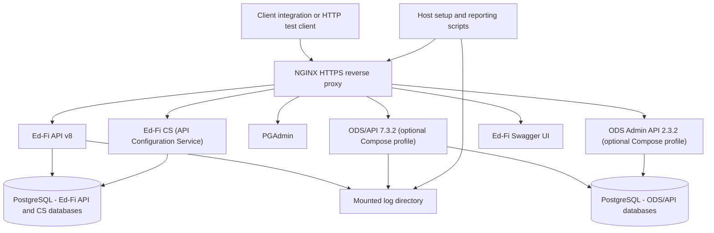

Ed-Fi API v8 has been through a great deal of internal testing: unit and
integration tests, end-to-end suites, and the [performance
comparison](./2026-09-30.md) against the ODS/API. All of that tells us the
platform behaves the way _we_ expect. It does not tell us whether it behaves the
way _your_ integration expects. The only way to learn that is to point real
client integrations — built by the organizations that will depend on the
platform in production — at a running Ed-Fi API v8 instance and see what
happens.

That is the purpose of the new [Ed-Fi API v8 Pilot Test
Kit](https://github.com/Ed-Fi-Exchange-OSS/Ed-Fi-API-v8-pilot-testing-kit): a
self-contained Docker Compose environment, plus a structured pilot program,
for exercising Ed-Fi API v8 with production-grade client integrations before
broader market adoption.



<!-- truncate -->

## Who the Pilot Is For

The [pilot test
proposal](https://github.com/Ed-Fi-Exchange-OSS/Ed-Fi-API-v8-pilot-testing-kit/blob/main/docs/client-integration-pilot-test-proposal.md)
defines a _client integration_ as any system that reads from or writes to an
Ed-Fi API. We are looking for participants across three representative shapes,
because each one stresses a different part of the platform:

- **Student Information System (SIS) integrations.** Write-oriented: core
  enrollment, demographic, staff, schedule, and calendar data, typically a large
  initial load followed by incremental updates. These stress validation,
  reference resolution, and write throughput.
- **Assessment provider integrations.** Write-oriented, with a narrower resource
  footprint: assessment metadata and student results that reference student and
  education organization records created by another system.
- **Downstream data warehouse and analytics loads.** Read-oriented: full paged
  extracts and incremental change-query reads. These stress paging, change
  queries, and query performance.

Participants deploy the kit in a non-production environment, run their own
client against it, and report installation, configuration, interoperability, or
data-processing problems back to Ed-Fi Alliance staff. Results stay anonymous
unless a participant opts in to being named, and the Alliance will not publish
detailed results without explicit permission. Participation has no bearing on a
product's Ed-Fi Certification.

## What Is Available Today

The Docker Compose environment for Ed-Fi API v8 is now in the `main` branch. It
brings up the Ed-Fi API (DMS), the Ed-Fi API Configuration Service (CS), PostgreSQL, an
HTTPS ingress via NGINX, Swagger UI, and PGAdmin, all configured for Ed-Fi Data
Standard 5.2. The target is less than one hour from `git clone` to a working,
authenticated API call — without first having to learn Ed-Fi API Platform
operations.

Getting started looks like this, in either Bash or PowerShell 7:

```shell
git clone https://github.com/Ed-Fi-Exchange-OSS/Ed-Fi-API-v8-pilot-testing-kit
cd Ed-Fi-API-v8-pilot-testing-kit/ed-fi-api-v8

# Start on the minimal template (descriptors only)...
./start.sh
# ...or on the populated template (Grand Bend synthetic sample data)
./start.sh --template populated

# Create a credential for your integration shape: sis, assessment, or warehouse
./new-credential.sh --shape sis --name my-sis-client

# Verify the environment end to end
./smoke-test.sh
```

:::tip

For PowerShell, substitute ".ps1" for ".sh" in the commands above, and change
flags from `--` to `-`, e.g. `./start.ps1 -template populated`.

:::

A few design choices are worth calling out:

- **Two starting templates.** The _minimal_ template contains descriptors only,
  which is the right starting point for a SIS integration that writes its own
  data. The _populated_ template adds the published Ed-Fi synthetic sample data
  (960 students in the Grand Bend ISD sample district), because an assessment
  provider needs existing students to reference and a warehouse load needs
  something to extract.
- **Credentials by integration shape.** `new-credential` picks the appropriate
  claim set (`SISVendor`, `AssessmentVendor`, or `DataWarehouse`), scopes the
  credential to the kit's baseline education organization hierarchy, and makes
  one authorized request before handing you the key and secret, so you know it
  works.
- **A read-everything claim set for warehouses.** No standard Ed-Fi API claim set
  grants broad, unscoped read access, so the kit adds a `DataWarehouse` claim
  set with `Read` and `ReadChanges` on every resource. This is a kit invention,
  not a standard Alliance claim set. Whether its shape matches what a real
  downstream integration needs is one of the questions this pilot is meant to
  answer.
- **A `/data/v3` compatibility rewrite.** Clients that hard-code the legacy
  ODS/API path segment can participate without a code change first. This is a
  pilot affordance, not a supported Ed-Fi API v8 path — and if your client
  depends on it, we specifically want to know.
- **Structured request logs.** NGINX writes one JSON object per request,
  including a correlation ID that also appears in the DMS logs. These logs are
  the raw material for the pilot's metrics: error counts, records landed or
  retrieved, and end-to-end duration.

## Important Considerations

- **Extensions are out of scope for this round.** The Alliance does not always
  have access to the community's extensions, and we lack the time to pre-configure the
  ones we do have. Extensions that only add fields to existing payloads will
  work fine, since the API ignores unknown fields. Extensions that add new
  endpoints will generate `404` errors; sometimes that is a nuisance to filter
  out of the log analysis, and sometimes it defeats the purpose of the test.
- **Synthetic or de-identified data only.** Do not submit real student records
  into this environment. Logs may contain payload fragments, so review them
  before sharing outside your organization.
- **Local development only.** The kit uses a self-signed TLS certificate and a
  broad-access bootstrap credential, and binds to `127.0.0.1` by default. None
  of this reflects how a production Ed-Fi API v8 deployment should be run.
- **Tested on Windows with amd64 containers.** macOS and arm64 (for example,
  Apple Silicon) have not been tested. They may work; nobody has checked yet.
- **Not a benchmark.** A single-machine Compose environment does not represent
  a production deployment. Results will only be compared within a single
  vendor's runs — Ed-Fi API v8 versus ODS/API — and never between vendors.

## What Comes Next

Two pieces described in the proposal are not yet in `main`:

1. **An Ed-Fi ODS/API environment for comparison.** As an optional activity,
   participants will be able to run the same exercise against the current
   ODS/API platform from the same package. Side-by-side results from the same
   client help separate "this integration has a problem" from "this integration
   behaves differently on v8," which is exactly what a migration plan needs.
2. **Scripts for building a report from the logs.** Today you would have to
   assemble error counts, record counts, and timing from the logs yourself.
   Report scripts will turn a test run into a consistent summary that
   participants can review before sending to Alliance staff.

In the meantime, the Ed-Fi API v8 environment is ready for early adopters. Try
it out, and tell us what made setup slower or more confusing than it should
have been. Unlike most Ed-Fi Alliance repositories, [GitHub
Issues](https://github.com/Ed-Fi-Exchange-OSS/Ed-Fi-API-v8-pilot-testing-kit/issues)
are open to everyone on this one, so please file problems with the kit there
rather than as Ed-Fi Community cases. If your organization would like to take
part in the pilot itself, reach out to Ed-Fi Alliance staff.

For more background on the transition from the ODS/API to Ed-Fi API v8, see the
[Ed-Fi ODS/API and Ed-Fi API v8 FAQ](/reference/roadmap/api-faq).
