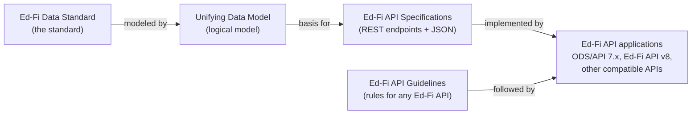

# Ed-Fi Data Standard vs. UDM vs. API Specifications vs. Ed-Fi API

The [Ed-Fi Data Standard](./data-standards.md) is the community standard for
K–12 education data. The [Ed-Fi Unifying Data Model (UDM)](./udm/readme.md) is
the logical model behind it, and the [Ed-Fi API
Specifications](./readme.md#ed-fi-api-specifications) are the REST endpoints and
JSON messages used to exchange data that conforms to it. The [Ed-Fi API
Guidelines](./api-guidelines/readme.md) set the rules an API must follow. An
_Ed-Fi API_ is any application that implements the API Specifications and
follows the Guidelines; the [Ed-Fi ODS/API](/reference/ods-api-platform) and
[Ed-Fi API v8](/reference/ed-fi-api/8) are the Ed-Fi Alliance's own Ed-Fi API
applications.

In short: the first four are published standards, and an Ed-Fi API is software
that implements them.

## How they relate

1. The **Data Standard** defines what education data means and how it is
   structured. It is expressed through the UDM and the API Specifications; it is
   not a separate artifact.
2. The **UDM** models that data as entities, attributes, and relationships. Its
   domain aggregates become the resources in the API Specifications.
3. The **API Specifications** describe the endpoints and JSON messages for
   exchanging that data. The Resources API specification has one version for
   each Data Standard version.
4. The **API Guidelines** describe the requirements any Ed-Fi API specification
   and implementation must meet, regardless of technology.
5. An **Ed-Fi API** application implements one or more of the API
   Specifications, follows the Guidelines, and runs in an agency's environment.

## Comparison

| | Ed-Fi Data Standard | Unifying Data Model (UDM) | Ed-Fi API Specifications | Ed-Fi API Guidelines | Ed-Fi API |
| --- | --- | --- | --- | --- | --- |
| **What it is** | The community standard for K–12 education data | The logical, enterprise data model behind the Data Standard | Open API definitions of REST endpoints and JSON messages | Requirements for any Ed-Fi REST API specification and implementation | Any application that implements the Ed-Fi API Specifications and follows the Guidelines |
| **What it does** | Defines the meaning and structure of exchanged data | Defines entities, attributes, and relationships, and keeps the specifications consistent with each other | Defines the resources, descriptors, and other API surfaces a client calls | Sets the rules for URLs, requests, authentication, and other behavior | Receives, validates, stores, and returns data in an agency's environment |
| **What it is not** | Software, a database, or a reporting tool | An API or a physical database schema | A running service or a specific product | A specification of endpoints, or an implementation technology | The Data Standard itself, or one specific product |
| **Normative?** | Its normative parts are the API Specifications, the Guidelines, and the UDM Best Practices pages | No, except its domain Best Practices pages | Yes | Yes | Not a standard; it conforms to the standards |
| **Versioning** | Major and minor versions (for example, Data Standard 6.1) | Versioned with the Data Standard | The Resources API matches the Data Standard version | Its own version (currently 4.0) | Each product has its own versions; see [Supported Versions](/reference/roadmap/supported-versions) |
| **Where to find it** | [About the Ed-Fi Data Standard](./data-standards.md) | [Unifying Data Model](./udm/readme.md) and the [Model Reference](/reference/data-exchange/data-standard/model-reference) | [Ed-Fi-API-Specifications on GitHub](https://github.com/Ed-Fi-Alliance-OSS/Ed-Fi-API-Specifications) | [Ed-Fi API Guidelines](./api-guidelines/readme.md) | [Ed-Fi API Platforms](/reference/ods-api-platform) |

For which Data Standard versions each Ed-Fi API product supports, see [Ed-Fi
Technology Suite Supported Versions](/reference/roadmap/supported-versions).

## What does "Ed-Fi API" mean?

In Ed-Fi Alliance documentation, **Ed-Fi API** means any API application that
implements one or more Ed-Fi API Specifications in the REST architectural style.
This is the definition in the [Scope of the Ed-Fi API
Guidelines](./api-guidelines/design-and-implementation-guidelines/scope.md).
The Guidelines also define two levels:

- **Ed-Fi aligned:** exposes some subset of the Ed-Fi Resources API and follows
  the Guidelines.
- **Ed-Fi compatible:** is Ed-Fi aligned, supports the _entire_ Resources API,
  and implements the Ed-Fi Discovery API.

Related names:

- **Ed-Fi ODS/API** (versions through 7.x) is the Ed-Fi Alliance's established
  Ed-Fi API application. "ODS" is its operational data store.
- **Ed-Fi API v8** is the Ed-Fi Alliance's next-generation Ed-Fi API
  application, replacing the ODS/API. Always include "v8" when you mean this
  product. It implements existing Data Standard versions; it is not a new Data
  Standard version. Earlier names for it include the Data Management Service
  (DMS) and Project Tanager; see [What are DMS, CMS, and Project
  Tanager?](/reference/roadmap/api-faq#q-what-are-dms-cms-and-project-tanager)
- **Ed-Fi API Specifications** are the definitions an Ed-Fi API implements, not
  an application.

:::note

The ODS/API documentation is published under URLs that begin with
`/reference/ed-fi-api/`. Those pages describe the ODS/API product; Ed-Fi API v8
documentation is under `/reference/ed-fi-api/8/`.

:::

## Common confusions

- **"The UDM is the database schema."** No. The UDM is a logical model. Each
  Ed-Fi API application derives its own physical storage from it.
- **"The Data Standard is the ODS/API."** No. The Data Standard is a
  specification; the ODS/API is one product that implements it.
- **"Ed-Fi API v8 is Data Standard 8."** No. Ed-Fi API v8 is a product version.
  It implements existing Data Standard versions; see [Supported
  Versions](/reference/roadmap/supported-versions) for which ones.
- **"The API Specifications and the API Guidelines are the same thing."** No.
  The Specifications define the endpoints and messages; the Guidelines define
  how any Ed-Fi API must behave when implementing them.
- **"Only the Ed-Fi Alliance can build an Ed-Fi API."** No. Any party can build
  an Ed-Fi aligned or compatible API by following the API Specifications and
  Guidelines. See [Tips for Success in Building an Ed-Fi Compatible
  API](./api-guidelines/tips-for-success.md).

## Related pages

- [Data Exchange Standards](./readme.md): a map of the standards the Ed-Fi
  Alliance publishes, normative and non-normative.
- [How the Ed-Fi Data Standard Fits Into Your Data
  Ecosystem](./ed-fi-in-your-data-ecosystem.md): how the Data Standard and Ed-Fi
  APIs relate to student information systems, data warehouses, and state
  longitudinal data systems.
- [Ed-Fi ODS/API and Ed-Fi API v8 FAQ](/reference/roadmap/api-faq): choosing
  between the two Ed-Fi API products.
