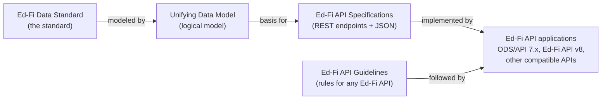

# Ed-Fi Data Standard vs. UDM vs. API Specifications vs. Ed-Fi API

The Ed-Fi Data Standard, the Unifying Data Model (UDM), the Ed-Fi API
Specifications, and the Ed-Fi API Guidelines are standards that the Ed-Fi
Alliance publishes; each one is defined on [Data Exchange
Standards](./readme.md#what-standards-does-the-ed-fi-alliance-publish). An
[Ed-Fi API](#what-does-ed-fi-api-mean) is software that implements them, such
as the Ed-Fi ODS/API or Ed-Fi API v8. This page compares how they relate, what
each one does and is not, and how each one is versioned.

## How they relate

The UDM's domain aggregates become the resources in the API Specifications,
and the Resources API specification has one version for each Data Standard
version. The Guidelines apply to any Ed-Fi API, whatever technology it uses.

## Comparison

| | Ed-Fi Data Standard | Unifying Data Model (UDM) | Ed-Fi API Specifications | Ed-Fi API Guidelines | Ed-Fi API |
| --- | --- | --- | --- | --- | --- |
| **What it does** | Defines the meaning and structure of exchanged data | Defines entities, attributes, and relationships, and keeps the specifications consistent with each other | Defines the resources, descriptors, and other API surfaces a client calls | Sets the rules for URLs, requests, authentication, and other behavior | Exposes a REST interface for exchanging data represented according to the Data Standard |
| **What it is not** | Software, a database, or a reporting tool | An API or a physical database schema | A running service or a specific product | A specification of endpoints, or an implementation technology | The Data Standard itself, or one specific product |
| **Normative?** | Its normative parts are the API Specifications, the Guidelines, and the UDM Best Practices pages | No, except its domain Best Practices pages | Yes | Yes | Not a standard; it conforms to the standards |
| **Versioning** | Major and minor versions (for example, Data Standard 6.1) | Versioned with the Data Standard | The Resources API matches the Data Standard version | Its own version (currently 4.0) | Each product has its own versions; see [Supported Versions](/reference/roadmap/supported-versions) |

For which Data Standard versions each Ed-Fi API product supports, see [Ed-Fi
Technology Suite Supported Versions](/reference/roadmap/supported-versions).

## What does "Ed-Fi API" mean?

In Ed-Fi Alliance documentation, **Ed-Fi API** means any API application that
implements one or more Ed-Fi API Specifications in the REST architectural style.
This is the definition in the [Scope of the Ed-Fi API
Guidelines](./api-guidelines/design-and-implementation-guidelines/scope.md).
The Guidelines also define two levels:

- **Ed-Fi aligned:** exposes some subset of the Ed-Fi Resources API and follows
  the Guidelines.
- **Ed-Fi compatible:** is Ed-Fi aligned, supports the _entire_ Resources API,
  and implements the Ed-Fi Discovery API.

Related names:

- **Ed-Fi ODS/API** (versions through 7.x) is the Ed-Fi Alliance's established
  Ed-Fi API application. "ODS" is its operational data store.
- **Ed-Fi API v8** is the Ed-Fi Alliance's next-generation Ed-Fi API
  application, replacing the ODS/API. Always include "v8" when you mean this
  product. It implements existing Data Standard versions; it is not a new Data
  Standard version. It was previously called the Data Management Service
  (DMS). Project Tanager is the project that built the services, not a product
  name; see [What are DMS, CMS, and Project
  Tanager?](/reference/roadmap/api-faq#q-what-are-dms-cms-and-project-tanager).
- **Ed-Fi API Specifications** are the definitions an Ed-Fi API implements, not
  an application.

:::note

The ODS/API documentation is published under URLs that begin with
`/reference/ed-fi-api/`. Those pages describe the ODS/API product; Ed-Fi API v8
documentation is under `/reference/ed-fi-api/8/`.

:::

## Common confusions

- **"The UDM is the database schema."** No. The UDM is a logical model.
  Each implementation chooses its own storage model; the API contract does not
  prescribe it.
- **"The Data Standard is the ODS/API."** No. The Data Standard is a
  specification; the ODS/API is one product that implements it.
- **"Ed-Fi API v8 is Data Standard 8."** No. Ed-Fi API v8 is a product version.
  It implements existing Data Standard versions; see [Supported
  Versions](/reference/roadmap/supported-versions) for which ones.
- **"The API Specifications and the API Guidelines are the same thing."** No.
  The Specifications define the endpoints and messages; the Guidelines define
  how any Ed-Fi API must behave when implementing them.
- **"Only the Ed-Fi Alliance can build an Ed-Fi API."** No. Any party can build
  an Ed-Fi aligned or compatible API by following the API Specifications and
  Guidelines. See [Tips for Success in Building an Ed-Fi Compatible
  API](./api-guidelines/tips-for-success.md).

## Related pages

- [Data Exchange Standards](./readme.md): a map of the standards the Ed-Fi
  Alliance publishes, normative and non-normative.
- [How the Ed-Fi Data Standard Fits Into Your Data
  Ecosystem](./ed-fi-in-your-data-ecosystem.md): how the Data Standard and Ed-Fi
  APIs relate to student information systems, data warehouses, and state
  longitudinal data systems.
- [Ed-Fi ODS/API and Ed-Fi API v8 FAQ](/reference/roadmap/api-faq): choosing
  between the two Ed-Fi API products.
