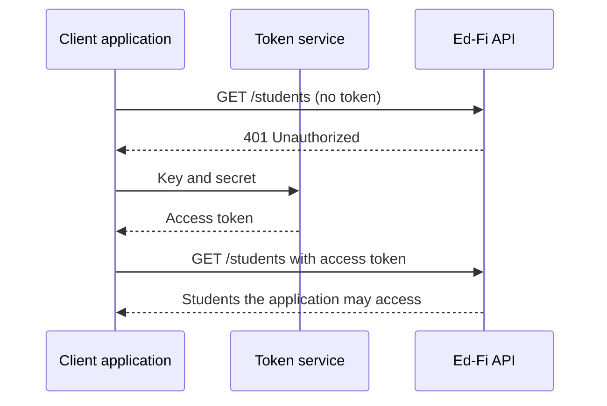

# How Ed-Fi API Platforms Secure Student Data

Ed-Fi API platforms, the Ed-Fi ODS/API and Ed-Fi API v8, protect student data in
layers:

1. **Authentication.** Every client application, such as a student information
   system, signs in with its own key and secret.
2. **Claim sets.** Each request is checked against the claim set assigned to that
   application, which says which kinds of data it may create, read, update, or
   delete.
3. **Relationship-based access.** Where configured for a resource and action,
   this restricts access to records for students, staff, and contacts connected
   to the schools or district associated with the application's key.
4. **Profiles.** Optionally, the host can limit which fields an application sees
   or writes.

The organization that hosts the API sets up all of these controls. This page
explains each one and links to the technical documentation.

## Authentication: Applications, Not People

Ed-Fi API applications use the OAuth 2.0 client credentials flow.[^oauth]
Credentials are issued to client applications, not to individual teachers or
staff. The host gives each application a key and secret, which the application
exchanges for a short-lived access token. Every API call must carry a valid
token. Hosts should always serve the API over HTTPS, which encrypts traffic
between the application and the API, including keys, secrets, and tokens.

Because access is granted per application, the client application controls what
its own users can see, using its local accounts and roles. The API host controls
what data the application as a whole can reach.

## Claim Sets: What an Application Can Do

A claim set works like a role. It lists the resources an application can use,
such as students, grades, or assessments, and whether it can create, read,
update, or delete each one. Claims are organized in a hierarchy, so a host can
grant access to a whole group of related resources at once.

Host administrators assign claim sets and manage keys and secrets with the
[Ed-Fi ODS Admin API](/reference/admin-api) for the ODS/API, or with the
Ed-Fi API Configuration Service for Ed-Fi API v8.

## Relationship-Based Access: Which Records an Application Can Reach

A claim set says an application may read students. Authorization strategies
decide _which_ students. Most student, staff, and contact data uses a
relationship-based strategy: an application's key is associated with one or more
education organizations, such as a school or district, and the application can
only reach people connected to those organizations for operations protected by
that strategy. For example, when a read strategy uses enrollment, a student
information system with a district key can read students enrolled in that
district's schools. Other strategies can use responsibility associations instead.

There are additional strategies for covering other kinds of data.
Namespace-based authorization, for example, controls access to assessment
metadata by the namespaces assigned to the application. For the full list, see
[Authorization Strategies](/reference/ed-fi-api/platform-dev-guide/security/api-claim-sets-resources#authorization-strategies).

## Profiles: Which Fields an Application Can See

Profiles let a host limit an application to a subset of a resource's fields.
For example, a gradebook application might read only a few student fields but
have full write access to grades. See
[API Profiles](/reference/ed-fi-api/platform-dev-guide/security/api-profiles).

## Putting It Together: One Request

A district's student information system asks the API for grades:

1. It exchanges its key and secret for an access token. Without a valid token,
   the API rejects the request.
2. The API checks the application's claim set. If the claim set doesn't allow
   reading grades, the request is denied.
3. The API applies the relationship-based strategy, so it returns grades only
   for students connected to the district's schools.
4. If the host assigned a profile, the API returns only the fields that profile
   allows.

## Who Is Responsible for What

- **The Ed-Fi Alliance** publishes the Ed-Fi Data Standard and the open-source
  Ed-Fi API software, including its security model. The Ed-Fi Alliance does not
  host, store, or have access to agencies' student data.
- **The API host**, often a state education agency, an education service agency,
  a district, or a managed service provider, installs and runs the API. The host
  issues keys and secrets, assigns claim sets and profiles, and associates each
  key with the right education organizations.
- **Client application vendors** keep their keys and secrets private and control
  their own users' access to data.

The API's controls cover who can call it and what data each application can
reach. Securing the servers, network, and database, including HTTPS, encryption
at rest, backups, and monitoring, is the host's responsibility.

These controls support privacy laws such as FERPA by limiting each application
to the people and data it needs, but they do not replace an agency's own privacy
policies and data-sharing agreements.

Hosts, lead developers, and IT operational staff should also read
[Education Agency Business Process Security Considerations](/reference/ed-fi-api/technical-articles/education-agency-business-process-security-considerations).

## Technical Documentation

**Ed-Fi ODS/API 7.3:**

- [Security](/reference/ed-fi-api/platform-dev-guide/security)
- [API Claim Sets & Resources](/reference/ed-fi-api/platform-dev-guide/security/api-claim-sets-resources)
- [API Profiles](/reference/ed-fi-api/platform-dev-guide/security/api-profiles)
- [Securing OAuth Secrets](/reference/ed-fi-api/technical-articles/securing-oauth-secrets)

**Ed-Fi API v8:**

- [Security](/reference/ed-fi-api/8/platform-dev-guide/security)
- [Authentication](/reference/ed-fi-api/8/client-developers-guide/authentication)
- [Authorization](/reference/ed-fi-api/8/client-developers-guide/authorization)

**For client developers:**

- [Authentication and OAuth](/getting-started/provider-playbook/implementation/ed-fi-api-fundamentals/authentication-and-oauth)
- [Authorization](/getting-started/provider-playbook/implementation/ed-fi-api-fundamentals/authorization)
- [Tutorial: Interacting with an Ed-Fi API](/reference/data-exchange/tutorial):
  try authentication and education organization authorization against a
  demonstration API with synthetic data.

[^oauth]: OAuth 2.0 is an open standard that lets an application get a
    limited, short-lived access token instead of sending a password with every
    request. In the client credentials flow, the client is the application
    itself, not a person: it sends its key and secret to a token service and
    gets back an access token. See
    [OAuth 2.0 Client Credentials](https://oauth.net/2/grant-types/client-credentials/)
    and [RFC 6749, section 4.4](https://tools.ietf.org/html/rfc6749#section-4.4).
