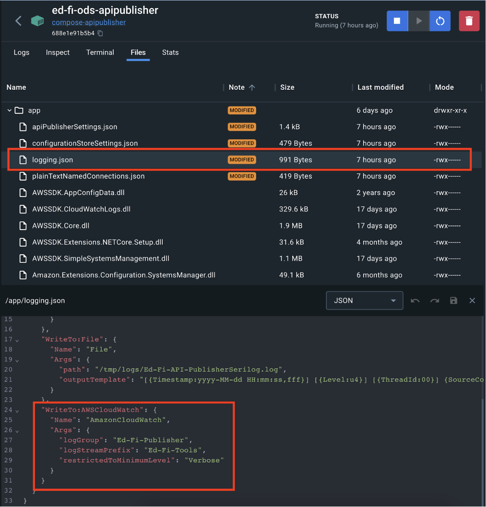

# CloudWatch Configuration

Sends the API Publisher logs to
[Amazon CloudWatch Logs](https://docs.aws.amazon.com/AmazonCloudWatch/latest/logs/WhatIsCloudWatchLogs.html).

## Configure AWS SDK

Ensure that the AWS SDK has the necessary
[configured AWS credentials](https://docs.aws.amazon.com/sdk-for-net/v4/developer-guide/creds-assign.html).

## Configure API Publisher

Configure the AWS log storage parameters in the configuration file.



When the API Publisher runs in a container, export the AWS credentials inside it:

```sh
export AWS_ACCESS_KEY_ID="<access key id>"
export AWS_SECRET_ACCESS_KEY="<secret access key>"
export AWS_SESSION_TOKEN="<session token>"
```

## Looking for a different output format?

The default sink for AWSCloudWatch publish the log as a JsonFormat, if you want
to use a different one, check the following link:
[How to use the TextFormatter class](Use-TextFormatter-Serilog.md).
