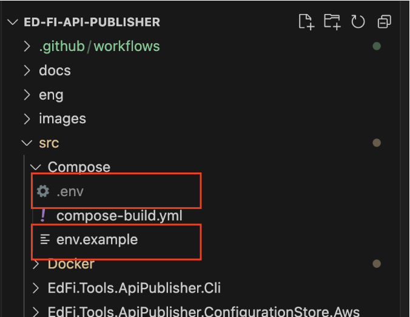
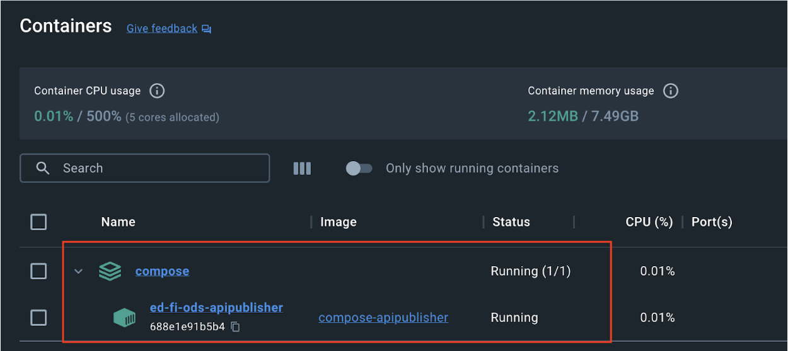
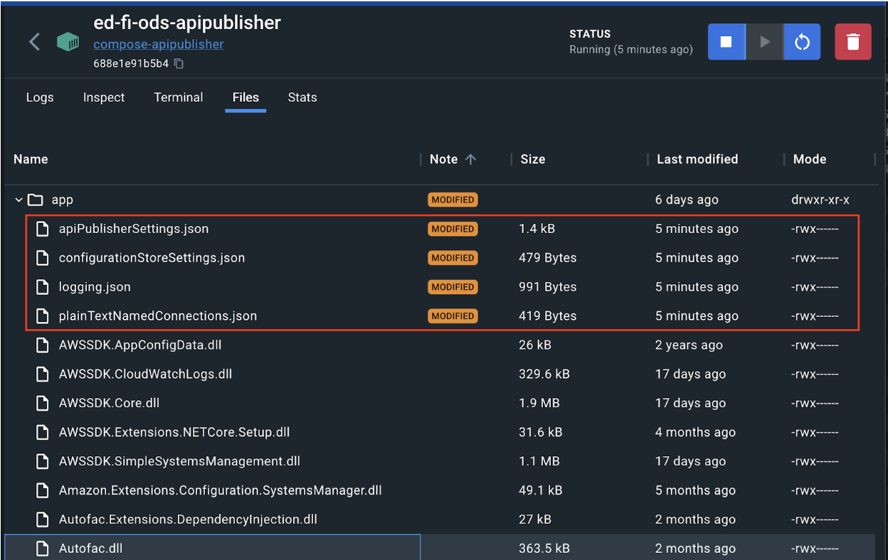
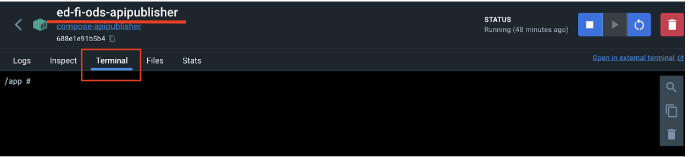
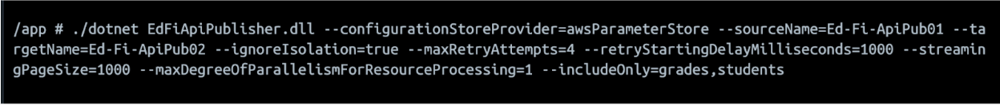
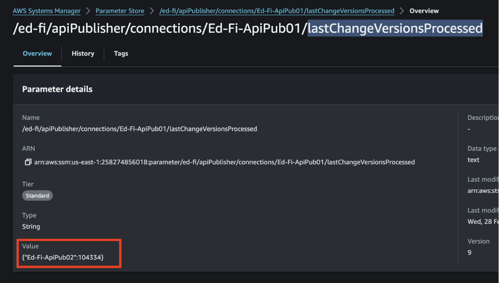
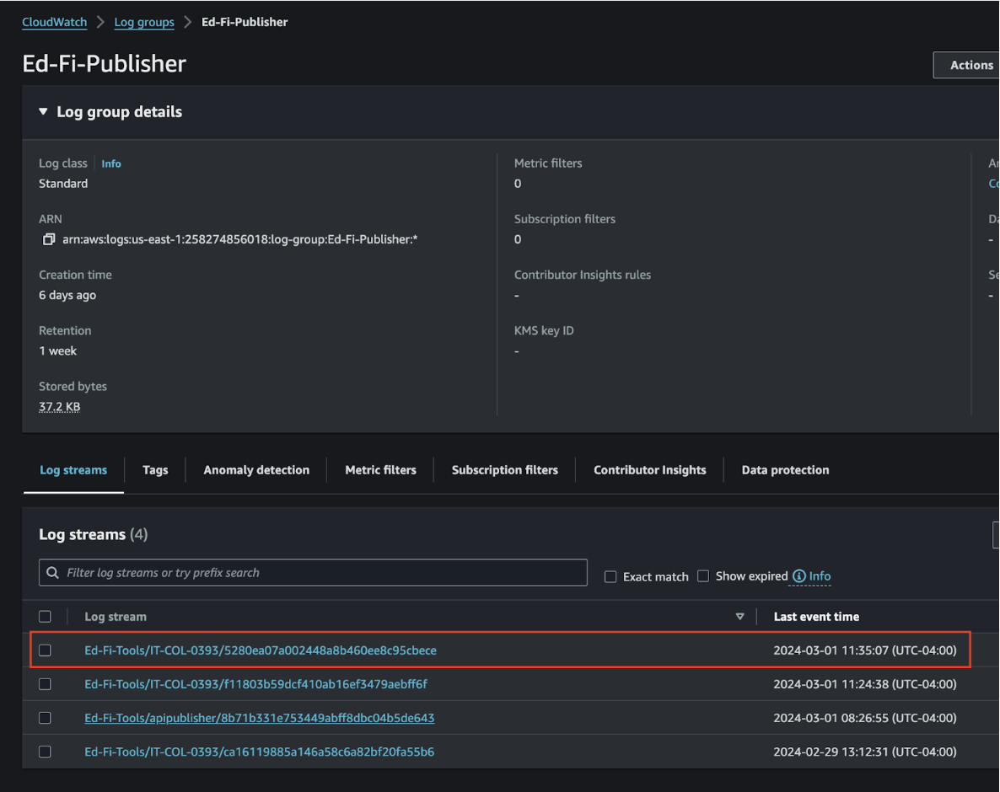

# Running in Docker Desktop

## Setup

### Step 1. Download the Source Code or Clone the Repo

The Ed-Fi ODS Docker deployment source code is in the Ed-Fi repository hosted by
GitHub. A link to the repository is provided in the download panel on the right.
You can clone the repository or download the source code as a ZIP file.

[Source code repository](https://github.com/Ed-Fi-Alliance-OSS/Ed-Fi-API-Publisher)

### Step 2. Setup Your Environment Variables

Configure your deployments using an environment file. The repository includes a
`.env.example` listing the supported environment variables.

> Path: `/src/Compose/env.example`



Copy `env.example` file and name it `.env`. Update the values as desired, and
replace every `<...>` placeholder: a value left as a placeholder is written to
the configuration as is.

When the container starts, it writes these variables into its configuration
files. Each variable in the options section of `env.example` sets the option of
the same name described in
[API Publisher Configuration](API-Publisher-Configuration.md#options), for
example `STREAMING_PAGE_SIZE` sets `StreamingPageSize`. Set every one of these
variables: an empty value makes the settings file invalid. The
exceptions are `MAX_CONCURRENT_SOURCE_REQUESTS`,
`TOO_MANY_REQUESTS_RETRY_ATTEMPTS`, `PROCESSING_BLOCK_BOUNDED_CAPACITY`,
`DISABLE_CURSOR_PAGING` and `CURSOR_PAGING_PARTITION_COUNT`, which take their
default value when they are not set. Options without a variable are passed as
command-line arguments when you run the API Publisher (Step 5).

The configuration store, the plain text connections and the log file:

| Variable | Use |
| --- | --- |
| `PROVIDER` | The configuration store: `sqlServer`, `postgreSql`, `awsParameterStore` or `plainText`. |
| `SQLSERVER_SERVER`, `SQLSERVER_DATABASE` | The SQL Server configuration store, when `PROVIDER` is `sqlServer`. |
| `POSTGRESQL_HOST`, `POSTGRESQL_DATABASE` | The PostgreSQL configuration store, when `PROVIDER` is `postgreSql`. |
| `AWS_PROFILE`, `AWS_REGION` | The AWS Parameter Store, when `PROVIDER` is `awsParameterStore`. |
| `SOURCE_NAME`, `SOURCE_URL`, `SOURCE_KEY`, `SOURCE_SECRET` | The source connection, when `PROVIDER` is `plainText`. |
| `TARGET_NAME`, `TARGET_URL`, `TARGET_KEY`, `TARGET_SECRET` | The target connection, when `PROVIDER` is `plainText`. |
| `WRITE_TO_FILE_PATH` | The path of the log file. |

### 2a. API Publisher Version

The image installs the API Publisher package set by `ARG VERSION` in
`src/Dockerfile`. To install another version, change that value before you build
the image. The available versions are listed in the
[EdFi.ApiPublisher feed](https://dev.azure.com/ed-fi-alliance/Ed-Fi-Alliance-OSS/_artifacts/feed/EdFi/NuGet/EdFi.ApiPublisher).

### 2b. Section ApiPublisherSettings file

If you like, you can change the default parameters or leave them as is.

[API Publisher Configuration](API-Publisher-Configuration.md)

### 2c. Section ConfigurationStoreSettings and Plain Text Connections

These two sections can be configured using
[API Connection Management](API-Connection-Management.md)

### Step 3. Run Docker Compose

In this step you need to run a command in any shell terminal that support Docker
commands (i.e. PowerShell in Windows)

Go to the root of the project and run this command:

```powershell
docker compose -f src/Compose/compose-build.yml --env-file src/Compose/.env up -d
```

## Step 4. Verify Your Deployments



You can also check these files to see if all the settings in the .env file are
used in the API Publisher configuration.



## Step 5. Run API Publisher

We have two ways to run API Publisher inside or outside the created container.

Inside the container, `localhost` is the container itself. To reach an API that
runs on the same machine as Docker, use `host.docker.internal` as the host name,
for example `https://host.docker.internal/WebApi/`.

To resume a run that failed partway through, pass `--resumeLastRun=true` and
set `--runStatePath` to a path on a mounted volume, so that the run state
outlives the container (see
[ResumeLastRun and RunStatePath](API-Publisher-Configuration.md#options)). The
compose file mounts a volume only at `/tmp/logs`.

### Outside Container

```powershell
docker exec -it ed-fi-ods-apipublisher dotnet EdFiApiPublisher.dll `
  --sourceUrl={{SourceUrl}} `
  --sourceKey={{SourceKey}} `
  --sourceSecret={{SourceSecret}} `
  --targetUrl={{TargetUrl}} `
  --targetKey={{TargetKey}} `
  --targetSecret={{TargetSecret}} `
  {{Additional Parameters}}
```

### Inside Container

Using Docker Dashboard it is possible to enter the container and use its
terminal. Once inside it is necessary to run the command without the docker
parameter... i.e.



```sh
dotnet EdFiApiPublisher.dll --sourceUrl={{SourceUrl}} \
  --sourceKey={{SourceKey}} \
  --sourceSecret={{SourceSecret}} \
  --targetUrl={{TargetUrl}} \
  --targetKey={{TargetKey}} \
  --targetSecret={{TargetSecret}} \
  {{Additional Parameters}}
```

## Additional Configurations

### AWS Parameter Store

#### A. Configuration

It is necessary to have the store parameters created on AWS
[Configuration Aws Parameter Store](ConfigurationStore/Aws-Parameter-Store.md)

Export AWS credentials to consume AWS parameters store inside the container

```sh
export AWS_ACCESS_KEY_ID="<access key id>"
export AWS_SECRET_ACCESS_KEY="<secret access key>"
export AWS_SESSION_TOKEN="<session token>"
```

#### B. Execution

Having all this configured it is possible to run ApiPublisher with the
AWSParameterStore parameter

```sh
dotnet EdFiApiPublisher.dll --configurationStoreProvider=awsParameterStore \
  --sourceName=Ed-Fi-ApiPub01 \
  --targetName=Ed-Fi-ApiPub02 \
  --ignoreIsolation=true \
  --maxRetryAttempts=4 \
  --retryStartingDelayMilliseconds=1000 \
  --streamingPageSize=1000 \
  --maxDegreeOfParallelismForResourceProcessing=1 \
  --includeOnly=grades,students
```



#### C. Validate Results

After completing the execution the 'lastChangeVersion Processed' parameter value
should be updated



## CloudWatch

### Configuration

Configure the AWS log storage parameters in the configuration file.
[Configuration CloudWatch](CloudWatch-configuration.md)

### Execution

Run any ApiPublisher command to start storing the execution results.

```sh
dotnet EdFiApiPublisher.dll --configurationStoreProvider=awsParameterStore \
  --sourceName=Ed-Fi-ApiPub01 \
  --targetName=Ed-Fi-ApiPub02 \
  --ignoreIsolation=true \
  --maxRetryAttempts=4 \
  --retryStartingDelayMilliseconds=1000 \
  --streamingPageSize=1000 \
  --maxDegreeOfParallelismForResourceProcessing=1 \
  --includeOnly=grades,students
```

To review the results we have to go to the 'logGroup' and then look for the last
logStream created.


