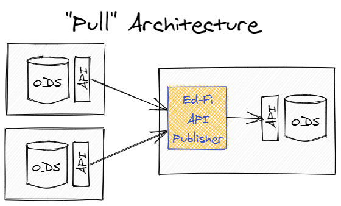
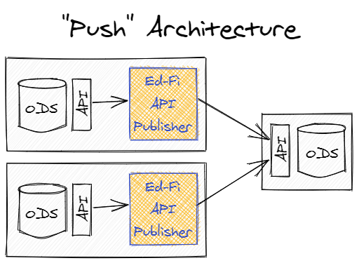
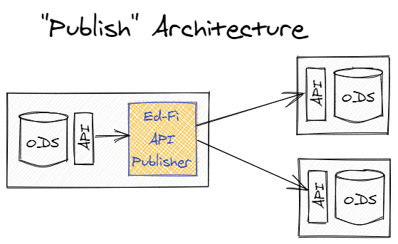

# Ed-Fi API Publisher

## Introduction

The Ed-Fi API Publisher is a utility that can be used to move data and changes
from one Ed-Fi API instance to another instance of the `same` version of Ed-Fi.
The source and the target can each be an Ed-Fi ODS/API or Ed-Fi API v8. It
operates as a standard API client against both API endpoints (source
and target) and thus it does not require any special network configuration,
direct ODS database access or a particular database engine. From a data
security/privacy perspective, it is also subject to all authorization performed
by the Ed-Fi ODS API endpoints with which it communicates.

Operationally, it can be used in a "Pull" model where it is deployed alongside a
target (central) API and gathers data from multiple source APIs.



Alternatively, it could also be used in a "Push" model where the utility is
deployed alongside the source APIs and pushes data to the central target.



However, it can also be used in a "Publishing" model where it is installed
alongside a source API and pushes data to multiple targets (e.g. to both a State
Education Agency and a collaborative).



If a source API supports the "Change Queries" feature, the Ed-Fi API Publisher
will perform a full publishing of the source data on the first run, and then
will only publish changed data to the target on subsequent runs. The change
versions that have been published to a particular target are maintained in a
configuration store automatically for each source/target combination.

## What's New

Version 1.4 runs on .NET 10, adds support for Ed-Fi API v8, and reads Ed-Fi
ODS/API 7.3 and later sources with cursor paging. See
[What's New](whats-new.md) for details.

## Quick Start

To demonstrate how the API Publisher works, this exercise copies the data of the
Populated Template sandbox to the Minimal Template sandbox of a local Ed-Fi
ODS/API 7.3 sandbox on Windows with SQL Server. Both sandboxes are served by the
same API, and each one has its own API client.

### Prerequisites

An Ed-Fi ODS/API 7.3 sandbox on Windows with SQL Server, installed by following
the
[Sandbox Installation Steps](/reference/ed-fi-api/getting-started/binary-installation/sandbox-installation-steps)
after the prerequisites listed in
[Binary Installation](/reference/ed-fi-api/getting-started/binary-installation/).
This Quick Start covers only the installation and use of the API Publisher.
It uses an Ed-Fi ODS/API sandbox; to publish to or from Ed-Fi API v8, see
[Considerations for API Hosts](Considerations-for-API-Hosts.md#ed-fi-api-v8).

### Configure Local Sandbox Environment

1. Find the keys and secrets of the Populated Template and Minimal Template
   sandboxes in the `User` section of
   `C:\inetpub\Ed-Fi\SandboxAdmin\appsettings.json`.
2. Configure the API clients of both sandboxes. The script below assigns the
   `Ed-Fi API Publisher - Writer` claim set to the Minimal Template client and
   associates both clients with the education organizations of the Populated
   Template data: Grand Bend ISD (`255901`), Communities in Schools of Grand
   Bend (`19255901`) and three schools of education (`5`, `6` and `7`) whose
   courses are used by Grand Bend course offerings. Run it against the SQL
   Server that hosts the `EdFi_Admin` database, for example in SQL Server
   Management Studio:

   ```sql
   SET NOCOUNT ON;
   SET XACT_ABORT ON;

   DECLARE @Clients TABLE (ApplicationName nvarchar(255), ApiClientName nvarchar(50));
   INSERT INTO @Clients VALUES
       ('Default Sandbox Application Sample', 'Populated Demonstration Sandbox'),
       ('Default Sandbox Application Minimal', 'Minimal Demonstration Sandbox');

   DECLARE @EducationOrganizations TABLE (EducationOrganizationId bigint);
   INSERT INTO @EducationOrganizations VALUES (255901), (19255901), (5), (6), (7);

   BEGIN TRANSACTION;

   IF (SELECT COUNT(*) FROM EdFi_Admin.dbo.ApiClients c
       JOIN EdFi_Admin.dbo.Applications a ON a.ApplicationId = c.Application_ApplicationId
       JOIN @Clients x ON x.ApplicationName = a.ApplicationName AND x.ApiClientName = c.Name) <> 2
       THROW 50000, 'Unable to find both sandbox API clients in the EdFi_Admin database.', 1;

   UPDATE EdFi_Admin.dbo.Applications
   SET ClaimSetName = 'Ed-Fi API Publisher - Writer'
   WHERE ApplicationName = 'Default Sandbox Application Minimal';

   INSERT INTO EdFi_Admin.dbo.ApplicationEducationOrganizations (Application_ApplicationId, EducationOrganizationId)
   SELECT a.ApplicationId, e.EducationOrganizationId
   FROM EdFi_Admin.dbo.Applications a
   JOIN @Clients x ON x.ApplicationName = a.ApplicationName
   CROSS JOIN @EducationOrganizations e
   WHERE NOT EXISTS (
       SELECT 1 FROM EdFi_Admin.dbo.ApplicationEducationOrganizations aeo
       WHERE aeo.Application_ApplicationId = a.ApplicationId
           AND aeo.EducationOrganizationId = e.EducationOrganizationId);

   INSERT INTO EdFi_Admin.dbo.ApiClientApplicationEducationOrganizations
       (ApiClient_ApiClientId, ApplicationEducationOrganization_ApplicationEducationOrganizationId)
   SELECT c.ApiClientId, aeo.ApplicationEducationOrganizationId
   FROM EdFi_Admin.dbo.ApiClients c
   JOIN EdFi_Admin.dbo.Applications a ON a.ApplicationId = c.Application_ApplicationId
   JOIN @Clients x ON x.ApplicationName = a.ApplicationName AND x.ApiClientName = c.Name
   JOIN EdFi_Admin.dbo.ApplicationEducationOrganizations aeo ON aeo.Application_ApplicationId = a.ApplicationId
   WHERE NOT EXISTS (
       SELECT 1 FROM EdFi_Admin.dbo.ApiClientApplicationEducationOrganizations caeo
       WHERE caeo.ApiClient_ApiClientId = c.ApiClientId
           AND caeo.ApplicationEducationOrganization_ApplicationEducationOrganizationId = aeo.ApplicationEducationOrganizationId);

   COMMIT TRANSACTION;
   ```

### Use the API Publisher

The API Publisher has three options to use the product. It runs on
[.NET 10.0](https://dotnet.microsoft.com/en-us/download/dotnet/10.0):

#### Option 1 - From binaries

1. Download the latest published API Publisher package here:
   [Ed-Fi API Publisher v1.4.0](https://dev.azure.com/ed-fi-alliance/Ed-Fi-Alliance-OSS/_artifacts/feed/EdFi/NuGet/EdFi.ApiPublisher/overview/1.4.0).
   Visit the page and click download.
2. This will download a NuGet package to your computer. Right-click the file,
   select **Properties**, check **Unblock** and click **OK**, so that Windows
   does not block the files extracted from it. Then rename the file,
   `EdFi.ApiPublisher.1.4.0.nupkg`, to include .zip extension:
   `EdFi.ApiPublisher.1.4.0.zip`.
3. Extract the ZIP file. It contains two folders:
   * `EdFi.ApiPublisher.Win64`: `EdFiApiPublisher.exe` for Windows. It includes
     the .NET runtime, so no separate installation is needed. The Quick Start
     command below uses it.
   * `EdFi.ApiPublisher`: for any operating system. It requires the .NET 10
     runtime and runs with `dotnet EdFiApiPublisher.dll`.

#### Option 2 - From Docker img

The Docker image for the Ed-Fi API Publisher is available here:
[Ed-Fi API Publisher tag v1.4.0 on Docker Hub](https://hub.docker.com/r/edfialliance/ods-api-publisher/tags).
Use this to include in your Docker environment and alongside other components of
the Ed-Fi stack. The image includes the .NET runtime. To build and run the API
Publisher with Docker Compose, see
[Running in Docker Desktop](Running-in-docker-desktop.md).

#### Option 3 - Build the API Publisher from source code

Building from source requires the
[.NET 10 SDK](https://dotnet.microsoft.com/en-us/download/dotnet/10.0). Build
the solution by running the following command from the repository's `src`
directory:

```powershell
 dotnet build
```

The API Publisher executable (`EdFiApiPublisher.exe`) will be located in the
`.\EdFi.Tools.ApiPublisher.Cli\bin\Debug\net10.0` subfolder.

### Publish Data to Local Sandbox

The following table shows the command-line arguments used for publishing.

| Parameter | Value |
| --- | --- |
| `--sourceUrl` | `https://localhost/WebApi/` |
| `--sourceKey` | Populated Template sandbox key |
| `--sourceSecret` | Populated Template sandbox secret |
| `--targetUrl` | `https://localhost/WebApi/` |
| `--targetKey` | Minimal Template sandbox key |
| `--targetSecret` | Minimal Template sandbox secret |
| `--ignoreSslErrors` | `true` |
| `--ignoreIsolation` | `true` |
| `--includeDescriptors` | `true` |

* `--ignoreSslErrors=true` accepts the self-signed certificate of the local
  sandbox. Use it only with a local environment, never with an API that has a
  valid certificate.
* `--ignoreIsolation=true` publishes without a snapshot, which the sandbox does
  not provide. See
  [Sources Without a Configured Snapshot](Known-Issues-Details.md#sources-without-a-configured-snapshot).

Run the Ed-Fi API Publisher from the `EdFi.ApiPublisher.Win64` folder,
substituting the keys and secrets from the Sandbox Admin `appsettings.json`
file:

```powershell
.\EdFiApiPublisher.exe --sourceUrl=https://localhost/WebApi/ `
  --sourceKey=populated_sandbox_key `
  --sourceSecret=populated_sandbox_secret `
  --targetUrl=https://localhost/WebApi/ `
  --targetKey=minimal_sandbox_key `
  --targetSecret=minimal_sandbox_secret `
  --ignoreSslErrors=true `
  --ignoreIsolation=true `
  --includeDescriptors=true
```

When the run finishes, the publisher prints a summary of the documents
attempted, published and failed for each resource. A successful run exits with
code `0`. See
[Run outcome and exit codes](API-Publisher-Configuration.md#run-outcome-and-exit-codes).

For more documentation on API Publisher's parameters, please see the
[API Publisher Configuration](API-Publisher-Configuration.md) markdown file for
other runtime options.

For more information in relation to key changes and deletes, please see
[Considerations in relation to key changes and
deletes](API-Publisher-Configuration.md#considerations-in-relation-to-key-changes-and-deletes)

## Known Issues

Usage notes and known issues for version 1.4 are described in
[Known Issues Details](Known-Issues-Details.md).

## Next Steps

When you're ready to look further, review these other topics:

* [API Connection Management](API-Connection-Management.md)
* [API Publisher Configuration](API-Publisher-Configuration.md)
* [Considerations for API Hosts](Considerations-for-API-Hosts.md)
* [Considerations for Docker Configuration and Execution](Running-in-docker-desktop.md)
* [How to use the TextFormatter class](Use-TextFormatter-Serilog.md).

## Support

For support with the API Publisher, please use
[Ed-Fi Support](https://support.ed-fi.org/) to open a support case and/or
feature request.
