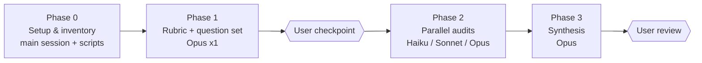

# Data Standard Documentation Content Audit — Plan

Status: Draft plan from interview, 2026-10-10. Not yet executed.

## Goal

Produce a prioritized **audit report** (no direct page edits) that recommends
content optimizations to the Ed-Fi Data Standard documentation for two
audiences:

1. **Human readers** — primarily people _new to Ed-Fi_ landing on a single page.
2. **LLM + RAG** — Perplexity web search restricted to `docs.ed-fi.org`, which
   crawls the **published HTML** and retrieves whole pages / passages.

## Decisions From Interview

| Topic | Decision |
| --- | --- |
| Content scope | `dataStandard_versioned_docs/` plus `docs/reference/1-data-exchange/udm/` and `docs/reference/1-data-exchange/data-standards.md` |
| Version focus | Improve v5 and v6 content; reduce redundancy _across versions_ |
| Old versions | Recommendations may go as far as **retiring** v3 (and possibly v4) |
| Model-reference pages | Hand-generated and hand-maintained (edit in place; no generator to fix) |
| RAG ingestion | Perplexity web search, domain-filtered to `docs.ed-fi.org`; chunking is a black box |
| Primary persona | New-to-Ed-Fi learner |
| Terminology | Enforce [terminology-guidelines.md](./terminology-guidelines.md); "Ed-Fi Unifying Data Model (UDM)" accepted; "Ed-Fi API Specification" enforced over "API Standard" |
| Glossary | No official glossary exists; the report may propose a data-model concepts glossary |
| Evaluation questions | Synthesized by subagents (no real logs available) |
| Deliverable | Audit report only |
| Model mix | Balanced: Haiku for mechanical work, Sonnet for per-domain audits, Opus for rubric, cross-version analysis, and synthesis |

## Context From Initial Reconnaissance

Size of in-scope content:

| Set | Files | Words |
| --- | --- | --- |
| DS v6 | 129 | ~97k |
| DS v5 | 109 | ~75k |
| DS v4 | 92 | ~54k |
| DS v3 | 88 | ~35k |
| UDM + `data-standards.md` | 10 | ~7k |

Observations to validate (not yet conclusions):

- **Support status makes retirement concrete.** Per
  `docs/reference/0-roadmap/supported-versions.md`, DS 3.3.1 was active through
  2024-2025 and DS 4.0.0 through 2025-2026 — both are now past their stated
  window. v4 certifications (`docs/partners/2-certification/available-certifications/*-v4`)
  still link to v4 content and must be accounted for.
- **No `description:` front matter** on any v6 page, so the HTML meta
  description is auto-derived. Page titles come from H1s like "Graduation
  Domain - Overview", with no Data Standard version — v3–v6 pages share
  near-identical titles, which invites wrong-version retrieval.
- **Four-page-per-domain pattern** (`readme`, `overview`, `model-diagrams`,
  `entities-references-and-descriptors`). The `readme.md` is a thin link hub;
  the overview is short; the diagrams page is Mermaid-only (client-side
  rendered — likely invisible or noise to a crawler); the entities page is
  a large table.
- **Descriptor tables repeat across domains** (e.g., `Country`,
  `AddressType` under the Graduation domain because they hang off
  `EducationOrganization`), and the classification columns (EDFacts Mapping,
  Commonly Used, etc.) are mostly empty.
- **Quality nits** exist, e.g., "acceptances acceptances" in
  `version-6/model-reference/graduation-domain/overview.md`.
- **Terminology drift**: a rough grep over v5, v6, and the UDM pages finds about
  517 uses of "Ed-Fi", of which about 200 are not followed by an accepted
  phrase. Examples: 75 bare "Ed-Fi", 43 "Ed-Fi data …", 22 "Ed-Fi community"
  (lowercase), and "Ed-Fi model", "Ed-Fi domains", "Ed-Fi core", "Ed-Fi
  extension". Some are probably acceptable in context, such as possessive
  constructions or "Ed-Fi data" meaning data conforming to the Ed-Fi Data
  Standard. Phase 2a will classify them.
- `robots.txt` allows everything; the sitemap comes from preset-classic
  defaults, with no per-version exclusions.
- The live site is **not reachable from the cloud container** (proxy 403), so
  rendered HTML must come from a local `npm run build`.

## Approach Overview



Outputs live under `drafts/data-standard-audit/` (not built or published):

```text
drafts/data-standard-audit/
  plan.md                  # this file
  terminology-guidelines.md  # brand terminology rules + audit rulings
  rubric.md                # Phase 1
  questions.yaml           # Phase 1
  working/                 # Phase 0 + Phase 2 raw outputs (may be gitignored or pruned)
    inventory.csv
    version-diff.csv
    retrieval-results.csv
    findings/<agent-id>.md
  report.md                # Phase 3 final deliverable
```

## Phase 0 — Setup and Inventory (main session, no subagents)

Deterministic work belongs in scripts, not LLM calls.

1. `npm ci && npm run build` to produce `build/` (the rendered HTML Perplexity
   would see). Check how Mermaid diagrams, tables, and admonitions appear in
   the static HTML.
2. Script an **inventory** (`working/inventory.csv`): path, version, domain,
   page type, word count, H1, heading outline, front matter keys, table
   row/column counts, empty-column ratio, outbound links, built URL,
   `<title>`, `<meta name="description">`, and visible-text word count from
   the built HTML.
3. Script a **cross-version diff matrix** (`working/version-diff.csv`): for
   each logical page, report similarity across v3/v4/v5/v6 (normalized text
   diff ratio) and flag identical or near-identical pages.
4. Script a **descriptor/entity duplication report**: how often each
   descriptor/entity row repeats across domain pages within v6 and v5.
5. Script a **terminology pre-pass** (`working/terminology-hits.csv`): every
   "Ed-Fi" occurrence in scope with path, line, version, the following 1–4
   words, a ±1 sentence context, first-on-page flag, and a rule tag:
   accepted phrase / avoid-list match / bare / unlisted phrase. Also flag
   verb misuse near "Ed-Fi Data Standard" (e.g., "deploy the data standard",
   "adopt the data standard" where "implement" fits). Regex finds candidates;
   Phase 2a classifies them.
6. Script a **lightweight retrieval simulator** (BM25 over built-HTML text, one
   document per page) for use in Phase 2f. It stands in for Perplexity, which
   is a black box; the point is relative signal (does v6 outrank v3? does the
   right domain win?), not absolute fidelity.

## Phase 1 — Rubric and Synthetic Question Set (1 × Opus subagent)

Opus, because every downstream agent inherits this quality bar.

Inputs: this plan, `CLAUDE.md`, `documentation_prompt.instructions.md`,
`terminology-guidelines.md`, inventory,
a sample of 3 domains (small/medium/large) in v6.

Outputs:

- `rubric.md` — scored criteria (0–3) with codes, examples, and "what good
  looks like" for each page type (domain readme, overview, diagrams,
  entities table, conceptual/UDM page, what's-new page). Dimensions:
  - **H — Human orientation**: first paragraph says what the page covers and
    why it matters; jargon (descriptor, association, extended reference,
    domain, UDM) defined or linked; next-step links.
  - **S — Self-containment**: page is useful when retrieved alone; names the
    domain _and_ Data Standard version; no "see above" dependencies.
  - **M — Metadata**: title, description, version in `<title>`, headings that
    are unique and descriptive (not "Key Concepts" repeated 27 times).
  - **R — Rendered visibility**: content that only exists in images or
    client-rendered Mermaid has a text equivalent.
  - **T — Table usability**: size, empty columns, cross-domain duplicate
    rows, missing narrative context around large tables.
  - **V — Version disambiguation**: clear version signals; retire, redirect,
    or noindex candidates.
  - **G — Terminology**: conforms to
    [terminology-guidelines.md](./terminology-guidelines.md) (no bare
    "Ed-Fi", no avoid-list phrases, correct implement/deploy/adopt verbs,
    full form on first use per page). This matters for retrieval too:
    consistent canonical names ("Ed-Fi Data Standard", "Ed-Fi ODS/API")
    help a search engine match learner queries to the right page.
  - **Q — Quality**: typos, outdated claims, broken or vague links,
    contradictions with UDM pages.
- `questions.yaml` — ~250 new-learner questions: ~8 per v6 domain (27
  domains) plus ~30 conceptual and cross-cutting questions (e.g., "What is a
  descriptor?", "What changed between DS 5 and 6?", "How do I model a student
  enrolled in two schools?"). Each question is tagged with the expected
  answer page(s), version, and question type (definition, relationship,
  how-to, change history).
- A Findings Schema (below) every Phase 2 agent must use.

**Checkpoint:** the user reviews the rubric and a sample of questions before
Phase 2 fans out.

### Findings Schema

Each Phase 2 agent writes `working/findings/<agent-id>.md` containing a table
with these columns:

`id | path | version | domain | page_type | rubric_code | severity (H/M/L) | audience (human/llm/both) | evidence (quote or metric) | recommendation | effort (S/M/L) | pattern (page-only / domain-template / site-wide)`

`pattern` matters: it lets synthesis turn 27 instances of the same issue
into one template recommendation.

## Phase 2 — Parallel Audits

Launch all Phase 2 agents **in a single message** so they run concurrently
(about 18 agents). Agent rules:

- Every agent gets `terminology-guidelines.md` along with the rubric. Their
  own recommendations, including proposed rewrites, must follow it.

- Use the `general-purpose` agent type (needs Write for the findings file);
  instruct agents to be **read-only on `docs/` and `dataStandard_versioned_docs/`**.
  No worktrees needed.
- Each agent gets an **explicit file list** (from the inventory), the rubric
  path, the schema, and its own output path. No two agents write the same file.
- Each agent's final message: a ≤150-word summary plus counts by severity.
  Details stay in the findings file, which keeps the main context small.
- Agents cite evidence (quote or metric) for every finding; synthesis drops
  findings without evidence.

| ID | Workstream | Model | Count | Scope |
| --- | --- | --- | --- | --- |
| 2a | Mechanical scan | Haiku | 2 | v6 and v5 (one each): typos, repeated words, heading anomalies, link-hub-only pages, inconsistent bullet styles, "Go back" boilerplate. Mostly verifies or extends the Phase 0 script output. |
| 2a-T | Terminology classification | Haiku | 2 | Split `terminology-hits.csv` in half. For each row, label it _violation_, _acceptable in context_, or _unsure_, with a suggested replacement. "Unsure" rows go to a single Sonnet pass during synthesis, not to Opus. |
| 2b | v6 domain audits | Sonnet | 7 | 27 v6 domains, about 4 per agent, balanced by word count (put the large entity tables, such as Teaching & Learning, Enrollment, and Alternative/Supplemental Services, in separate batches). Apply the rubric to source plus built HTML; try to answer each domain's synthetic questions using only that domain's pages and record gaps. |
| 2c | v5 delta audit | Sonnet | 2 | Only v5 pages that differ meaningfully from v6 (from the diff matrix). Assume v6 findings carry over; record v5-specific issues and which v6 recommendations apply. |
| 2d | Conceptual and learner journey | Sonnet | 2 | (i) UDM folder plus `data-standards.md`; (ii) v6 `readme`, `handbook`, `model-reference/readme`, `whats-new/*`, migration guide. Walk the new-learner path: where would they land, and what is missing (glossary, "how to read an entities table", domain map)? Flag overlap between UDM pages and the handbook. |
| 2e | Cross-version redundancy and retirement | Opus | 1 | Uses the diff matrix, supported-versions, the certification pages, inbound links (`grep` for `/data-standard/3` and `/4`), and `docusaurus.config.js`. Recommends a retire/archive plan for v3 and v4, redirect map, `noindex` and sitemap handling, version-in-title strategy, and certification-doc implications. Needs judgment about trade-offs, hence Opus. |
| 2f | Retrieval simulation | Sonnet | 2 | Run the Phase 0 BM25 simulator for every question, then judge whether the top-3 pages actually answer it, and classify misses (wrong version, wrong domain, answer only in diagram or table, answer absent). Split the question set in half between the two agents. |

**Concurrency:** about 18 agents fit comfortably in one fan-out. If rate limits
bite, run 2a, 2a-T, 2b, and 2e first, then 2c, 2d, and 2f (2c benefits from 2b
anyway).

**Why these models:**

- **Haiku**: pattern matching with low judgment and high volume. Cheap enough
  to rerun.
- **Sonnet**: per-page rubric application and answerability judgments.
  This is most of the token volume, and Sonnet's quality is enough for it.
- **Opus**: tasks whose output shapes everything else (rubric), cross-cutting
  trade-off reasoning (retirement, SEO and redirect implications), and final
  synthesis and prioritization.

## Phase 3 — Synthesis (Opus; main session or 1 subagent)

1. Merge all findings. Drop unsupported findings and deduplicate by `pattern`.
2. Promote recurring page-level issues to **domain-template** or
   **site-wide** recommendations.
3. Score priority as impact (number of affected questions and pages × persona
   relevance) ÷ effort.
4. Write `report.md`:
   - Executive summary (one page) with the top 10 recommendations.
   - Findings by theme: metadata and titles, version strategy and retirement,
     domain page template, tables and descriptors, diagrams' text
     equivalents, learner on-ramp and glossary, terminology conformance,
     quality fixes.
   - Terminology appendix: violation counts by rule and by page, plus a
     replacement table ready for a find-and-review pass. Also note the
     inconsistency in the source guidelines ("API Standard" vs. "API
     Specification") and the UDM ruling.
   - **Proposed domain page template** (before/after example on one domain).
   - v3/v4 retirement plan with a redirect map and certification impacts.
   - Per-domain scorecard (v6, plus a v5 delta column).
   - Retrieval simulation results (hit rate before vs. an estimated "after").
   - Candidate work items sized for Jira (titles + acceptance criteria). The
     plan does not create tickets.
   - Assumptions and limitations: Perplexity is a black box; the BM25 proxy
     is directional only; questions are synthetic; AI-generated analysis.
5. Run `npx markdownlint-cli2 drafts/data-standard-audit/*.md` (or
   `npm run lint:folder drafts/data-standard-audit`) to keep style consistent.

## Phase 4 — Human Review

- The user reviews `report.md` and is accountable for any decisions taken
  from it.
- When sharing beyond the team, **disclose that the analysis was
  AI-assisted**, and note the limitations above.
- Optional follow-ups (out of scope here): create Jira tickets, pilot the
  template on one domain, and re-run Phase 2f afterward to measure the
  change.

## Risks and Mitigations

| Risk | Mitigation |
| --- | --- |
| Perplexity behavior is opaque | Optimize for widely applicable signals (titles, descriptions, self-contained pages, text over diagrams, fewer duplicate versions); treat BM25 results as directional |
| Live site unreachable from container | Use local `build/`; optionally have a human spot-check 3–5 pages in Perplexity before and after |
| Agents drift from the rubric | Shared rubric file, a fixed schema, evidence required, and a user checkpoint after Phase 1 |
| Retiring v4 disrupts certified vendors | 2e must enumerate certification dependencies and recommend timing |
| Context bloat in main session | Agents write files and return only short summaries |

## Open Questions (can be answered during execution)

- Who owns the retirement decision for v3 and v4, and does the timing need to
  align with certification cycles?
- Should `working/` artifacts be committed or kept local only?
