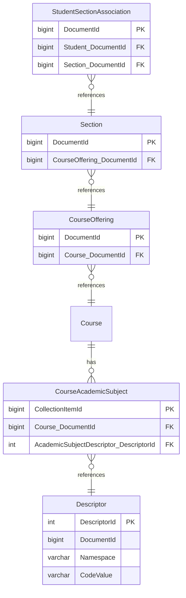

import Tabs from '@theme/Tabs';
import TabItem from '@theme/TabItem';

# How To: Use Custom View-Based Authorization

This walkthrough adds a custom view-based authorization strategy that limits the
students an API client can read and update to students enrolled in a CTE (Career
and Technical Education) course. For the concepts and conventions behind custom
views, see
[Authorizing Requests Using Custom Database Views](../technical-articles/authorizing-requests-using-custom-database-views.md).

The example uses a non-production environment with sample data, and an API
client assigned to the `EdFiSandbox` claim set, with education organization IDs
that cover the sample data's schools (for example, the district `255901`).
Changing the claims document at runtime requires the Configuration Service
setting
`CONFIGURATION_SERVICE_DANGEROUSLY_ENABLE_UNRESTRICTED_CLAIMS_LOADING=true`.

## Create the Custom Authorization View

First, identify the _basis resource_ for the authorization. This is the resource
whose `DocumentId` the view returns. For this example, the basis resource is
`Student`, so the view returns the `DocumentId` of each student enrolled in a
CTE course.

Next, work out a query that finds those students. In the Ed-Fi API database, a
student's section enrollment refers to the section, the section refers to its
course offering, and the course offering refers to the course, whose academic
subjects are stored in a collection table:



Finally, name the view using the convention `{BasisResource}With{HintPhrase}`.
The first part is the basis resource's name, `Student`. The second part is the
literal, case-sensitive text `With`. The final part is a title-cased hint
phrase. When authorization fails, the Ed-Fi API builds a hint from the name, so
the hint phrase should complete the sentence "You may need a Student with…".
This example uses `StudentWithCTECourseEnrollments`.

Create the view in the `auth` schema of the Ed-Fi API database. On PostgreSQL,
quote the names, because the Ed-Fi API matches the view name case-sensitively:

<Tabs>
  <TabItem value="pg" label="PostgreSQL" default>

```sql
CREATE OR REPLACE VIEW "auth"."StudentWithCTECourseEnrollments" AS
    SELECT ssa."Student_DocumentId" AS "DocumentId"
    FROM "edfi"."StudentSectionAssociation" ssa
        INNER JOIN "edfi"."Section" sec
            ON sec."DocumentId" = ssa."Section_DocumentId"
        INNER JOIN "edfi"."CourseOffering" co
            ON co."DocumentId" = sec."CourseOffering_DocumentId"
        INNER JOIN "edfi"."CourseAcademicSubject" cas
            ON cas."Course_DocumentId" = co."Course_DocumentId"
        INNER JOIN "dms"."Descriptor" d
            ON d."DescriptorId" = cas."AcademicSubjectDescriptor_DescriptorId"
    WHERE d."Namespace" = 'uri://ed-fi.org/AcademicSubjectDescriptor'
        AND d."CodeValue" = 'Career and Technical Education';
```

  </TabItem>
  <TabItem value="mssql" label="SQL Server">

```sql
CREATE OR ALTER VIEW [auth].[StudentWithCTECourseEnrollments] AS
    SELECT ssa.[Student_DocumentId] AS [DocumentId]
    FROM [edfi].[StudentSectionAssociation] ssa
        INNER JOIN [edfi].[Section] sec
            ON sec.[DocumentId] = ssa.[Section_DocumentId]
        INNER JOIN [edfi].[CourseOffering] co
            ON co.[DocumentId] = sec.[CourseOffering_DocumentId]
        INNER JOIN [edfi].[CourseAcademicSubject] cas
            ON cas.[Course_DocumentId] = co.[Course_DocumentId]
        INNER JOIN [dms].[Descriptor] d
            ON d.[DescriptorId] = cas.[AcademicSubjectDescriptor_DescriptorId]
    WHERE d.[Namespace] = N'uri://ed-fi.org/AcademicSubjectDescriptor'
        AND d.[CodeValue] = N'Career and Technical Education';
GO
```

  </TabItem>
</Tabs>

A student enrolled in several CTE sections appears more than once. That's
expected: don't add `DISTINCT`, which only slows the authorization check down.

## Add the Strategy to a Claim Set

The authorization strategy name must be the same as the view name. Add it to the
claims document as a claim set authorization strategy override. The claim set
endpoints (such as `POST /v3/claimSets/import`) accept only the built-in
strategies, so they can't be used for a custom view.

1. Retrieve the current claims document with `GET /management/current-claims`,
   as described in
   [Runtime Upload via Configuration Service](./how-to-create-and-manage-api-security-metadata.mdx#runtime-upload-via-configuration-service).
1. In `claimsHierarchy`, find the
   `http://ed-fi.org/identity/claims/ed-fi/student` claim under the `people`
   domain. Add an entry for the `EdFiSandbox` claim set to its `claimSets`
   array:

   ```json
   {
     "name": "EdFiSandbox",
     "actions": [
       { "name": "Create" },
       {
         "name": "Read",
         "authorizationStrategyOverrides": [
           { "name": "RelationshipsWithEdOrgsAndPeople" },
           { "name": "StudentWithCTECourseEnrollments" }
         ]
       },
       {
         "name": "Update",
         "authorizationStrategyOverrides": [
           { "name": "RelationshipsWithEdOrgsAndPeople" },
           { "name": "StudentWithCTECourseEnrollments" }
         ]
       },
       { "name": "Delete" },
       { "name": "ReadChanges" }
     ]
   }
   ```

   The entry lists all of the actions that `EdFiSandbox` has on the `people`
   domain, and overrides the strategies for Read and Update. Because an override
   replaces the resource's strategies, it lists the relationship-based strategy
   as well, so the client still needs a relationship to each student. The custom
   view then further limits those students to the ones with CTE course
   enrollments.

1. Upload the changed document with `POST /management/upload-claims`.

For a production deployment, put the override in the claims source instead, such
as a
[claims fragment](./how-to-create-and-manage-api-security-metadata.mdx#claims-fragments),
and review
[When Claims Are Loaded](./how-to-create-and-manage-api-security-metadata.mdx#when-claims-are-loaded)
first.

The Ed-Fi API caches claim sets for up to 10 minutes
(`CacheSettings:ClaimSetsCacheExpirationSeconds`). Wait for the cache to expire,
or restart the Ed-Fi API, before testing.

## Test the New Authorization Strategy

Identify some students who are enrolled in a CTE course and some who aren't, for
example with a query like this:

<Tabs>
  <TabItem value="pg" label="PostgreSQL" default>

```sql
SELECT s."StudentUniqueId",
       CASE WHEN EXISTS (
           SELECT 1 FROM "auth"."StudentWithCTECourseEnrollments" v
           WHERE v."DocumentId" = s."DocumentId"
       ) THEN 'CTE' ELSE 'Not CTE' END AS "Enrollment"
FROM "edfi"."Student" s;
```

  </TabItem>
  <TabItem value="mssql" label="SQL Server">

```sql
SELECT s.[StudentUniqueId],
       CASE WHEN EXISTS (
           SELECT 1 FROM [auth].[StudentWithCTECourseEnrollments] v
           WHERE v.[DocumentId] = s.[DocumentId]
       ) THEN 'CTE' ELSE 'Not CTE' END AS [Enrollment]
FROM [edfi].[Student] s;
```

  </TabItem>
</Tabs>

Then, using an API client in the `EdFiSandbox` claim set, test the following
operations:

- `GET` all `students`. Only students with CTE course enrollments are returned.
- `GET` a student who isn't enrolled in a CTE course by `id`. The request fails
  with `403 Forbidden` and the hint "You may need a Student with CTE Course
  Enrollments."
- `GET` a student enrolled in a CTE course by `id`. The request succeeds.
- `POST` a student item for an _existing_ student who isn't enrolled in a CTE
  course. A `POST` that matches an existing item is authorized as an Update, so
  the request fails with `403 Forbidden`.
- `POST` a student item for an _existing_ student enrolled in a CTE course. The
  request succeeds.

A failed request returns a response like this:

```json
{
  "detail": "Access to the requested data could not be authorized. Hint: You may need a Student with CTE Course Enrollments.",
  "type": "urn:ed-fi:api:security:authorization",
  "title": "Authorization Denied",
  "status": 403,
  "errors": [
    "The caller is not authorized to perform the requested operation on the item based on the existing value of the 'StudentUniqueId' property of the item."
  ]
}
```

If requests fail with `500 Internal Server Error` instead, check the view's
name, schema, and `DocumentId` column, and see
[Configuration Errors](../technical-articles/authorizing-requests-using-custom-database-views.md#configuration-errors).

:::info

Since the strategy is defined entirely by security metadata and a database view,
the Ed-Fi API doesn't need to be rebuilt. You can change the view at any time,
and changes to the data in it, such as a new CTE enrollment, take effect on the
next request.

:::
