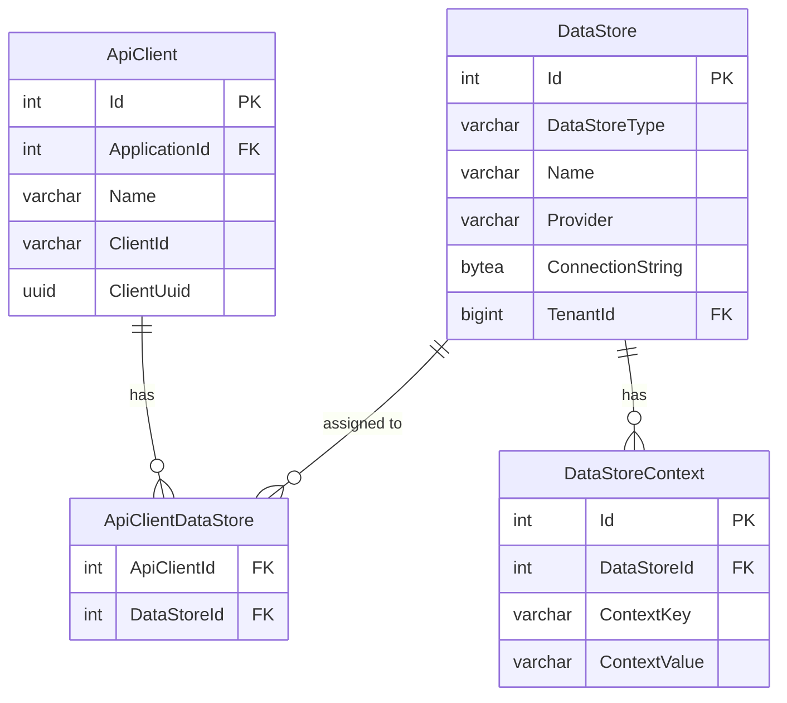
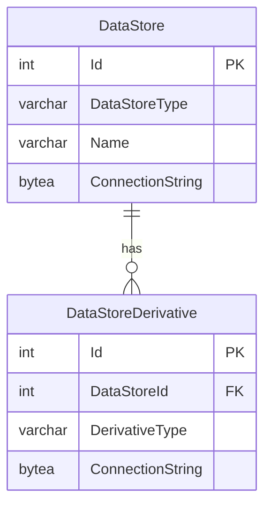

# API Client and Data Store Configuration

## Data Stores

Database connection strings for Ed-Fi API v8 are stored in the Configuration
Service, not in application configuration files. Each _data store_ entry holds
the connection string and type for one Ed-Fi API database. Connection strings
stored in the Configuration Service are encrypted at rest using AES. This
measure guards against the possibility that someone who gains unauthorized
access to the database can retrieve connection strings from the system.

Data stores are managed through the Configuration Service API
(`/v3/dataStores`). See the
[Configuration Details](./configuration-details#configuration-service-settings)
page for encryption key configuration. A data store request can also include
an optional `provider` field, either `postgresql` or `sqlserver`, which records
the database engine for reference.

Data store names must be unique within a tenant (or, in a single-tenant
deployment, across the deployment). Creating a data store with a name already
in use, or renaming one onto it, returns `400 Bad Request`. In a multi-tenant
deployment, each data store belongs to one tenant, recorded in its `TenantId`.
See [Single and Multi-Tenant
Configuration](./single-and-multi-tenant-configuration.md).

### Connection String Handling

The Configuration Service never returns a connection string in plain text. A
`GET` of a data store returns `connectionString` as the encrypted,
Base64-encoded value:

- `POST` accepts a valid plain-text connection string for the configured
  database engine. You can also omit it, or send `null`, to register a data
  store without one. Requests routed to a data store with no connection string
  return `503 Service Unavailable` until one is set.
- `PUT` with `connectionString` omitted or `null` keeps the stored value. Use
  this to update other fields of a data store you read with `GET`.
- `PUT` with a value validates it and replaces the stored value.
- An encrypted value copied from a `GET` response is rejected with `400`,
  because it isn't a connection string. Send the plain-text value, or leave
  the field out to keep the stored one.
- An empty or whitespace-only value is rejected with `400`.

No request clears a stored connection string; to remove one, delete and
re-create the data store. Deleting a data store also removes its contexts,
derivatives, and API client assignments, so re-create those afterwards.

## Data Store Derivatives

Ed-Fi API v8 supports data store derivatives: secondary databases (read
replicas and snapshots) registered with a data store, configured in the
`DataStoreDerivative` table.

The `DerivativeType` column accepts the following values:

| Value | Description |
| --- | --- |
| `ReadReplica` | A read-only replica of the primary data store, used to serve read requests. See [Read Replicas](../features/read-replicas.md) |
| `Snapshot` | A point-in-time copy of the primary data store, used for consistent change processing by API clients. See [Changed Record Queries](../features/changed-record-queries.md#changed-record-queries-with-snapshot-isolation) |

Each data store can have at most one derivative of each type. Creating a
second derivative of the same type for a data store, or changing a derivative's
type to one the data store already has, returns `400 Bad Request`.

Derivative connection strings follow the same rules as data store connection
strings (see [Connection String Handling](#connection-string-handling)).

## API Client and Data Store Association

API clients belong to applications, which in turn belong to vendors. The full
hierarchy is: vendor → application → API client → data store. Vendors,
applications, API clients, and their data store associations are all managed
through the Configuration Service API.

Data stores are assigned to each API client, not to the application. An API
client can have zero, one, or many data stores, set with the `dataStoreIds`
list on `POST /v3/apiClients` and `PUT /v3/apiClients/{id}`:

- The data stores must already exist in the caller's tenant.
- On `PUT`, `dataStoreIds` replaces the client's existing assignments. An
  empty list, or omitting the property, removes them all. Sending `null` is
  rejected.
- A client with no data stores can authenticate and receive a token, but every
  resource request returns `403 Forbidden`.
- The assignments are carried in the client's access token. The client must
  request a new access token to pick up the change.
- `POST /v3/applications` assigns its `dataStoreIds` to the application's first
  API client.

To provide a simple experience for API clients with a fixed API base URL (no
route segments for school year, district, etc.), assign each API client a
single data store. That assignment alone identifies the data store for each
API request. To give one API client access to several data stores, use
context-based routing (see [Route-Based Data Store
Selection](#route-based-data-store-selection) below).

API client names must be unique within an application. Creating an API client
with a name the application already uses, or renaming or moving a client onto
one, returns `409 Conflict`.

### Applications Without API Clients

By default, `POST /v3/applications` also creates the application's first API
client and returns its key and secret. To create only the application, send
`"createDefaultCredentials": false`. The response then returns `null` for the
key and secret. Because no API client is created, the request must not include
the client fields `enabled` or `dataStoreIds` (either one returns `400`, even
`false` or `[]`). Add API clients later with `POST /v3/apiClients`.

### Education Organization Scope

Each API client has its own education organization scope. By default a client
inherits its application's `educationOrganizationIds` and follows later changes
to them. To narrow a client, send `educationOrganizationIds` on `POST
/v3/apiClients` or `PUT /v3/apiClients/{id}` with a non-empty subset of the
application's list. To return a narrowed client to inheriting, set
`inheritsApplicationEducationOrganizations` to `true`. See the Configuration
Service OpenAPI specification for the full rules. Scope changes apply to tokens
requested afterwards; tokens already issued keep their claims until they expire.

### Ownership Tokens

For [ownership-based
authorization](../security/ownership-based-authorization.md), ownership tokens
are created with `/v3/ownershipTokens` and assigned to an API client with
`PUT /v3/apiClients/{id}/ownership` (read them with
`GET /v3/apiClients/{id}/ownership`). The API client create and update
requests don't accept ownership fields. See [Configuring the API
Clients](../security/ownership-based-authorization.md#configuring-the-api-clients).

## Route-Based Data Store Selection

If school year or district segments in the API routes are desired, use
context-based routing. With this setting, the same API key and
secret can be used to connect to more than one data store by using entries in
the `DataStoreContext` table. The combination of the API client's data store
association and the context provided in the request route is used to identify
the appropriate data store for each API request.

Route qualifiers are configured via the `RouteQualifierSegments` setting (in
Docker Compose, the `ROUTE_QUALIFIER_SEGMENTS` variable). See
[Context-Based Routing for Year-Specific Data Store](./context-based-routing-for-year-specific-datastore.md)
for configuration details.
