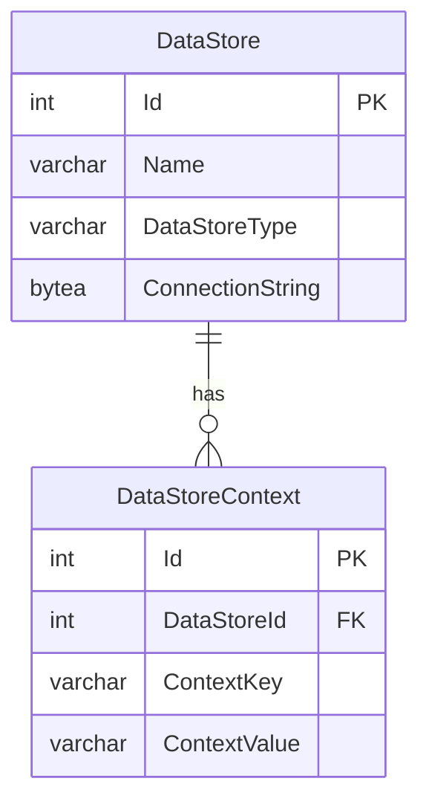

# Context-Based Routing for Year-Specific Data Store

The Ed-Fi API v8 routing provides a simple, predictable base path for all API
requests by default. The out-of-the-box configuration allows for the
implementation of any _implicit_ data segmentation strategy through the
configuration of data stores, API clients, and their associations — with each
API client configured with access to a single data store. In this
configuration, API clients all use the same base path with their requests and
are not aware how the data is segmented by the host.

However, some implementations may find it useful to add an explicit school year
(or some other contextual value such as a district and/or instance identifier)
to the API request base path as part of an _explicit_ data segmentation
strategy or to distinguish data associated with previous years from data for
the current year, or both. The primary reason for pursuing an explicit data
segmentation strategy is to allow the same API client credentials to be used to
access several different data stores.

To enable context-based routing, set `AppSettings:RouteQualifierSegments` to a
comma-separated list of segment names. These names appear as path segments
between the path base and the `/data/ed-fi/...` portion of the URL and can
include multiple segments if multiple context values are required (e.g.,
`districtId,schoolYear`).

```json
{
  "AppSettings": {
    "RouteQualifierSegments": "schoolYear"
  }
}
```

Or set the `AppSettings__RouteQualifierSegments` environment variable. In the
provided Docker Compose files, set `ROUTE_QUALIFIER_SEGMENTS` instead:

```ini
ROUTE_QUALIFIER_SEGMENTS=schoolYear
```

The Ed-Fi API validates the segment names at startup. Names must be unique
(ignoring letter case) and can't be `__identityId` or `__identityToken`. If the
value is invalid, the Ed-Fi API logs a `Critical` error and returns `500` for
every request, including `/health`, until you correct the setting and restart
the service.

Once `RouteQualifierSegments` is defined, _all_ API requests must include the
segment(s) in the base path (in multi-tenant mode this context segment will be
added after the tenant identifier segment). Each data store's context values
are stored as `DataStoreContext` entries in the Configuration Service:



## How a Data Store Is Selected

For each request, the Ed-Fi API only considers the data stores assigned to the
calling API client (the client's `dataStoreIds` in the Configuration Service,
as recorded in its access token when the token was issued). Data stores that
exist but aren't assigned to the client are never selected, even if their
context values match the route. Among the assigned data stores, a data store
matches when:

- It has one context entry per route qualifier segment, no more and no fewer.
  (With no route qualifiers configured, only data stores with no context
  entries match.)
- Each context key matches a segment name. Use the same spelling and letter
  case as in `RouteQualifierSegments`.
- Each context value matches the value in the request path. Values are
  compared case-insensitively.

The result depends on how many assigned data stores match:

| Matching data stores | Response |
| --- | --- |
| None, because the API client has no data stores assigned | `403 Forbidden` |
| None | `404 Not Found` |
| One | The request is served from that data store |
| One, but it has no connection string | `503 Service Unavailable` |
| More than one | `400 Bad Request` (ambiguous routing isn't supported) |

Each data store's database must also be provisioned before it can serve
requests. The Ed-Fi API doesn't create database schemas at startup. See
[Database Provisioning](../utilities/database-provisioning.md).

Examples below outline steps to configure explicit year-specific and
district-specific routes.

## Configuring Year-Specific Routes

To route requests to two year-specific databases, for school years 2026 and
2027 with an explicit school year segment in the route:

- **Step 1:** Set `RouteQualifierSegments` to `schoolYear` (in Docker Compose,
  `ROUTE_QUALIFIER_SEGMENTS`), then restart the Ed-Fi API.

- **Step 2:** Create two data stores in the Configuration Service with
  `POST /v3/dataStores` — one named `EdFi_2026` and one named `EdFi_2027` —
  each with the appropriate database connection string. `dataStoreType` is
  required; it's a free-form label of up to 50 characters. Note the `id` of
  each new data store.

  ```json
  {
    "dataStoreType": "Production",
    "name": "EdFi_2026",
    "connectionString": "<connection string>"
  }
  ```

- **Step 3:** Add a context entry to each data store with
  `POST /v3/dataStoreContexts`, using `contextKey: "schoolYear"` and the
  corresponding year as `contextValue` (`"2026"` and `"2027"` respectively).
  Use the `id` returned for each data store in Step 2 as `dataStoreId` (here,
  `1` and `2`):

  ```json
  {
    "dataStoreId": 1,
    "contextKey": "schoolYear",
    "contextValue": "2026"
  }
  ```

- **Step 4:** Assign both data stores to each API client that should reach
  them, with `PUT /v3/apiClients/{id}`. The `dataStoreIds` list replaces the
  client's current assignments, so include every data store the client needs.
  Without this step, requests return `404` (or `403` if the client has no data
  stores at all). The client must request a new access token to pick up the
  change. `PUT` replaces the whole client record, so read it first with
  `GET /v3/apiClients/{id}` and change only `dataStoreIds`.

  ```json
  {
    "id": 5,
    "applicationId": 3,
    "name": "SIS Vendor client",
    "isApproved": true,
    "dataStoreIds": [1, 2]
  }
  ```

- **Step 5:** Provision each data store's database. See
  [Database Provisioning](../utilities/database-provisioning.md).

After this configuration, API requests use the school year in the path:

```text
GET http://localhost:8080/api/2026/data/ed-fi/schools
GET http://localhost:8080/api/2027/data/ed-fi/schools
```

API clients can request tokens from either `/api/oauth/token` or the qualified
path, such as `/api/2026/oauth/token`. One token covers every data store
assigned to the client, so the same token works for both school years.

For a local environment, the `-SchoolYearRange` option of
`bootstrap-local-dms.ps1` creates year-specific data stores and their
`schoolYear` context entries for you. See [Year-Specific Data
Stores](../../getting-started/docker-deployment.md#optional-year-specific-data-stores)
in Getting Started.

## Configuring District-Specific Routes

To route requests to two district-specific databases for LEA IDs 255901 and
255902 with an explicit district segment in the route:

- **Step 1:** Set `RouteQualifierSegments` to `districtId` (in Docker Compose,
  `ROUTE_QUALIFIER_SEGMENTS`), then restart the Ed-Fi API.

- **Step 2:** Create two data stores in the Configuration Service with
  `POST /v3/dataStores` — one per district — each with a `dataStoreType` and
  the appropriate database connection string. Note the `id` of each new data
  store.

- **Step 3:** Add a context entry to each data store with
  `POST /v3/dataStoreContexts`, using `contextKey: "districtId"` and the LEA ID
  as `contextValue` (`"255901"` and `"255902"` respectively).

- **Step 4:** Assign both data stores to each API client that should reach
  them (`dataStoreIds` on `PUT /v3/apiClients/{id}`), and provision each
  data store's database, as in the year-specific example.

After this configuration, API requests use the district ID in the path:

```text
GET http://localhost:8080/api/255901/data/ed-fi/schools
GET http://localhost:8080/api/255902/data/ed-fi/schools
```

## Multi-Tenant Deployments with Route Qualifiers

When multi-tenancy is enabled alongside route qualifiers, the tenant identifier
appears _before_ the route qualifier segment(s):

```text
GET http://localhost:8080/api/{tenantId}/{qualifier}/data/ed-fi/schools
```

For example, with `MultiTenancy=true` and `RouteQualifierSegments=schoolYear`:

```text
GET http://localhost:8080/api/tenant1/2026/data/ed-fi/schools
GET http://localhost:8080/api/tenant2/2027/data/ed-fi/schools
```

Data stores, their contexts, and API clients belong to a tenant. Send the
`Tenant` header with each Configuration Service request in the setup steps, so
that the data stores are created in, and assigned within, the right tenant.

See [Single and Multi-Tenant
Configuration](./single-and-multi-tenant-configuration.md) for details on
enabling multi-tenancy.
