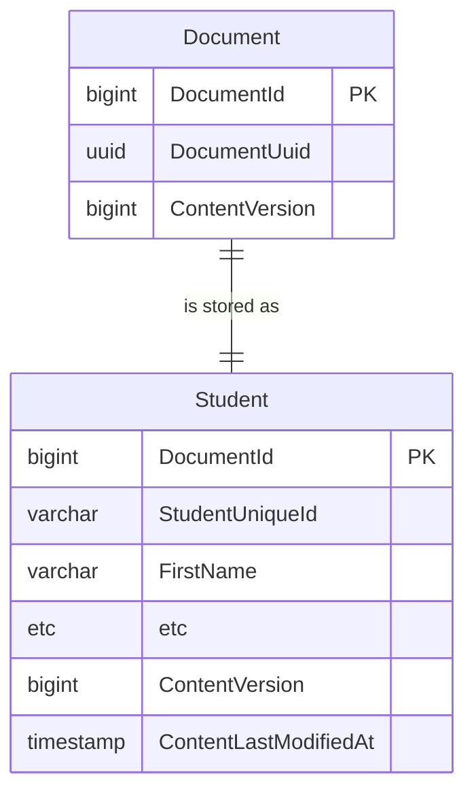
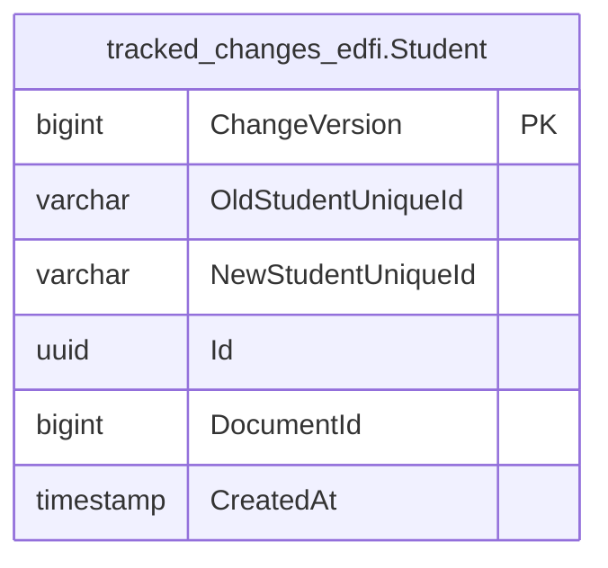

# Changed Record Queries

The Ed-Fi API platform tracks inserts, updates, and deletes, and surfaces those
changes to client systems through a feature called changed record queries, or
"change queries." Change queries allow client systems to narrow requests for
data to only data that has changed since a specified point in time. This allows
client systems to stay in sync with the Ed-Fi API without having to pull a
complete data set.

Client system interaction is documented in the [Using the Changed Record
Queries](../../client-developers-guide/using-the-changed-record-queries.md)
section of the API Client Developers' Guide.

Change queries are always enabled in Ed-Fi API v8. The change query database
schema is provisioned as part of the standard database setup via
`api-schema-tools ddl provision`. No additional configuration is required to enable
the feature.

Platform hosts can also offer [snapshot
isolation](#changed-record-queries-with-snapshot-isolation), which lets API
clients process changes from a point-in-time copy of the data that isn't
affected by ongoing writes.

## Technical Details

The change queries feature uses basic versioning concepts. A global version
counter is kept in the `dms.ChangeVersionSequence` sequence. Every document has
a `ContentVersion`, stored on `dms.Document` and mirrored on its resource's root
table (for example, `edfi.Student`) or on `dms.Descriptor`. Triggers stamp a new
value from the sequence on every insert and every update that changes the
record, including changes to child collections and extensions. Queries done against the API to find changed records
function by adding an additional where clause based on this `ContentVersion`
column.



Supporting deletes and key changes requires a history of tracked changes. The
same triggers record a row in a per-resource _tracked-change_ table, in a
`tracked_changes_<project>` schema (for example, `tracked_changes_edfi`), when a
record is deleted or its identifying values change. Each row stores the
resource id, the old and new values (the new values are empty for a delete),
and the `ChangeVersion` of the change. Descriptors share a single
`tracked_changes_edfi.Descriptor` table. API requests to the `/deletes` and
`/keyChanges` routes query these tables, so the history survives after the
record itself is deleted.

:::note

There is a concern in use cases with very high volume of deletes or for very
long-running database instances where the size of these tracked-change tables
can get very large. In that case, these tables can be truncated periodically.
The only risk is losing visibility into any deletes and key changes that are
removed by the truncation.

:::



The patterns described above are used for both the standard, as-shipped Ed-Fi
database tables, as well as tables generated to serve Ed-Fi Extensions. The
`api-schema-tools ddl provision` command generates the `ContentVersion` columns,
triggers, and tracked-change tables from the API schema, including the schema
for extensions built with [MetaEd](/reference/metaed). This allows hosts to have
consistent support for the feature across their entire API, even for new
top-level entities introduced by Extension projects.

## Changed Record Queries with Snapshot Isolation

Snapshot isolation lets platform hosts serve change query requests from a
static copy of the database that is isolated from ongoing writes. This avoids
data consistency problems, processing failures, and undetected missing data in
downstream systems.

A host offers a snapshot by registering a data store derivative with a
`derivativeType` of `Snapshot` in the Configuration Service, using
`POST /v3/dataStoreDerivatives/`:

```json
{
  "dataStoreId": 1,
  "derivativeType": "Snapshot",
  "connectionString": "<connection string of the snapshot database>"
}
```

Each data store can have at most one snapshot. API clients then read from it by
sending the `Use-Snapshot: true` header on each request; see [Using the Changed
Record
Queries](../../client-developers-guide/using-the-changed-record-queries.md#use-snapshot-isolation).

The Ed-Fi API responds as follows:

- **Read requests** with `Use-Snapshot: true` are served from the snapshot. A
  snapshot takes precedence over a [read replica](./read-replicas.md).
- **The header value must be `true`.** It isn't case-sensitive, and spaces
  around it are ignored. Any other value, such as `yes` or `1`, is treated as a
  request for current data, without an error.
- **Without a snapshot,** or if the snapshot database can't be reached, a
  request with `Use-Snapshot: true` gets a `404 Not Found` response with the
  message `Snapshot not found.` The API doesn't fall back to current data. A
  client can't tell the two cases apart, so check the Ed-Fi API log, which
  records a warning when a snapshot connection fails.
- **Write requests** (`POST`, `PUT`, and `DELETE`) with `Use-Snapshot: true` get
  a `405 Method Not Allowed` response.

Each Ed-Fi API instance caches the data store configuration, including
snapshots, and reloads it from the Configuration Service only after
`CacheSettings:DataStoreCacheExpirationSeconds` has passed (10 minutes by
default). A new or changed snapshot can take that long to reach every instance.
Restarting the Ed-Fi API instances applies the change immediately.

## Creating and Managing Snapshots

Platform hosts implement a DevOps process to maintain a periodically refreshed
static copy of the Ed-Fi API database, and the corresponding data store
derivative in the Configuration Service. The Ed-Fi API doesn't create or
refresh snapshots itself.

This is typically a scheduled database backup-and-restore operation. For
PostgreSQL or SQL Server, the respective database's lightweight snapshot
features can also be used where available.

The process needs to:

- Back up the current Ed-Fi API database.
- Restore it as a snapshot copy.
- Create or update the data store derivative in the Configuration Service with
  a `derivativeType` of `Snapshot` and the snapshot connection string, for the
  appropriate data store.
- Wait until every Ed-Fi API instance has loaded the updated configuration,
  either by waiting for the data store cache to expire or by restarting the
  instances, before allowing new synchronization runs to start.

:::warning

A snapshot must not change while a client is reading from it. Use a static copy,
not a live secondary or a standby that is still applying changes; a changing
source can return a record twice and skip another within a single read, without
an error.

Don't replace the snapshot (by changing the derivative's connection string or
re-creating the database behind it) while clients are reading from it. Those
clients would read later pages from a different copy of the data, and the API
can't detect it. Schedule refreshes for times when no synchronization runs are
in progress, and don't start new runs until every Ed-Fi API instance has
loaded the new connection string. Otherwise, a run can start against the old
snapshot and switch to the new one partway through when the cache refreshes.

:::
