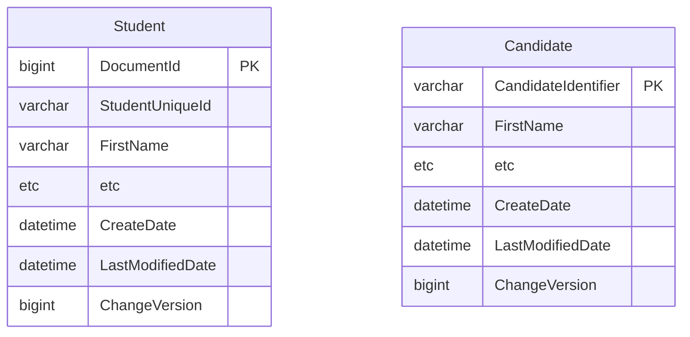
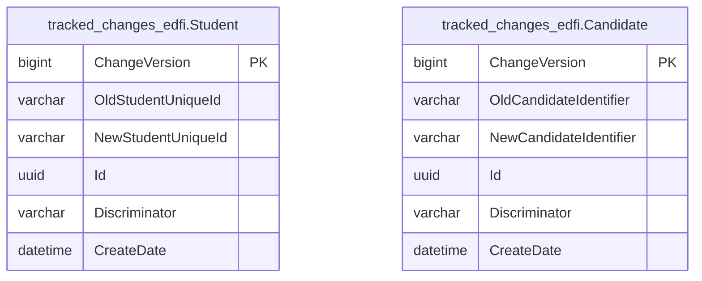

# Changed Record Queries

The Ed-Fi API platform tracks inserts, updates, and deletes, and surfaces those
changes to client systems through a feature called changed record queries, or
"change queries." Change queries allow client systems to narrow requests for
data to only data that has changed since a specified point in time. This allows
client systems to stay in sync with the Ed-Fi API without having to pull a
complete data set.

Client system interaction is documented in the [Using the Changed Record
Queries](../../client-developers-guide/using-the-changed-record-queries.md)
section of the API Client Developers' Guide.

Change queries are always enabled in Ed-Fi API v8. The change query database
schema is provisioned as part of the standard database setup via
`api-schema-tools ddl provision`. No additional configuration is required to enable
the feature.

Platform hosts can also offer [snapshot
isolation](#changed-record-queries-with-snapshot-isolation), which lets API
clients process changes from a point-in-time copy of the data that isn't
affected by ongoing writes.

## Technical Details

The change queries feature uses basic versioning concepts. A global version
counter is introduced using a sequence object, and each table representing the
top-level entities of a data domain is given a `ChangeVersion` column to
represent the current version of the entity instance. These columns are set up
with triggers to ensure they are automatically updated based on the latest value
of the sequence on all inserts and updates. Queries done against the API to find
changed records function by adding an additional where clause based on this
`ChangeVersion` column.



Supporting delete tracking requires a "tombstone" table. This concept involves
tracking all deletes and storing a record of what was deleted, to allow future
querying against deleted records. The pattern is implemented using a delete
trigger on the main table, and the resource id and primary key of the deleted
record are stored in the tracking table. API requests to retrieve information on
deletes query against these tables to retrieve the resource ids of deleted entity
instances.

:::note

There is a concern in use cases with very high volume of deletes or for very
long-running database instances where the size of these delete tracking tables
can get very large. In that case, these tables can be truncated periodically.
The only risk is losing visibility into any deletes that are removed by the
truncation.

:::



The patterns described above are used for both the standard, as-shipped Ed-Fi
database tables, as well as tables generated to serve Ed-Fi Extensions. By using
[MetaEd](/reference/metaed) (the recommended method for extending the Ed-Fi
API), scripts are generated to support the `ChangeVersion` column,
insert/update/delete triggers, and delete tracking tables. This allows hosts to
have consistent support for the feature across their entire API, even for new
top-level entities introduced by Extension projects.

## Changed Record Queries with Snapshot Isolation

Snapshot isolation lets platform hosts serve change query requests from a
static copy of the database that is isolated from ongoing writes. This avoids
data consistency problems, processing failures, and undetected missing data in
downstream systems.

A host offers a snapshot by registering a data store derivative with a
`derivativeType` of `Snapshot` in the Configuration Service, using
`POST /v3/dataStoreDerivatives/`:

```json
{
  "dataStoreId": 1,
  "derivativeType": "Snapshot",
  "connectionString": "<connection string of the snapshot database>"
}
```

Each data store can have at most one snapshot. API clients then read from it by
sending the `Use-Snapshot: true` header on each request; see [Using the Changed
Record
Queries](../../client-developers-guide/using-the-changed-record-queries.md#use-snapshot-isolation).

The Ed-Fi API responds as follows:

- **Read requests** with `Use-Snapshot: true` are served from the snapshot. A
  snapshot takes precedence over a [read replica](./read-replicas.md).
- **The header must be exactly `true`** (in any letter case). Any other value,
  such as `yes` or `1`, is treated as a request for current data, without an
  error.
- **Without a snapshot,** or if the snapshot database can't be reached, a
  request with `Use-Snapshot: true` gets a `404 Not Found` response with the
  message `Snapshot not found.` The API doesn't fall back to current data. A
  client can't tell the two cases apart, so check the Ed-Fi API log, which
  records a warning when a snapshot connection fails.
- **Write requests** (`POST`, `PUT`, and `DELETE`) with `Use-Snapshot: true` get
  a `405 Method Not Allowed` response.

## Creating and Managing Snapshots

Platform hosts implement a DevOps process to maintain a periodically refreshed
static copy of the Ed-Fi API database, and the corresponding data store
derivative in the Configuration Service. The Ed-Fi API doesn't create or
refresh snapshots itself.

This is typically a scheduled database backup-and-restore operation. For
PostgreSQL or SQL Server, the respective database's lightweight snapshot
features can also be used where available.

The process needs to:

- Back up the current Ed-Fi API database.
- Restore it as a snapshot copy.
- Create or update the data store derivative in the Configuration Service with
  a `derivativeType` of `Snapshot` and the snapshot connection string, for the
  appropriate data store.

:::warning

A snapshot must not change while a client is reading from it. Use a static copy,
not a live secondary or a standby that is still applying changes; a changing
source can return a record twice and skip another within a single read, without
an error.

Don't replace the snapshot (by changing the derivative's connection string or
re-creating the database behind it) while clients are reading from it. Those
clients would read later pages from a different copy of the data, and the API
can't detect it. Schedule refreshes for times when no synchronization runs are
in progress.

:::
