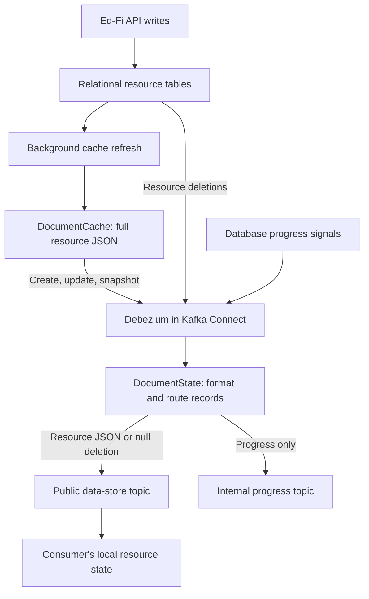

# Event Streaming with Kafka

Ed-Fi API v8 can send resource data to Apache Kafka so downstream systems can
maintain a copy of a data store without polling the API. Each data store has
one topic containing all its resource types. Messages describe the latest
available state of a resource; deletes remove that resource from the
consumer's copy.

This page explains the feature for platform hosts and teams building consumers.
For a working example, follow [Set Up Kafka CDC
Streaming](../../how-to-guides/how-to-set-up-kafka-cdc-streaming.mdx).

:::important Local evaluation only

The supplied deployment runs one Kafka broker and one Kafka Connect worker,
with Kafka authorization disabled. Use synthetic data in an isolated local
environment. It does not provide production access isolation or availability.

The walkthrough requires a fresh environment and a new data store. Adding CDC
to an existing deployment, replacing its source database, and moving consumers
to a new topic generation are not supported by this setup.

Message delivery and readiness reporting are separate checks. The standalone
status command can report unknown cache-refresh health even when messages
arrive; see [Check Status](../../how-to-guides/how-to-set-up-kafka-cdc-streaming.mdx#check-status).

:::

## How Data Reaches Kafka

Change data capture (CDC) reads database changes and sends them to another
system. For Ed-Fi API, a background process first prepares full resource JSON
in the [DocumentCache](./document-cache.md). Debezium, running in Kafka Connect,
captures those cached resources and resource deletions. The Ed-Fi
`DocumentState` transform converts the captured changes to the public message
format described below.



Cached creates, updates, and snapshot records become _upserts_: a message that
adds or replaces a resource. A deletion of the resource from the database
becomes a _tombstone_: a Kafka record with a key and a null value. Deleting or
rebuilding cached copies alone does not publish resource deletions. Internal
progress signals stay out of the public topic.

Cache refresh is asynchronous and can combine several changes before a
resource reaches Kafka. Kafka compaction can later remove superseded messages.
Consumers must not use this stream as an audit log or expect every intermediate
change. Streaming does not replace [Changed Record Queries](./changed-record-queries.md).

## Host Prerequisites

The host must configure and activate DocumentCache for the selected data store.
Its background refresh is required for streaming; serving API reads from the
cache is optional. `DataManagement:DocumentCache:ReadAcceleration:Enabled` can
remain `false`.

| Database | Requirements |
| --- | --- |
| PostgreSQL | Logical replication enabled, sufficient replication slots and WAL senders, and a restricted connector login with replication permission. |
| SQL Server | SQL Server Agent and CDC enabled; read committed snapshot isolation (RCSI), snapshot isolation, and server nested triggers enabled; a restricted connector login. |

The [walkthrough](../../how-to-guides/how-to-set-up-kafka-cdc-streaming.mdx)
includes preparation and checks for both engines. Its bootstrap creates the new
database, prepares capture, activates the cache, and verifies initial streaming
before starting API writers. A database created with `source-history-only` or
with DocumentCache activated independently is ineligible for initial Kafka
setup. Do not prepare capture tables, replication slots, or connectors manually
alongside it.

The standalone status command cannot observe the API's running cache-refresh
process. It can report `RuntimeNotObserved`, projection `Unknown`, and aggregate
`NotReady` after successful setup, even when messages are arriving. Successful
bootstrap and demonstrated delivery establish the local evaluation result;
they do not establish current aggregate readiness. Other diagnostic failures
require investigation. See [Check Status](../../how-to-guides/how-to-set-up-kafka-cdc-streaming.mdx#check-status).

## Topics and Keys

A public topic has this name:

```text
<topic-prefix>.instance.<instance-key>-g<generation>.documents.v1
```

| Part | Meaning |
| --- | --- |
| `topic-prefix` | Identifies the deployment and environment. It must be unique among deployments sharing a broker. A short prefix is suitable only for an isolated local broker. |
| `instance-key` | An opaque, stable identifier for the data store within that prefix. Data-store IDs are not globally unique. Do not use district names, tenant names, or other sensitive identifiers. |
| `generation` | A positive integer identifying the association between a source database and a topic. It starts at `1`; it is not a resource version. The supplied workflow does not support switching an established deployment to a new generation. |
| `documents.v1` | Identifies the public document-state contract. |

For example, the walkthrough creates
`edfi.instance.datastore-1-g1.documents.v1`. A deployment sharing a Kafka
cluster would need a deployment-specific prefix, such as
`edfi.deployment-a.prod`.

The key is the API resource's `id`, encoded as lowercase UUID text:

```text
f81d4fae-7dec-11d0-a765-00a0c91e6bf6
```

The key has no JSON quotes or schema wrapper. Creates, updates, and deletes
use the same key. A topic's partition count and key-to-partition mapping remain
fixed for its lifetime. Ordering is per resource, with no global ordering
across resources or partitions.

## Message Values

An upsert is a UTF-8 JSON object containing metadata and the full resource.
There is no `schema`/`payload` wrapper, Avro encoding, or Schema Registry
dependency. The `document` field is an object, not an escaped JSON string.

This synthetic example shows an academic subject descriptor:

```json
{
  "contractVersion": 1,
  "documentUuid": "f81d4fae-7dec-11d0-a765-00a0c91e6bf6",
  "projectName": "Ed-Fi",
  "resourceName": "AcademicSubjectDescriptor",
  "resourceVersion": "5.2.0",
  "contentVersion": 123456,
  "lastModifiedAt": "2026-11-16T15:30:45Z",
  "documentCreatedAt": "2026-11-16T15:29:00Z",
  "document": {
    "id": "f81d4fae-7dec-11d0-a765-00a0c91e6bf6",
    "namespace": "uri://ed-fi.org/AcademicSubjectDescriptor",
    "codeValue": "CdcDemo",
    "shortDescription": "CDC demonstration",
    "description": "Synthetic data for a local streaming evaluation",
    "_etag": "123456-a1b2c3d4.j._.n.i",
    "_lastModifiedDate": "2026-11-16T15:30:45Z"
  }
}
```

| Field | JSON type | Meaning |
| --- | --- | --- |
| `contractVersion` | Number | `1`, identifying this envelope contract. |
| `documentUuid` | String | Public resource ID, identical to the Kafka key and `document.id`. |
| `projectName` | String | Data model project, such as `Ed-Fi`. |
| `resourceName` | String | Resource type, such as `Student` or `AcademicSubjectDescriptor`. |
| `resourceVersion` | String | Version of the resource's data model, such as `5.2.0`; not the API software version. |
| `contentVersion` | Number | Signed 64-bit integer used to compare non-null versions of this resource. Preserve its integer precision. |
| `lastModifiedAt` | String | UTC last-modified time at whole-second precision, in `yyyy-MM-ddTHH:mm:ssZ` format; identical to `document._lastModifiedDate`. |
| `documentCreatedAt` | String | UTC creation time in the same format. Updates preserve this value. It is not an ordering field. |
| `document` | Object | Full resource JSON, including `id`, `_etag`, and `_lastModifiedDate`. |

Treat `document._etag` as opaque. It describes the stream representation and
is not necessarily the validator for a differently filtered or formatted API
response. Use `contentVersion`, rather than timestamps or the ETag, to compare
upserts. Kafka record timestamps are outside this public contract.

A delete uses the same key and a **record-level null value**. It is neither
the string `"null"` nor a JSON object with `deleted: true`. It contains no
resource type, resource body, or `contentVersion`. Consumers that route by
resource type must retain enough previous state to identify a deleted key.
A tombstone can arrive without an earlier upsert for that key.

## Consumer Responsibilities

### Apply Upserts and Deletes

For each key, apply its first non-null message. While retaining non-null state,
replace it only when an incoming `contentVersion` is higher. Ignore equal
versions as duplicates and lower versions as stale. Delivery can include
duplicates and replayed records, including during connector recovery.

Apply a tombstone by removing the key's local state and advancing the delivery
checkpoint. Do not require a higher version for a tombstone: it has no version.
Persist state changes and their partition checkpoints consistently so a restart
does not skip unapplied records.

Replaying earlier records can temporarily restore a resource after its
tombstone was already observed. The replayed tombstone removes it again when
the connector reaches that deletion. The contract guarantees convergence
after catch-up, not continuously increasing state across deletes or exactly-once
delivery. Partition offsets track delivery progress; they do not replace
`contentVersion` for ordering non-null state.

### Reconstruct State Within the Retention Window

The topic uses `cleanup.policy=compact` and an explicit per-topic
`delete.retention.ms` of at least `604800000` (seven days). Compaction retains
the latest live value for each key, but Kafka can eventually remove a
tombstone and the older values it deletes. Simply resuming an old consumer
checkpoint can therefore leave deleted resources in local state.

To build a valid copy of the data store:

1. Start at the earliest available offset of **every** partition. Capture each
   partition's end offset as a completion boundary for this scan.
2. Apply through every captured boundary to durable local state within
   **24 hours** of starting the first partition scan.
3. Continue from the next offsets only after the reconstructed state and its
   checkpoints are durable. If completion within 24 hours cannot be proved,
   discard the copy and restart the full scan.

Afterward, renew this proof at least once in every 24-hour interval: capture
new end offsets and durably apply through all of them. An idle partition may
have an unchanged end offset.

If the consumer misses that deadline, loses or corrupts a checkpoint, encounters
an unexpected partition assignment, or otherwise cannot prove continuous
progress, immediately stop presenting its copy as valid. Discard the entire
copy and repeat the bounded reconstruction. Do not resume from an uncertain
checkpoint. These obligations apply even if Kafka reports no offset error.

Size and test consumers against the retained log, including uncompacted
records, large messages, uneven partitions, storage writes, and concurrent
updates. The count of live resources alone does not establish that a scan
will finish in time. Adding time- or size-based segment deletion to the topic
would invalidate this topic-only reconstruction contract.

### Accept the Configured Record Size

Set both `max.partition.fetch.bytes` and `fetch.max.bytes` to at least the
deployment's `Cdc.MaxRecordBytes`, and provide enough receive and
deserialization memory for a record of that size. The walkthrough uses
`10000000` bytes. This is an operational ceiling, not the largest possible
Ed-Fi resource; the stream envelope and resource links add bytes beyond an
API request body.

An oversized record stops the connector task instead of publishing a partial
resource. Increasing the ceiling requires coordinated consumer, broker,
topic, and producer changes; changing a consumer setting alone does not repair
the publishing path.

## Security

The stream contains sensitive student data. Topic access grants access to the
data store's full resource stream; it does not reproduce API client
authorization or readable-profile filtering. Consumer-side filtering is not
an access-control boundary. The local evaluation has no Kafka authorization
and must use synthetic data.

Public messages omit API client identity, authorization results, education
organization hierarchy arrays, tenant display names, and readable-profile
projections. They also omit Debezium's `before`, `after`, `source`, and `op`
metadata, internal database IDs, and cache-processing status. These exclusions
do not make the resource bodies anonymous or safe to expose.

Protect database and Configuration Service credentials, Kafka Connect's REST
interface, deployment-state files, and diagnostic output as well as the
topics. Consumers need access only to their authorized public topic, not the
worker's internal configuration, offset, history, or progress topics.

## Operating the Evaluation

| Situation | Action or limitation |
| --- | --- |
| Stop and resume the environment | Use the bootstrap's managed stop/start commands in the walkthrough. Retain database and Kafka volumes, settings, offsets, and the bootstrap/state directories. A raw container restart does not perform the same checks. |
| Messages stop arriving | Check API request results, connector/task status, and CDC diagnostics using the walkthrough. Inspect cache-refresh failures, capture progress, disk capacity, and record-size errors. A healthy HTTP endpoint alone does not prove streaming works. |
| PostgreSQL disk usage grows | A delayed connector can retain WAL through its replication slot. Investigate connector progress and available disk space; do not drop the managed slot to reclaim space. Lost source history cannot be repaired by silently resetting offsets. |
| SQL Server capture falls behind | Check Agent, capture/cleanup jobs, retained change history, and version-store capacity. Preserve the source and connector history. Do not recreate capture instances or internal schema-history topics to bypass an error. |
| Consumer reconstruction becomes slow | Monitor retained log size and compaction health. Increase consumer capacity before the 24-hour deadline is missed; invalidate and rebuild consumer state when continuity cannot be proved. |
| Increase the record-size ceiling | Stop publication while coordinating downstream capacity, then use the managed size-change procedure. It validates broker/topic capacity before raising producer limits and does not change topic generation. |
| Deployment state is missing or the source database was replaced | Stop and preserve evidence. The supplied workflow cannot adopt an established deployment with missing records or treat a restored/replaced source as the original. Do not delete state and rerun initial setup. |
| Retire a topic or remove the evaluation | Retirement is destructive and requires the retained deployment inventory, stopped writers/connectors, and verification that deletion completed. Ordinary stop preserves data. Advanced retirement is outside the walkthrough. |
| Sensitive data was published | Stop further publication, restrict access, and follow your incident process. Correcting a resource or sending a tombstone does not erase retained records, replicas, backups, or consumer copies. Verified destructive retirement and coordinated downstream removal are required. |

The [walkthrough](../../how-to-guides/how-to-set-up-kafka-cdc-streaming.mdx)
contains the supported local setup, observation, and lifecycle commands.
See also [Configuration Details](../configuration/configuration-details.mdx#event-streaming-with-kafka).
For advanced operations outside that walkthrough, the
[CDC operations reference](https://github.com/Ed-Fi-Alliance-OSS/Data-Management-Service/blob/v8.1.0/reference/cdc-documentation/operations-runbook.md#procedure-navigation)
provides the full operational procedures and their restrictions.
