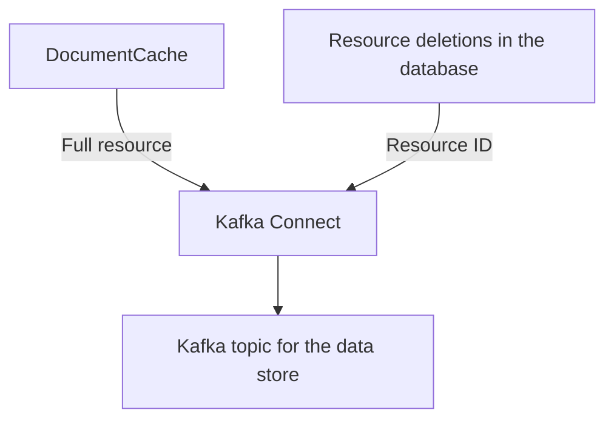

# Event Streaming with Kafka

Ed-Fi API v8 can send resource changes to Apache Kafka so another system can
keep a copy of the data without polling the API. Each data store publishes to
one _topic_, a named stream of messages. Creates and updates send the full
resource. A deletion sends the resource ID with a null value.

The API uses change data capture (CDC) to publish changes in the background.
Several edits can reach Kafka as one update, so the stream cannot serve as an
audit log. Clients that poll the API can use
[Changed Record Queries](./changed-record-queries.md).

## Before You Start {#setup}

The supplied setup is for **local evaluation with synthetic data only**.
Kafka authorization is turned off. Anyone who can read the topic can see
every resource in the data store, regardless of API client permissions or
readable profiles. Restrict access to Kafka Connect, its internal topics, and
the deployment's settings and logs.

| Your situation | Where to start |
| --- | --- |
| You want to try streaming | Follow [Stream Ed-Fi API Changes to Kafka](../../how-to-guides/how-to-set-up-kafka-cdc-streaming.mdx) **before creating the database**. The setup script registers the data store and activates [DocumentCache](./document-cache.md). Accelerated API reads are optional. |
| You already have a data store | Use a separate, fresh environment for the evaluation. Initial Kafka setup requires a new database even if the existing store already uses DocumentCache. |
| You stopped an evaluation | [Resume the same evaluation](../../how-to-guides/how-to-set-up-kafka-cdc-streaming.mdx#stop-and-resume-the-evaluation) with its original files and Docker volumes. |
| You are building a system that reads from Kafka (a _consumer_) | Start with [Read the Messages](#consumer-reference). |

## Check Status

Use the settings and state paths printed under `Inspect CDC` at startup to
[check streaming status](../utilities/database-provisioning.md#check-cdc-status).
`Ready` means all checks passed at that moment. If the cache status
(`projection`) is `Unknown`, check the reported reason and the other results.
Seeing a test resource in Kafka confirms that message arrived, even if the
tool cannot confirm overall readiness.

## Read the Messages {#consumer-reference}

The local walkthrough uses the topic `edfi.instance.datastore-1-g1.documents.v1`.
Each message uses the resource's API `id` as its key, written as lowercase
UUID text. Kafka divides a topic into ordered groups of messages called
_partitions_. All messages for one resource go to the same partition.

Kafka Connect reads creates and updates from DocumentCache and deletions from
the resource tables. Rebuilding the cache alone does not send deletions.



### Creates and Updates

A create or update sends a UTF-8 JSON object called an _upsert_. For example,
a consumer receives this value for an academic subject descriptor:

```json
{
  "contractVersion": 1,
  "documentUuid": "f81d4fae-7dec-11d0-a765-00a0c91e6bf6",
  "projectName": "Ed-Fi",
  "resourceName": "AcademicSubjectDescriptor",
  "resourceVersion": "5.2.0",
  "contentVersion": 123456,
  "lastModifiedAt": "2026-11-16T15:30:45Z",
  "documentCreatedAt": "2026-11-16T15:29:00Z",
  "document": {
    "id": "f81d4fae-7dec-11d0-a765-00a0c91e6bf6",
    "namespace": "uri://ed-fi.org/AcademicSubjectDescriptor",
    "codeValue": "CdcDemo",
    "shortDescription": "CDC demonstration",
    "description": "Synthetic data for a local streaming evaluation",
    "_etag": "123456-a1b2c3d4.j._.n.i",
    "_lastModifiedDate": "2026-11-16T15:30:45Z"
  }
}
```

| Field | How to use it |
| --- | --- |
| `contractVersion` | Identifies the message format. This format is version `1`. |
| `documentUuid` | Matches the Kafka key and `document.id`. |
| `projectName`, `resourceName`, `resourceVersion` | Identify the data model project, resource type, and version of its data model. |
| `contentVersion` | Compare versions of the same resource. Preserve the full precision of this signed 64-bit integer. |
| `lastModifiedAt`, `documentCreatedAt` | Give the modification and creation times in UTC to the second. `lastModifiedAt` matches `document._lastModifiedDate`. The creation time stays the same across updates. |
| `document` | Contains the full resource as a JSON object. Treat its `_etag` as opaque. A filtered API response can have a different ETag. |

Read each partition in order. Save the first upsert for each key, then replace
the saved resource only when an upsert has a higher `contentVersion`. Kafka
can deliver an earlier version again after a newer one.

### Deletions

A delete sends a _tombstone_, a message with the same key and a **null Kafka
value**. The resource type, body, and version are absent. If you store each
resource type separately, keep track of which type each key belongs to.

Remove the resource if present. Save your reading position even if you have
never seen that key. During recovery the connector can replay an earlier upsert and
temporarily restore a deleted resource. Applying the replayed tombstone
removes it again.

### Keep a Local Copy Up to Date

Kafka compacts the topic, keeping the latest value for each live resource.
It can eventually remove a tombstone and the messages it supersedes. A
consumer that falls behind can therefore miss a deletion.

1. Start with an empty copy. Record the end position (_offset_) of each
   partition, then read from the earliest available offset in every partition.
2. Within **24 hours** of starting the first partition, apply all messages
   through the recorded positions. Save the data and the position where
   reading should resume (the _checkpoint_) together in durable storage.
3. Continue reading from those checkpoints. At least once every 24 hours,
   record fresh end offsets for **all** partitions and save all changes
   through them. Include idle partitions, even when their offsets stay the same.

If you miss the deadline, lose a checkpoint, see an unexpected partition
assignment, or cannot verify progress, stop using the copy. Discard it and
repeat the full scan. Test that your consumer can meet the deadline with
large records, uneven partitions, and new updates arriving.

<details>
<summary>Topic settings for consumers</summary>

The topic name follows
`<topic-prefix>.instance.<instance-key>-g<generation>.documents.v1`. The
prefix identifies the deployment and must be unique on a shared broker.
The instance key identifies the data store within that prefix. Keep district
and tenant names out of it. The generation starts at `1` and stays the same
across restarts. The supplied setup supports one generation.

Keep the partition count and key mapping fixed. Use `cleanup.policy=compact`
and set `delete.retention.ms` explicitly on the topic to at least
`604800000` (seven days). Set the consumer's `max.partition.fetch.bytes`
and `fetch.max.bytes` to at least the
[configured record size](../configuration/configuration-details.mdx#cdc-record-size).
Allow enough memory to read a record of that size.

</details>

## When Something Goes Wrong

- **An expected message is missing.** Check that the API request succeeded,
  then look for its resource ID on the data store's topic. If the message is
  still missing after 120 seconds in the walkthrough, [check the connector and
  its logs](../../how-to-guides/how-to-set-up-kafka-cdc-streaming.mdx#troubleshooting).
- **The evaluation fails to restart.** Keep the original settings, state files,
  and volumes together and leave other writers stopped. If files are missing
  or the source database was replaced, follow the [recovery procedure](https://github.com/Ed-Fi-Alliance-OSS/Data-Management-Service/blob/v8.1.0/reference/cdc-documentation/operations-runbook.md#unsupported-provenance).
- **A record is too large.** Check the connector error and the
  [record-size limit](../configuration/configuration-details.mdx#cdc-record-size).
- **Sensitive data reached Kafka.** Stop publication, restrict access, and
  follow your incident process. Deleting the resource can leave copies in
  Kafka, backups, and downstream systems. See the [disclosure response
  procedure](https://github.com/Ed-Fi-Alliance-OSS/Data-Management-Service/blob/v8.1.0/reference/cdc-documentation/operations-runbook.md#sensitive-data-response).
