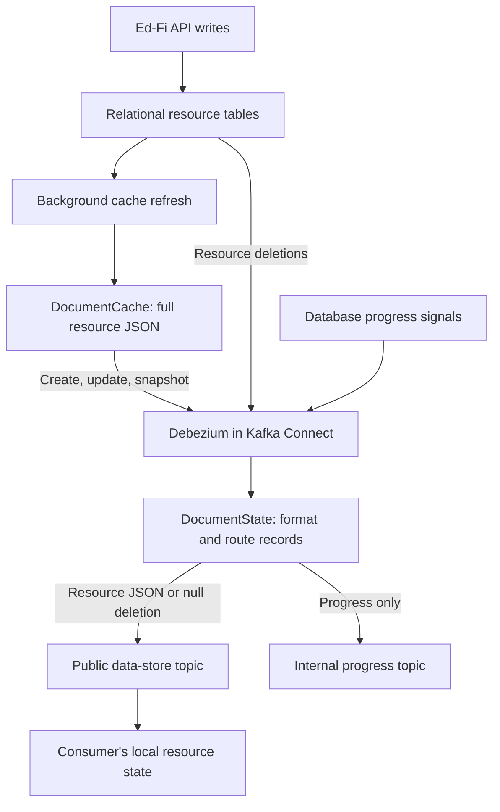

# Event Streaming with Kafka

Ed-Fi API v8 can use change data capture (CDC) to send resource data to
Apache Kafka so downstream systems can maintain a copy of a data store
without polling the API. Each data store has
one _topic_, a named stream containing all its resource types. A system reading
the topic (a _consumer_) receives the latest available state of each resource
and a message when a resource is deleted. Several edits can reach Kafka as one
update, so the stream is unsuitable for auditing every change.
[Changed Record Queries](./changed-record-queries.md) remain available for
clients that poll the API.

## Before You Start

Use the supplied setup only for a **local evaluation with synthetic data**.
Anyone with access to the topic can read every resource it carries, including
sensitive student data. The setup runs one Kafka broker and one Kafka Connect
worker with Kafka authorization disabled.

| Your deployment | Where to start |
| --- | --- |
| You want to evaluate Kafka for the first time | [Turn it on](#setup) before creating the data store or starting API writers. |
| You already have a data store created without Kafka | Use a [fresh, isolated environment](../../how-to-guides/how-to-set-up-kafka-cdc-streaming.mdx#prepare-the-host). An existing store is ineligible for initial setup, even if DocumentCache is active. |
| You have a retained Kafka evaluation | [Check status](#check-status) while it is running. If you stopped it, [resume the same deployment](../../how-to-guides/how-to-set-up-kafka-cdc-streaming.mdx#stop-and-resume-the-evaluation). |
| You are writing a consumer | Start with the [topic, message, and replay contract](#consumer-reference). |

## Turn It On {#setup}

Streaming is off by default. Choose this workflow **before creating the data
store**. It requires a fresh Configuration Service database and creates the
API database itself. A database created with `source-history-only` or with
[DocumentCache](./document-cache.md) activated independently is ineligible.
Serving reads from the cache is optional.

1. [Prepare the host](../../how-to-guides/how-to-set-up-kafka-cdc-streaming.mdx#prepare-the-host)
   and its private configuration. Choose one database engine and keep API
   writers and seed loaders stopped until bootstrap succeeds.
2. [Start the database and Configuration Service](../../how-to-guides/how-to-set-up-kafka-cdc-streaming.mdx#start-the-database-and-configuration-service),
   then [prepare the restricted connector login](../../how-to-guides/how-to-set-up-kafka-cdc-streaming.mdx#prepare-the-connector-login).
   PostgreSQL uses logical replication. SQL Server uses SQL Server Agent to run capture jobs.
3. [Prepare the API and CDC settings](../../how-to-guides/how-to-set-up-kafka-cdc-streaming.mdx#prepare-the-complete-api-and-cdc-settings).
   Select the same data store for DocumentCache and CDC, and supply the
   connection addresses for both the host and the worker.
4. [Run managed bootstrap](../../how-to-guides/how-to-set-up-kafka-cdc-streaming.mdx#start-the-api-and-streaming)
   with `-EnableKafkaCdc` and `-SeparateConfigDatabase`. It registers and
   provisions the store, activates the cache, and sets up capture before the
   API starts. Save the settings and state paths printed in `Inspect CDC`.
   You will need that exact pair to check this deployment.

## Check Status

From the root of the release checkout, run the status check in PowerShell
using the two paths from bootstrap's `Inspect CDC` line. Run it against the
retained, running deployment. If it detects lost source or connector offset
history, the check can record an incident and stop the affected connector.

```powershell
Import-Module ./eng/docker-compose/bootstrap-schema-tool.psm1
$schemaTool = Resolve-DmsSchemaTool
$retainedSettings = Read-Host 'Exact settings path from Inspect CDC'
$retainedState = Read-Host 'Exact state path from Inspect CDC'
& $schemaTool cdc status --settings $retainedSettings --state-path $retainedState --json
$statusExitCode = $LASTEXITCODE
```

| Result | What to check |
| --- | --- |
| Exit `0`, `data.aggregate.readiness` is `Ready` | All required checks passed for this observation. |
| Exit `1`, projection is `Unknown` | Inspect the target diagnostics. An explicit `RuntimeNotObserved` means the CLI could not observe the API's cache-refresh process. A Projection / `Unavailable` diagnostic alone leaves the cause unknown. Check the other components and verify delivery separately. |
| Exit `1`, a component failed | Inspect that component's diagnostics and any reported incident or connector stop. Follow the [troubleshooting steps](../../how-to-guides/how-to-set-up-kafka-cdc-streaming.mdx#troubleshooting) before retrying. |

Seeing the test resource in Kafka confirms delivery. Readiness can still be
`NotReady`. For all exit codes and incident results, see the
[CDC status command reference](../utilities/database-provisioning.md#check-cdc-status).

## When Something Goes Wrong

- **A message is missing.** Confirm the API write succeeded and Kafka UI shows
  the correct topic and resource ID. If the message is still missing after
  120 seconds, check the connector and its task using the
  [troubleshooting steps](../../how-to-guides/how-to-set-up-kafka-cdc-streaming.mdx#troubleshooting).
- **The environment fails to restart.** Keep the database and Kafka volumes,
  settings, and saved state together. Use the walkthrough's
  [stop and resume procedure](../../how-to-guides/how-to-set-up-kafka-cdc-streaming.mdx#stop-and-resume-the-evaluation).
  If state is missing or the source database was replaced, stop and preserve
  what remains and follow the [missing state and source mismatch procedure](https://github.com/Ed-Fi-Alliance-OSS/Data-Management-Service/blob/v8.1.0/reference/cdc-documentation/operations-runbook.md#unsupported-provenance).
- **The connector task rejected an oversized record.** Check the task error
  and the [configured record size](../configuration/configuration-details.mdx#cdc-record-size)
  before changing a limit or restarting the task.
- **Sensitive data reached Kafka.** Stop publication, restrict access, and
  follow your incident process. Deleting the resource can still leave copies
  in retained records, backups, and downstream systems. Follow the
  [disclosure response procedure](https://github.com/Ed-Fi-Alliance-OSS/Data-Management-Service/blob/v8.1.0/reference/cdc-documentation/operations-runbook.md#sensitive-data-response).

For persistent capture delays or retiring an old topic, use the
[CDC operations runbook](https://github.com/Ed-Fi-Alliance-OSS/Data-Management-Service/blob/v8.1.0/reference/cdc-documentation/operations-runbook.md#procedure-navigation).

## Consumer Reference

### How Data Reaches Kafka

A background process prepares full resource JSON in DocumentCache. Debezium
runs inside Kafka Connect. It reads changes to the cached resources and
captures deletions from the database. The Ed-Fi `DocumentState` transform
converts these changes into the messages consumers receive.



Cached creates, updates, and snapshots produce _upserts_, messages that add or
replace a resource. Deleting the resource from the database produces a
_tombstone_, a Kafka record with a key and a null value. Rebuilding the cache
alone does not publish resource deletions. Progress signals go to an internal
topic.

### Topics and Keys

A public topic has this name:

```text
<topic-prefix>.instance.<instance-key>-g<generation>.documents.v1
```

| Part | Meaning |
| --- | --- |
| `topic-prefix` | Identifies the deployment and environment. It must be unique among deployments sharing a broker. A short prefix is suitable only for an isolated local broker. |
| `instance-key` | A stable ID for the data store within that prefix. Choose a value that reveals nothing about the district or tenant. Data-store IDs can repeat across deployments. |
| `generation` | A number identifying the pairing of a source database with a topic. It starts at `1`. The supplied setup does not support moving consumers to a new generation. |
| `documents.v1` | Identifies the public document-state contract. |

For example, the walkthrough creates
`edfi.instance.datastore-1-g1.documents.v1`. A deployment sharing a Kafka
cluster would need a deployment-specific prefix, such as
`edfi.deployment-a.prod`.

The key is the API resource's `id`, encoded as lowercase UUID text:

```text
f81d4fae-7dec-11d0-a765-00a0c91e6bf6
```

Creates, updates, and deletes use the same key, without JSON quotes or a schema
wrapper. Kafka divides a topic into ordered sequences called _partitions_. The
number of partitions and the mapping of keys to partitions stay fixed for the
life of the topic. Consumers can rely on message order for each resource only.

### Message Values

An upsert is a UTF-8 JSON object containing metadata and the full resource.
There is no `schema`/`payload` wrapper, Avro encoding, or Schema Registry
dependency. The `document` field is an object, not an escaped JSON string.

This synthetic example shows an academic subject descriptor:

```json
{
  "contractVersion": 1,
  "documentUuid": "f81d4fae-7dec-11d0-a765-00a0c91e6bf6",
  "projectName": "Ed-Fi",
  "resourceName": "AcademicSubjectDescriptor",
  "resourceVersion": "5.2.0",
  "contentVersion": 123456,
  "lastModifiedAt": "2026-11-16T15:30:45Z",
  "documentCreatedAt": "2026-11-16T15:29:00Z",
  "document": {
    "id": "f81d4fae-7dec-11d0-a765-00a0c91e6bf6",
    "namespace": "uri://ed-fi.org/AcademicSubjectDescriptor",
    "codeValue": "CdcDemo",
    "shortDescription": "CDC demonstration",
    "description": "Synthetic data for a local streaming evaluation",
    "_etag": "123456-a1b2c3d4.j._.n.i",
    "_lastModifiedDate": "2026-11-16T15:30:45Z"
  }
}
```

| Field | JSON type | Meaning |
| --- | --- | --- |
| `contractVersion` | Number | `1`, identifying this envelope contract. |
| `documentUuid` | String | Public resource ID, identical to the Kafka key and `document.id`. |
| `projectName` | String | Data model project, such as `Ed-Fi`. |
| `resourceName` | String | Resource type, such as `Student` or `AcademicSubjectDescriptor`. |
| `resourceVersion` | String | Version of the resource's data model, such as `5.2.0`; not the API software version. |
| `contentVersion` | Number | Signed 64-bit integer used to compare non-null versions of this resource. Preserve its integer precision. |
| `lastModifiedAt` | String | UTC last-modified time at whole-second precision, in `yyyy-MM-ddTHH:mm:ssZ` format; identical to `document._lastModifiedDate`. |
| `documentCreatedAt` | String | UTC creation time in the same format. Updates preserve this value. It is not an ordering field. |
| `document` | Object | Full resource JSON, including `id`, `_etag`, and `_lastModifiedDate`. |

Treat `document._etag` as opaque. It describes the stream representation and
is not necessarily the validator for a differently filtered or formatted API
response. Use `contentVersion`, rather than timestamps or the ETag, to compare
upserts. Kafka record timestamps are outside this public contract.

A delete uses the same key and a **record-level null value**. It is neither
the string `"null"` nor a JSON object with `deleted: true`. It contains no
resource type, resource body, or `contentVersion`. Consumers that route by
resource type must retain enough previous state to identify a deleted key.
A tombstone can arrive without an earlier upsert for that key.

### Apply Upserts and Deletes

For each key, apply the first upsert. Replace the saved resource only when
an upsert has a higher `contentVersion`. Ignore equal or lower versions.
A tombstone has no version. When one arrives, remove the resource if present.

An _offset_ is a position in a partition. A _checkpoint_ is the position a
consumer saves so it can resume reading that partition. Save each change with
its checkpoint so a restart cannot skip it. Advance the checkpoint even when
a tombstone arrives for a key that is already absent.

During recovery the connector can send earlier records again. A replayed
upsert may temporarily restore a deleted resource. The replayed tombstone
removes it again when the consumer catches up.

### Rebuild and Maintain a Consumer's Copy

The topic uses `cleanup.policy=compact` and an explicit per-topic
`delete.retention.ms` of at least `604800000` (seven days). Compaction retains
the latest live value for each key, but Kafka can eventually remove a
tombstone and the older values it deletes. Simply resuming an old consumer
checkpoint can therefore leave deleted resources in local state.

To build a copy of the data store, scan all the partitions.

1. Record the end offset of each partition and start reading at its earliest
   available offset.
2. Apply all changes through those end offsets and save the copy and its
   checkpoints to durable storage. Finish both within **24 hours** of starting
   the first partition, then continue from the saved positions.
3. At least once every 24 hours after that, record each partition's current
   end offset and save all changes through those positions with their
   checkpoints. An idle partition may have the same end offset as before.

If you cannot verify completion on time, stop using the copy, discard it, and
rebuild from the beginning of every partition. Do the same if a checkpoint is
missing or corrupt, a partition assignment changes unexpectedly, or you can no
longer verify progress, even if Kafka reports no error.

Test that the consumer can finish in time with large records, uneven
partitions, and new updates arriving. The scan includes older records that
Kafka has yet to compact. Adding time- or size-based deletion can remove
records needed to rebuild the copy.

### Accept the Configured Record Size

Set both `max.partition.fetch.bytes` and `fetch.max.bytes` to at least the
deployment's `Cdc.MaxRecordBytes`, and provide enough receive and
deserialization memory for a record of that size. The walkthrough uses
`10000000` bytes. This is an operational ceiling, not the largest possible
Ed-Fi resource; the stream envelope and resource links add bytes beyond an
API request body.

An oversized record stops the connector task. To raise the ceiling, stop
publication and coordinate the consumer, broker, topic, and producer settings.
See [CDC record size](../configuration/configuration-details.mdx#cdc-record-size).

### Security

API client permissions and readable profiles do not filter the stream. A
consumer receives the full resource before it can apply any filters of its own.
Public messages omit API client identity, authorization results, education
organization hierarchy arrays, tenant display names, and readable-profile
projections. They also omit Debezium's `before`, `after`, `source`, and `op`
fields, internal database IDs, and cache-processing status.

Protect database and Configuration Service credentials, Kafka Connect's REST
interface, deployment-state files, and diagnostic output as well as the
topics. Grant consumers access only to their authorized public topic. Restrict
access to the worker's internal configuration, offset, history, and progress
topics.
