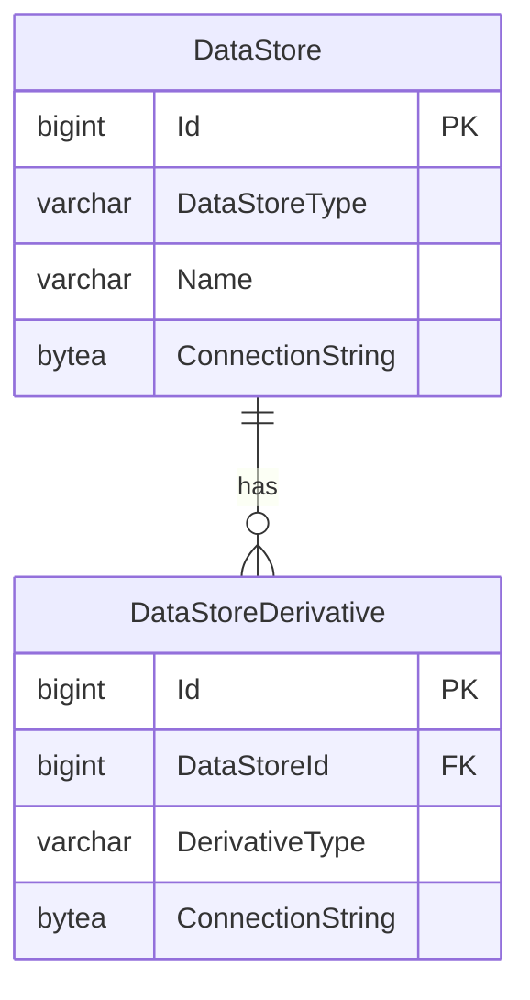

# Read Replicas

When the Ed-Fi API has both heavy read and write loads, or a deployment needs
high availability, a data store's database can be deployed as a writable primary
with a read-only replica that is kept up to date continuously. The Ed-Fi API can
send read requests to the replica to reduce the load on the primary database
server.

:::info

The replica is kept up to date by your database platform, not by the Ed-Fi API.
For SQL Server, this functionality is provided through SQL Server Always On
availability groups (see [What is an Always On availability
group?](https://learn.microsoft.com/en-us/sql/database-engine/availability-groups/windows/overview-of-always-on-availability-groups-sql-server)).
For PostgreSQL, the options available depend on your cloud host or environment
(see [High Availability, Load Balancing, and
Replication](https://www.postgresql.org/docs/current/high-availability.html) in
the PostgreSQL documentation).

:::

## API Configuration

The Ed-Fi API identifies a read replica by a data store derivative with a
`derivativeType` of `ReadReplica`. Register it in the Configuration Service with
`POST /v3/dataStoreDerivatives/`, giving the data store it belongs to and the
replica's connection string:

```json
{
  "dataStoreId": 1,
  "derivativeType": "ReadReplica",
  "connectionString": "Server=AGListener;Database=EdFi_Api;User ID=edfi;Password=<password>;Encrypt=True;ApplicationIntent=ReadOnly"
}
```

Each data store can have at most one read replica. The replica's connection
string is stored encrypted, like the primary database connection string. If you
delete the data store in the Configuration Service, its read replica
registration is deleted with it.

For SQL Server, note the addition of `ApplicationIntent=ReadOnly`, which directs
the connection to a readable secondary replica of an availability group.



## Request Routing

When a data store has a read replica, the Ed-Fi API decides which database to
use for each request. API clients don't need to change anything, and the host
doesn't configure routing for individual resources or endpoints.

- **Read requests use the read replica.** This includes `GET` requests for a
  single resource or a collection, `/partitions` requests, and the change query
  `/deletes`, `/keyChanges`, and `availableChangeVersions` requests.
- **Write requests use the primary database.** This includes `POST`, `PUT`, and
  `DELETE` requests.
- **A snapshot takes precedence.** A read request with the `Use-Snapshot: true`
  header is served from the data store's snapshot instead of the read replica;
  see [Changed Record Queries](./changed-record-queries.md).

:::caution

The Ed-Fi API falls back to the primary database only when a read replica isn't
configured, has an empty connection string, or has a connection string that
can't be decrypted. A configured read replica that can't be reached isn't
replaced by the primary: read requests fail until the replica is available
again.

:::

The Ed-Fi API checks each read replica the first time a request is routed to
it, the same way it checks the primary: the replica must be provisioned with the
same effective schema. Requests routed to a replica with a different schema get
a `503 Service Unavailable` response.

Because a read replica can lag slightly behind the primary database, a client
that writes a record and immediately reads it back might not see the change yet.
