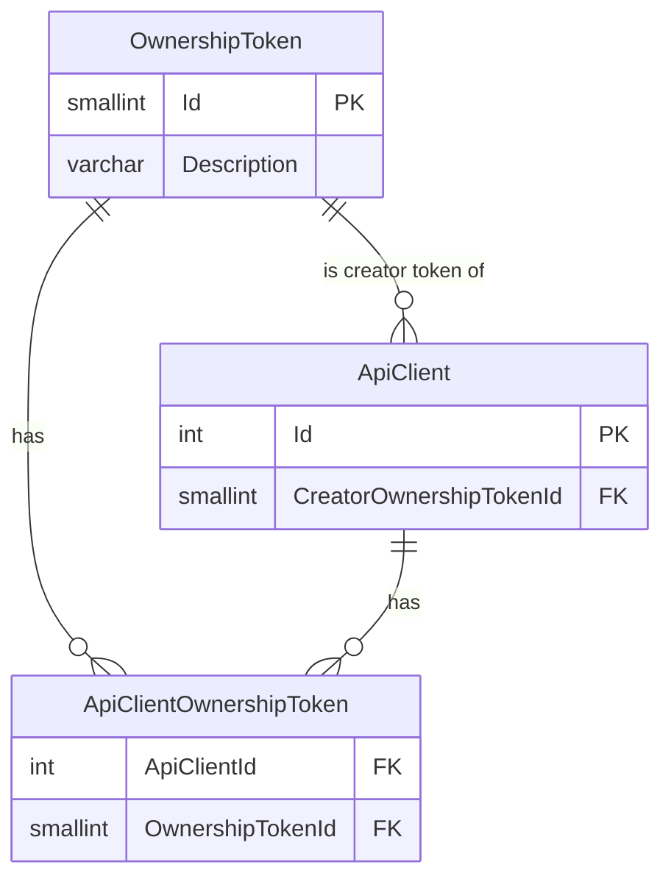

# Ownership-Based Authorization

The Ed-Fi API primarily uses relationship-based authorization strategies based
on education organizations. Ownership-based authorization adds an optional,
additional level of authorization for scenarios that need more granular access
control. Refer to [API Claim Sets & Resources](./api-claim-sets-resources.md)
for details on the available authorization strategies. This page covers the
essentials for platform hosts to set up and manage ownership-based
authorization.

## How Ownership-Based Authorization Works

Each record the Ed-Fi API stores can carry the _ownership token_ of the API
client that created it. Each API client can have:

- A **creator token**, which is stamped on every record the client creates.
  The creator token is optional: records created by a client without one have
  no ownership token. See [Records Without an
  Owner](#records-without-an-owner).
- A list of **ownership tokens**, which identifies the records the client
  "owns" and can read and change under the `OwnershipBased` authorization
  strategy.

When a claim set uses the `OwnershipBased` strategy for a resource and action,
the Ed-Fi API allows a request only if the record's ownership token is in the
API client's list of ownership tokens. For collection requests, records owned by
others are left out of the results.

Ownership-based authorization is typically used _in conjunction with_
relationship-based authorization, for example where students from several LEAs
attend the same private school for special education services. When both are
configured for a resource and action, both must pass: relationship-based
strategies are combined with each other using OR, and the `OwnershipBased`
strategy is combined with them using AND. The relationship check confirms that
the caller's education organization has a path to the record, and the ownership
check then limits access to the records the caller owns.

:::info

Unlike the Ed-Fi ODS/API, Ed-Fi API v8 has no feature flag and needs no extra
database scripts for ownership-based authorization. Every record created by an
API client with a creator token is stamped with that token, whether or not any
claim set uses the `OwnershipBased` strategy.

:::

The steps to set up ownership-based authorization are:

1. [Set up security metadata](#setting-up-security-metadata) so that a claim
   set uses the `OwnershipBased` strategy.
1. [Configure the API clients](#configuring-the-api-clients) with ownership
   tokens.
1. [Verify the setup](#verifying-a-successful-setup).

## Setting up Security Metadata

Add the `OwnershipBased` strategy to the resource claims and actions it should
apply to, usually as a claim set authorization strategy override alongside the
relationship-based strategy. For example, to let several vendors read each
other's data but allow only the creator to update or delete it, override the
Update and Delete actions for the vendors' claim set with both
`RelationshipsWithEdOrgsAndPeople` and `OwnershipBased`. See [Claim Set
Authorization Strategy
Overrides](../../how-to-guides/how-to-create-and-manage-api-security-metadata.mdx#claim-set-authorization-strategy-overrides)
for the full example.

Assign the claim set to the applications whose API clients should be
authorized this way.

## Configuring the API Clients

Ownership tokens are managed through the Configuration Service API. Requests
need a Configuration Service bearer token: write operations require the
`edfi_admin_api/full_access` scope, and `GET` operations also accept
`edfi_admin_api/readonly_access`. See [Runtime Upload via Configuration
Service](../../how-to-guides/how-to-create-and-manage-api-security-metadata.mdx#runtime-upload-via-configuration-service)
for an example of obtaining a token.

In a multi-tenant deployment, tokens belong to a tenant and can only be
assigned to API clients in the same tenant. Every request must include the
[`Tenant` header](../configuration/single-and-multi-tenant-configuration.md)
with the tenant name, for example `Tenant: tenant1`. Requests without it fail
with `400 Bad Request`.

1. **Create an ownership token** for each API client, or for each group of API
   clients that should share ownership, with `POST /v3/ownershipTokens/`. The
   `201 Created` response body includes the new token's `id` and
   `description`.

   ```json
   {
     "description": "Vendor A ownership token"
   }
   ```

   The description is required and can be up to 50 characters long.

1. **Assign the tokens to the API client** with
   `PUT /v3/apiClients/{id}/ownership`, which replaces the client's ownership
   configuration:

   ```json
   {
     "apiClientId": 5,
     "creatorOwnershipTokenId": 1,
     "ownershipTokenIds": [1]
   }
   ```

   - `apiClientId` must equal the `{id}` in the URL.
   - `creatorOwnershipTokenId` is the token stamped on records the client
     creates.
   - `ownershipTokenIds` lists the tokens of the records the client can access,
     up to 1,999 tokens.

   Every token must exist in the API client's tenant. If any token doesn't
   exist or belongs to another tenant, the request fails with `409 Conflict`
   and the client's previous configuration is kept.

:::warning

The creator token isn't added to `ownershipTokenIds` automatically. Include it
in `ownershipTokenIds` if the API client needs to access its records through
actions that use the `OwnershipBased` strategy.

When the Create action itself uses the `OwnershipBased` strategy, the API client
also needs a correctly configured creator token to create records:

- If the client has no creator token, creates are denied with the
  `ownership-uninitialized` type.
- If its creator token isn't in its `ownershipTokenIds`, creates are denied
  with the `ownership-mismatch` type.

:::

To see an API client's current configuration, use
`GET /v3/apiClients/{id}/ownership`. Ownership tokens can be listed with
`GET /v3/ownershipTokens/` and renamed with `PUT /v3/ownershipTokens/{id}`,
whose body must include the token's `id`, matching the URL, as well as its
`description`. There is no endpoint to delete an ownership token.

The 1,999-token limit is enforced by the Configuration Service. The Ed-Fi API
also checks it: if an API client somehow has 2,000 or more tokens, for example
because the Configuration Service database was changed directly, the Ed-Fi API
rejects the client's configuration and all of its requests fail with
`503 Service Unavailable`, whether or not they use the `OwnershipBased`
strategy.

### When Changes Take Effect

The Ed-Fi API caches each API client's ownership configuration for the period
set by `CacheSettings:ApplicationContextCacheExpirationSeconds`, which defaults
to 600 seconds (10 minutes). A change to an API client's tokens can take that
long to take effect. Restarting the Ed-Fi API applies it immediately.

## Transferring Ownership to Another API Client

Records don't need to change when another API client takes over from the one
that created them, for example when a district replaces a vendor. To hand over
the records:

1. **Give the new client the previous client's tokens.** Because
   `PUT /v3/apiClients/{id}/ownership` replaces the whole configuration, the
   new client's `ownershipTokenIds` must list both its existing tokens and the
   previous client's tokens. Sending only the previous client's tokens removes
   the new client's own. To have the new client keep stamping the same token
   on new records, also set it as the new client's `creatorOwnershipTokenId`.
1. **Retire the previous client.** Delete it with
   `DELETE /v3/apiClients/{id}`. To keep the client but remove its access
   through actions that use the `OwnershipBased` strategy, update its
   ownership with an empty `ownershipTokenIds` list and no
   `creatorOwnershipTokenId`:

   ```json
   {
     "apiClientId": 4,
     "ownershipTokenIds": []
   }
   ```

   The client can still access the records through actions that use other
   strategies. Records it creates afterward have no owner, and if the Create
   action uses the `OwnershipBased` strategy, its creates are denied with the
   `ownership-uninitialized` type.

1. **Wait for the change to take effect.** The previous client can keep
   accessing the records for as long as the Ed-Fi API caches its configuration.
   See [When Changes Take Effect](#when-changes-take-effect). Don't treat the
   handover as complete until the cache period has passed or the Ed-Fi API has
   been restarted.

## Records Without an Owner

:::caution

A record is stamped only if its creator had a creator token at the time it was
created. Records created by an API client without a creator token have no owner,
and can never be accessed through the `OwnershipBased` strategy. A request for
such a record gets a `403 Forbidden` response, and collection requests leave it
out.

Assign creator tokens to API clients before they load data that ownership-based
authorization should apply to. The Ed-Fi API doesn't assign owners to existing
records.

:::

Ownership-based authorization applies to descriptors in the same way as to
other resources.

## Verifying a Successful Setup

To verify the setup, use Swagger UI or another API client to request records
under a resource and action that use the `OwnershipBased` strategy. Use a
caller that passes the other authorization strategies for the resource and
action, such as the relationship-based and namespace-based checks. Otherwise,
the request can be denied by one of those strategies, and the response won't
show the ownership error types below.

- A `GET` request for a single record that the caller owns returns
  `200 OK`.
- A `GET` request for a single record that the caller doesn't own returns
  `403 Forbidden` with the type
  `urn:ed-fi:api:security:authorization:ownership:access-denied:ownership-mismatch`.
- A record with no owner returns `403 Forbidden` with the type
  `urn:ed-fi:api:security:authorization:ownership:invalid-data:ownership-uninitialized`.
  The same type is returned when a client without a creator token tries to
  create a record and the Create action uses the `OwnershipBased` strategy.
- A collection `GET` request returns only the records the caller owns.

## Technical Details

The Configuration Service database stores the ownership tokens and their
assignment to API clients:



In the Ed-Fi API database, each record's ownership token is stored in the
`CreatedByOwnershipTokenId` column of `dms.Document`. The Ed-Fi API reads an API
client's tokens from the Configuration Service; they aren't included in the
client's access token.
