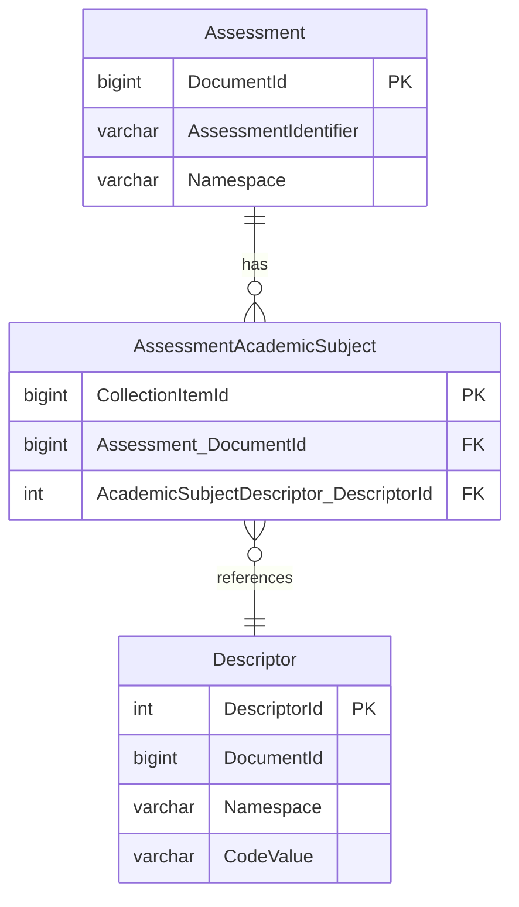

# Authorizing Requests Using Custom Database Views

The relationship-based authorization strategies in the Ed-Fi API are oriented
around an API client's education organization claims: the education
organization hierarchy, and the "primary associations" that connect students,
staff, and contacts to education organizations (such as student enrollment or
staff employment). When applied, these strategies allow access to all students
enrolled in an education organization in the API client's claims, the contacts
of those students, and the staff employed or assigned to those education
organizations.

Some use cases need narrower rules, such as limiting access to students based on
their enrollment in specific courses or grade levels. The Ed-Fi API supports
these through _custom view-based authorization strategies_. A custom view-based
strategy only requires a database view in the Ed-Fi API database and an entry
in the security metadata. No code changes, recompilation, or API restarts are
needed.

Using this capability, you could create authorization strategies that limit an
API client's access to groups of students such as:

- Students enrolled in CTE courses
- Students in the Gifted and Talented program
- Students in preschool or early childhood education

Custom views are not limited to students. Any Ed-Fi or extension resource can be
the basis for authorization. For example:

- `AssessmentWithReadingInTheIdentifier` could limit access to assessment data
  (assessment metadata or student assessment results) to assessments whose
  `assessmentIdentifier` contains "Reading".
- `TransportationTypeDescriptorWithABus` could limit access to student
  transportation items to those with a transportation type whose code value
  contains "Bus".

The approach is flexible, but it requires strict conventions for the
authorization strategy names and the matching database views. This article
describes those conventions. For a worked example, see [How To: Use Custom
View-Based Authorization](../how-to-guides/how-to-use-custom-view-based-authorization.mdx).

:::info

If you're moving custom views from the Ed-Fi ODS/API, rewrite them for the Ed-Fi
API v8 database. ODS/API views return the basis entity's primary key columns,
such as `StudentUSI`. Ed-Fi API v8 views must return the basis resource's
`DocumentId` instead, and the tables and columns they query are different. On
PostgreSQL, the view name must also be quoted (see [Name the
View](#name-the-view)).

:::

## How Custom View-Based Strategies Work

When a claim set's security metadata names an authorization strategy that isn't
one of the built-in strategies, the Ed-Fi API treats it as a custom view-based
strategy:

1. It finds the _basis resource_ in the strategy name. The name follows the
   pattern `{BasisResource}With{Description}`, so
   `StudentWithCTECourseEnrollments` has the basis resource `Student`.
1. It finds the path from the resource being authorized to the basis resource,
   through the resource's references.
1. It checks that the basis resource's `DocumentId` for the item is in the view
   `auth.{StrategyName}`.

Custom view-based strategies are combined with the other strategies using AND
semantics. They act as additional filters rather than new ways to relate
education organizations and people, so you can use them alone or together with a
relationship-based strategy to further restrict access. When several strategies
apply to the same request:

- Custom view-based and `NamespaceBased` strategies run in the order they're
  listed in the claim set's strategies for the resource, and all of them must
  pass.
- `OwnershipBased` always runs last of these.
- Relationship-based strategies run after the others. They're combined with
  each other using OR semantics.

When more than one custom view-based strategy applies, an item must be in every
view.

## Step 1: Identify the Basis Resource

A custom view-based strategy starts with a basis resource. This is the resource
whose `DocumentId` the view returns, and that the resources being authorized
must reference. Any Ed-Fi or extension resource can be used, including
descriptors and education organizations.

For this example, let's build a strategy based on `Assessment` that authorizes
access to resources that reference an assessment, filtering them to assessments
with the academic subject "Mathematics".

## Step 2: Create the Database View

### Name the View

The view's name and the authorization strategy's name must be the same, and must
follow this convention:

`{BasisResource}With{HintPhrase}`

- The first part is the basis resource's name, such as `Assessment`.
- The second part is the literal text `With`. It's case-sensitive.
- The final part is a title-cased hint phrase, described below.

The Ed-Fi API reads every `With` in the name and chooses the longest resource
name that the strategy name starts with. If an extension has a resource with the
same name as an Ed-Fi resource, the Ed-Fi resource is used.

The Ed-Fi API looks for the view in the `auth` schema and matches its name
_case-sensitively_ on both database engines. On PostgreSQL, quote the view name
when you create it. Without quotes, PostgreSQL stores the name in lowercase and
the Ed-Fi API doesn't find the view:

```sql
-- Found by the Ed-Fi API
CREATE VIEW "auth"."AssessmentWithAnAcademicSubjectOfMathematics" AS ...

-- Not found: stored as auth.assessmentwithanacademicsubjectofmathematics
CREATE VIEW auth.AssessmentWithAnAcademicSubjectOfMathematics AS ...
```

Names are also limited by the database engine: PostgreSQL identifiers are at most
63 bytes long, and SQL Server identifiers at most 128 characters.

#### The Hint Phrase

When a request fails custom view-based authorization, the Ed-Fi API returns a
problem details response with a hint about how to fix it. Because a custom view
has no other metadata, the hint is built from the strategy name:

- The name is split into words at each capital letter, keeping acronyms such as
  "CTE" together.
- Common articles, prepositions, and conjunctions (such as "with", "a", "of",
  "the", and "or") are made lowercase.
- "You may need a" (or "an") is added at the start.

For example, a strategy named `StudentWithCTECourseEnrollments` produces the
hint "You may need a Student with CTE Course Enrollments." Choose a hint phrase
that completes the sentence "You may need a Student with…".

:::info

Using the word "a" right before an acronym makes the result ambiguous. For
example, `StudentWithACTECourseEnrollment` produces "You may need a Student with
ACTE Course Enrollment" rather than "…with a CTE Course Enrollment". Use a
plural noun instead to avoid the "a".

:::

### What the View Must Return

The view must:

- Be in the `auth` schema, with the same name as the authorization strategy.
- Be a view. On PostgreSQL, a materialized view also works. A table isn't
  accepted.
- Have a `DocumentId` column, named exactly that, with the type `bigint`,
  containing the basis resource's `DocumentId` values. Other types, such as
  `integer` or text, aren't accepted. Other columns are ignored.

For a descriptor basis resource, return the descriptor's `DocumentId` from
`dms.Descriptor`, not its `DescriptorId`.

Don't use `SELECT DISTINCT`. The Ed-Fi API checks membership with an `IN`
condition, so duplicate rows don't change the result, and on PostgreSQL
`DISTINCT` prevents the database from optimizing the check.

### Plan the Query

The view's query uses the Ed-Fi API's relational tables. In those tables:

- Each resource has a table named after it, in a schema for its project (such as
  `edfi`), with a `bigint` `DocumentId` primary key.
- A reference to another resource is stored as a `{Reference}_DocumentId`
  column, such as `Assessment_DocumentId` or `Student_DocumentId`.
- A descriptor value is stored as a `{Descriptor}_DescriptorId` column, which
  joins to `dms.Descriptor` on `DescriptorId`. `dms.Descriptor` holds each
  descriptor's `Namespace`, `CodeValue`, and `DocumentId`.
- Collections, such as an assessment's academic subjects, are stored in their
  own tables, with a column referring to their parent's `DocumentId`.

Table and column names come from the data standard and extensions you deploy,
so check the names against your own database.

In this example, an assessment's academic subjects are stored in the
`edfi.AssessmentAcademicSubject` collection table:



Since `Assessment_DocumentId` is already on the collection table, the view
doesn't need to query `edfi.Assessment` itself. It does need to join to
`dms.Descriptor` to filter on the academic subject.

### Create the View

With the name and query decided, create the view. The `auth` schema is created
when the database is provisioned.

PostgreSQL:

```sql
CREATE OR REPLACE VIEW "auth"."AssessmentWithAnAcademicSubjectOfMathematics" AS
    SELECT aas."Assessment_DocumentId" AS "DocumentId"
    FROM "edfi"."AssessmentAcademicSubject" aas
        INNER JOIN "dms"."Descriptor" d
            ON d."DescriptorId" = aas."AcademicSubjectDescriptor_DescriptorId"
    WHERE d."Namespace" = 'uri://ed-fi.org/AcademicSubjectDescriptor'
        AND d."CodeValue" = 'Mathematics';
```

SQL Server:

```sql
CREATE OR ALTER VIEW [auth].[AssessmentWithAnAcademicSubjectOfMathematics] AS
    SELECT aas.[Assessment_DocumentId] AS [DocumentId]
    FROM [edfi].[AssessmentAcademicSubject] aas
        INNER JOIN [dms].[Descriptor] d
            ON d.[DescriptorId] = aas.[AcademicSubjectDescriptor_DescriptorId]
    WHERE d.[Namespace] = N'uri://ed-fi.org/AcademicSubjectDescriptor'
        AND d.[CodeValue] = N'Mathematics';
GO
```

## Step 3: Define the Security Metadata

Use the strategy name like any other authorization strategy, usually as a claim
set authorization strategy override. Because overrides replace a resource's
strategies, list the relationship-based strategy as well if the resource should
still be authorized by relationships:

```json
"authorizationStrategyOverrides": [
  { "name": "RelationshipsWithEdOrgsAndPeople" },
  { "name": "AssessmentWithAnAcademicSubjectOfMathematics" }
]
```

Add the override through the claims document, not the claim set endpoints. The
claim set import and override endpoints (`POST /v3/claimSets/import` and
`.../overrideAuthorizationStrategy`) accept only the built-in authorization
strategies, and reject a custom strategy name. You can add the override:

- In a non-production environment, by editing and uploading the claims document
  with `POST /management/upload-claims`.
- At deployment time, in the `Claims.json` used by the Filesystem loading mode
  or in a claims fragment.

See [How To: Create and Manage API Security Metadata using Declarative Security
Policies](../how-to-guides/how-to-create-and-manage-api-security-metadata.mdx)
for both approaches, including when deployment-time claims are loaded.

## How Requests Are Authorized

A custom view-based strategy applies to every action it's configured for:

- **Read, many items.** Items whose basis resource isn't in the view are left
  out of the results. No error is returned, so an empty view returns an empty
  page.
- **Read, one item, and Delete.** The stored item is checked. If it isn't in
  the view, the request fails with `403 Forbidden`.
- **Update.** The stored item is checked first, then the new values in the
  request.
- **Create.** The new values in the request are checked. A `POST` that matches
  an existing item is authorized as an Update. If the basis resource is the
  resource being created (for example, `StudentWithCTECourseEnrollments` on
  Create for `Student`), the create is always denied, because a new item can't
  be in the view yet.
- **ReadChanges.** The strategy also applies to the `/deletes` and
  `/keyChanges` change query endpoints. See [Change
  Queries](#change-queries).

A denied request returns `403 Forbidden` with the type
`urn:ed-fi:api:security:authorization` and the hint from the strategy name:

```json
{
  "detail": "Access to the requested data could not be authorized. Hint: You may need a Student with CTE Course Enrollments.",
  "type": "urn:ed-fi:api:security:authorization",
  "title": "Authorization Denied",
  "status": 403,
  "errors": [
    "The caller is not authorized to perform the requested operation on the item based on the existing value of the 'StudentUniqueId' property of the item."
  ]
}
```

If the reference to the basis resource is empty:

- A read or delete of a stored item without that reference fails with `403
  Forbidden` and the type
  `urn:ed-fi:api:security:authorization:custom-view:invalid-data:element-uninitialized`.
- A create or update without that reference fails with `403 Forbidden` and the
  type `urn:ed-fi:api:security:authorization:custom-view:access-denied:element-required`.
- A read of many items leaves those items out.

Changes to the data in the view take effect immediately. For example, when a
student enrolls in a CTE course, the next request for that student is
authorized.

### Change Queries

On `/deletes` and `/keyChanges`, the Ed-Fi API authorizes each deleted or
changed item using the values recorded when it was deleted or changed. These
records only keep a resource's identifying values and the values used for
authorization, so the first reference on the path to the basis resource must be
part of the resource's identity or one of those authorization values. If it
isn't, change query requests for that resource fail with a security
configuration error.

If the basis resource itself may have been deleted, end the strategy name with
`IncludingDeletes`, for example `SchoolWithAlternativeTypeIncludingDeletes`.
The Ed-Fi API then also checks the basis resource's deleted items, so deleted
items that referred to it can still be authorized. Without the suffix, only
basis items that still exist are checked. The suffix has no effect on other
requests, and the view's name still includes it.

## When Changes Take Effect

The Ed-Fi API checks each custom view when a request uses it, not at startup.
You can create or fix a view at any time without restarting the Ed-Fi API.

A new or changed authorization strategy in the security metadata takes effect
when the Ed-Fi API next refreshes its claim set cache. By default, the cache
expires after 10 minutes, set by `CacheSettings:ClaimSetsCacheExpirationSeconds`.
Restarting the Ed-Fi API applies the change immediately.

## Configuration Errors

Mistakes in a custom view or its strategy name cause server errors rather than
authorization failures, so that a broken configuration isn't mistaken for an
empty result. Check the Ed-Fi API log for details.

- **A missing or invalid view.** If the view doesn't exist, isn't a view, or has
  no `bigint` `DocumentId` column, requests fail with `500 Internal Server Error`
  and the type `urn:ed-fi:api:system`. This includes a PostgreSQL view created
  without quotes around its name.
- **An unknown basis resource.** If the strategy name has no `With`, or no
  resource name matches the part before it, requests fail with `500 Internal
  Server Error`, the type `urn:ed-fi:api:system:configuration:security`, and
  the title "Security Configuration Error".
- **No path to the basis resource.** If the resource being authorized doesn't
  reference the basis resource, directly or through other references, requests
  fail with the same security configuration error. The log message names the
  resource, the strategy, and the basis resource.

A view is only checked when the strategies before it pass. For example, if
`NamespaceBased` is listed before the view and denies a request, the response is
a `403 Forbidden`. Since the view isn't checked, a missing or invalid view
doesn't cause a `500` for that request.
