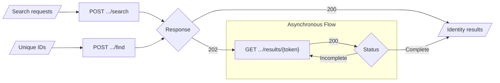

# Identities API

The Ed-Fi Identities API provides a standard interface to an optional identity
system, such as a state or district unique ID system. It lets clients create,
look up and search for person identities without knowing which identity system
the platform host uses. Because the identity system, and each of its
operations, is optional, coordinate with your platform host before you use
these endpoints.

The Ed-Fi API provides the endpoints, authentication, tenant checks and error
responses. The operations themselves are performed by an identity provider
plugin that the platform host supplies. The Ed-Fi API ships with no provider,
and the endpoints are turned off by default. See
[Unique ID System Integration](./unique-id-system-integration.md) for how the
Identities API fits with unique ID validation.

## Operations

The Identities API is available at `/identity/v2/identities` and supports these
operations:

| Operation | Method and route | Request body | Result |
| --- | --- | --- | --- |
| Create | `POST /identity/v2/identities` | A JSON object | `200` with the new unique ID as a JSON string. |
| Get by unique ID | `GET /identity/v2/identities/{id}` | None | `200` with one identity. |
| Find | `POST /identity/v2/identities/find` | A JSON array of unique IDs | `200` with the results, or `202` with a `Location` header to poll. |
| Search | `POST /identity/v2/identities/search` | A JSON array of search requests | `200` with the results, or `202` with a `Location` header to poll. |
| Results | `GET /identity/v2/identities/results/{token}` | None | `200` with the results of an earlier find or search, complete or not yet complete. |

On a multi-tenant host, the tenant comes before the route, for example
`/{tenant}/identity/v2/identities`. Any configured route qualifiers follow the
tenant, as they do for the data routes.

A platform host's identity provider may not support every operation. An
operation the provider doesn't support returns `404` with the problem type
`urn:ed-fi:api:identities:operation-not-supported`.

The Ed-Fi API serves the OpenAPI specification for these endpoints at
`/metadata/identity/v2/swagger.json` when the Identities API is turned on.

### Authorization

Clients call the Identities API with the same bearer token they use for the
rest of the Ed-Fi API. Their claim set must grant the identity service claim,
`http://ed-fi.org/identity/claims/services/identity`: `Create` for creating an
identity, and `Read` for every other operation. A client without the required
action receives `403`. See
[Service Claims](../platform-dev-guide/security/api-claim-sets-resources.md#service-claims).

The identity provider can apply its own access rules as well. A request it
doesn't allow is answered as `404`, without saying whether the person exists.

### Request and Response Bodies

Property names are in Pascal case. A create or search request describes a
person:

```json
{
  "FirstName": "Maria",
  "MiddleName": null,
  "LastSurname": "Lopez",
  "GenerationCodeSuffix": null,
  "SexType": "Female",
  "BirthDate": "2015-04-12T00:00:00",
  "BirthOrder": null,
  "BirthLocation": {
    "City": "Austin",
    "StateAbbreviation": "TX",
    "InternationalProvince": null,
    "Country": "US"
  }
}
```

Every property is optional; send `null` or leave out a value you don't know.
The identity provider decides which values it needs, and rejects a request that
doesn't have enough information with `400`. A find request is an array of unique
IDs, such as `["604822", "604823"]`, and a search request is an array of
objects like the one above.

Get by unique ID returns one identity. Find, search and results return a search
response, with one entry in `SearchResponses` for each item in the request, in
the same order:

```json
{
  "Status": "Complete",
  "SearchResponses": [
    {
      "Responses": [
        {
          "UniqueId": "604822",
          "Score": 96,
          "FirstName": "Maria",
          "MiddleName": null,
          "LastSurname": "Lopez",
          "GenerationCodeSuffix": null,
          "SexType": "Female",
          "BirthDate": "2015-04-12T00:00:00",
          "BirthOrder": null,
          "BirthLocation": {
            "City": "Austin",
            "StateAbbreviation": "TX",
            "InternationalProvince": null,
            "Country": "US"
          }
        }
      ]
    }
  ]
}
```

An empty `Responses` array means no match for that item. A find returns zero or
one identity for each unique ID. A search can return several possible matches,
each with a `Score` from 0 to 100 that shows how well it matches; 100 is a
perfect match. The meaning of a score between those values depends on the
identity system. Outside a search, `Score` is `null`.

The properties of an identity are as follows:

| Property | Description |
| --- | --- |
| `UniqueId` | The person's unique ID. Returned only, never sent. |
| `Score` | How well a search result matches the request, from 0 to 100. Returned only, and `null` outside a search. |
| `LastSurname` | All the family names associated with the person, separated by spaces. In some traditions, this includes both parents' surnames. |
| `FirstName` | The person's given first name. |
| `MiddleName` | The person's given middle name, if available. |
| `GenerationCodeSuffix` | The suffix applied to the person's name, such as Jr. or III. |
| `SexType` | The person's sex. |
| `BirthDate` | The date the person was born. |
| `BirthOrder` | The person's birth order among their siblings, if known. |
| `BirthLocation` | Where the person was born: `City`, `StateAbbreviation`, `InternationalProvince` and `Country`. |

An identity system that doesn't support one of these properties returns it as
`null`. It still returns `BirthLocation`, with `null` values inside, if it
doesn't support birth locations.

#### Additional Properties

Some identity systems use more information to tell people apart, such as school
enrollment, government-issued identity numbers or previous names. The Ed-Fi API
doesn't define these properties, because every system needs a different set.
Instead, the platform host's identity provider can accept and return its own
properties on requests, identities and `BirthLocation`. The Ed-Fi API passes
them through without inspecting them. Ask your platform host which additional
properties its provider supports.

## Synchronous and Asynchronous Find and Search

Find and search can complete immediately or later, depending on the identity
system. A client must accept either:

- **`200`** with the complete results.
- **`202 Accepted`** with no body and a `Location` header. The `Location` is the
  results URL to poll: `.../identity/v2/identities/results/{token}`, including
  the tenant and route qualifiers from the request.

Polling the results URL returns `200` with a `Status` of `Incomplete` and a
`Location` header to poll again, or `200` with a `Status` of `Complete` and the
results.

A browser-based client can read the `Location` header only if it's served from
the origin set in `Cors:SwaggerUIOrigin` (in Docker Compose,
`DMS_SWAGGER_UI_URL`). The Ed-Fi API doesn't expose the header to other origins.

The following diagram shows the flow:



**Figure 1.** Identities API workflow

This workflow keeps server resources low while the identity system performs
potentially expensive operations, and it lets each identity system work
synchronously or asynchronously, whichever suits it.

In most cases, client code should follow this pattern:

```text
result <= client.Post(queryURL, queryData)
While result.HttpStatus is 202
        or (result.HttpStatus is 200 and result.Data.Status is "Incomplete")
    wait, then result <= client.Get(result.Location)
if result.HttpStatus is 200 and result.Data.Status is "Complete"
    return result.Data
return Error condition
```

A results token is valid for a limited time that the identity system decides.
After it expires, or when another client uses it, polling returns `404`. If the
identity system reports that the find or search failed permanently, polling
returns `502` with the problem type `urn:ed-fi:api:identities:job-failed`. Stop
polling that request when you receive it.

## Error Responses

Errors are returned as `application/problem+json`. A client should use the
problem `type` to tell responses with the same status apart.

| Status | Problem `type` | Cause |
| --- | --- | --- |
| `400` | `urn:ed-fi:api:bad-request:data-validation-failed` or `urn:ed-fi:api:bad-request` | The body isn't valid JSON or isn't the right shape, or the identity provider rejected the request's properties. |
| `401` | `urn:ed-fi:api:security:authentication` | No bearer token, a token that can't be validated, or on a multi-tenant host, a client that doesn't belong to the tenant in the URL. |
| `403` | — | The client's claim set doesn't grant the identity service claim for the operation. Check the status code rather than the problem type. |
| `404` | `urn:ed-fi:api:identities:not-found` | No matching identity, an unknown or expired results token, or a request the identity provider doesn't allow. |
| `404` | `urn:ed-fi:api:identities:operation-not-supported` | The identity provider doesn't support this operation. |
| `404` | `urn:ed-fi:api:not-found` | The Identities API is turned off, or on a multi-tenant host, the tenant doesn't exist. The `detail` tells these apart. |
| `415` | `urn:ed-fi:api:unsupported-media-type` | A `POST` with a `Content-Type` other than `application/json` or `text/json`. |
| `429` | `urn:ed-fi:api:too-many-requests` | The Ed-Fi API's request rate limit was reached. A `Retry-After` header is included when the limit provides one. |
| `500` | `urn:ed-fi:api:identities:provider-configuration` | The identity provider couldn't be started. This is a platform configuration problem. |
| `500` | `urn:ed-fi:api:system:configuration:security` | The identity service claim's authorization strategy isn't exactly `NoFurtherAuthorizationRequired`. This is a platform configuration problem. |
| `502` | `urn:ed-fi:api:identities:upstream-failure` | The identity system couldn't complete the request. Whether a retry succeeds depends on the cause. |
| `502` | `urn:ed-fi:api:identities:job-failed` | An earlier find or search failed permanently. Stop polling. |
| `502` | `urn:ed-fi:api:identities:provider-contract-violation` | The identity provider returned an invalid answer. Retrying doesn't help; report it to the platform host. |
| `503` | `urn:ed-fi:api:service-unavailable` | The Ed-Fi API couldn't confirm the tenant, or the client's access to it, at this time. |

Every response from these endpoints carries `Cache-Control: no-store`.

## Enabling the Identities API

The platform host turns on the Identities API in three steps:

1. Deliver an identity provider plugin to the Ed-Fi API and list it in
   `Plugins:Allowed`. See
   [Plugins](../platform-dev-guide/extensibility-customization/plugins.md).
2. Set `DataManagement:IdentityManagement:Enabled` to `true`. In Docker Compose,
   set `DMS_ENABLE_IDENTITY_MANAGEMENT`. See
   [Configuration Details](../platform-dev-guide/configuration/configuration-details.mdx).
3. Grant the identity service claim to the claim sets of the clients that need
   it. Its authorization strategy must be exactly
   `NoFurtherAuthorizationRequired`, for each action you grant. With any other
   strategy, with none, or with more than one, every identity request that needs
   that action returns `500` with the problem type
   `urn:ed-fi:api:system:configuration:security`. See
   [Service Claims](../platform-dev-guide/security/api-claim-sets-resources.md#service-claims).

While `DataManagement:IdentityManagement:Enabled` is `false`, the routes don't
exist, and every request to them returns `404`. When it's `true` but no
provider plugin is installed, every operation returns `404` with the problem
type `urn:ed-fi:api:identities:operation-not-supported`.

## Identity Service Interface

An identity provider is a plugin that implements `IIdentityService` from the
`EdFi.Api.Identity` package. It wraps the platform host's identity system. Its
members are:

```csharp
IdentityCapabilities Capabilities { get; }

Task<IdentityResult> CreateAsync(
    JsonObject request, IdentityRequestContext context, CancellationToken cancellationToken);

Task<IdentityResult> GetByIdAsync(
    string uniqueId, IdentityRequestContext context, CancellationToken cancellationToken);

Task<IdentityAsyncResult> FindAsync(
    IReadOnlyList<string> uniqueIds, IdentityRequestContext context, CancellationToken cancellationToken);

Task<IdentityAsyncResult> SearchAsync(
    IReadOnlyList<JsonObject> requests, IdentityRequestContext context, CancellationToken cancellationToken);

Task<IdentityResult> ResultsAsync(
    string requestToken, IdentityRequestContext context, CancellationToken cancellationToken);
```

Each operation receives an `IdentityRequestContext` with the tenant, the route
qualifiers, the authenticated client's ID and a trace ID. Requests and responses
are JSON, so the provider can read and return additional properties without a
custom model.

### Identity Service Capabilities

`Capabilities` tells the Ed-Fi API which operations the provider supports. It
returns a combination of the `IdentityCapabilities` flags `Create`, `GetById`,
`Find`, `Search` and `Results`. The Ed-Fi API answers an operation the provider
doesn't list with `404` `operation-not-supported`, without calling the provider.
A provider that returns a results token from find or search must also support
`Results`.

It's recommended that a provider support every operation, so that clients get
a consistent Identities API, but it isn't required. A platform host's policy
might forbid creating identities, for example.

### Identity Result Status

Each operation returns a result with one of the following statuses. The Ed-Fi
API turns it into the HTTP response:

| Status | Meaning | HTTP response |
| --- | --- | --- |
| `Success` | The request was processed. Find and search return either the results or a results token. | `200`, or `202` with a `Location` for a token |
| `Incomplete` | From results only: the find or search isn't finished. | `200` with `Status` `Incomplete` and a `Location` |
| `InvalidProperties` | The request's data is invalid or insufficient. Include at least one error. | `400` |
| `NotFound` | No matching identity or results token, or the client isn't allowed this request. | `404` |
| `JobFailed` | From results only: the find or search failed permanently. | `502` `job-failed` |

When the identity system can't answer, for example because it times out, the
provider throws instead of returning a status. The Ed-Fi API logs the exception
and returns `502` `upstream-failure` without the provider's details. The Ed-Fi
API applies no timeout and no retry of its own.

### Synchronous Operations

- **Create** returns the unique ID of the new identity as a JSON string. Bulk
  creation isn't supported.
- **Get by unique ID** returns one identity.
- **Find** returns, for each unique ID, zero or one identity.
- **Search** returns, for each search request, zero or more identities, each
  with a `Score`. Limit the matches to likely ones.

### Asynchronous Find and Search

A provider can process find and search later instead of immediately. It returns
`Success` with a request token and no results, and the Ed-Fi API answers `202`
with a `Location` built from the token. When the client polls, the Ed-Fi API
calls `ResultsAsync` with the token, and the provider returns:

- `Success` with the complete results,
- `Incomplete` while the request is still running,
- `NotFound` for a token it doesn't recognize, that has expired, or that belongs
  to another client, or
- `JobFailed` when the request failed permanently.

A provider decides how long a token stays valid and documents it. It must check
that the polling client, tenant and route qualifiers match the request that
issued the token, and answer `NotFound` when they don't.

### Registering the Provider

The plugin registers its `IIdentityService` implementation with a plain `Add`,
for example:

```csharp
services.AddScoped<IIdentityService, MyIdentityService>();
```

Don't use `TryAdd`, `Replace` or `RemoveAll`. The Ed-Fi API always registers a
default provider that supports no operations, so `TryAdd` is silently skipped,
and `Replace` and `RemoveAll` fail at startup. Only one identity provider can be
installed.

A provider must also enforce its own access rules for each client, using the
client ID in `IdentityRequestContext`. The identity service claim controls
whether a client can call the Identities API at all, not which people it can
see. Answer a request the client isn't allowed with `NotFound`.

The
[Ed-Fi API Identity implementer guide](https://github.com/Ed-Fi-Alliance-OSS/Data-Management-Service/blob/main/src/dms/core/EdFi.DataManagementService.Identity/IDENTITY.md)
in the Ed-Fi API repository has the complete contract and an end-to-end sample
provider. See
[Building a Plugin](../platform-dev-guide/extensibility-customization/plugins.md#building-a-plugin)
for the rules every plugin follows.
