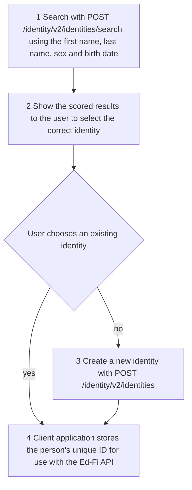

# Unique ID System Integration

:::tip

Out of the box, the Ed-Fi API does not require use of a unique ID system. Check
with your Ed-Fi API platform host to find out whether they require client
applications to integrate with a unique ID solution before you build an
integration with either of the models described below. Don't use this page's
guidance as basic instructions for building an Ed-Fi Data Standard integration.

:::

Generally speaking, a unique ID system ensures that a person has only one unique
ID for an organization, even if the person is represented in multiple roles,
such as an individual who is both a staff member and a parent at a school.

Many organizations have an existing unique ID system. The Ed-Fi API doesn't
replace it. Instead, it provides extension points for platform hosts to
integrate with their existing system, and a standardized API that clients can
use to integrate identity management into their applications.

The Ed-Fi API provides two points of integration with unique ID systems:

- **Unique ID validation** checks that the `studentUniqueId`, `staffUniqueId`
  or `contactUniqueId` a client supplies exists in the external system.
- **The [Identities API](./identities-api.md)** is an optional set of endpoints
  that clients use to create, look up and search for unique IDs for people.

In both, the Ed-Fi API provides the framework and a plugin supplied by the
platform host does the work. The Ed-Fi API ships with neither: unique ID values
aren't validated, and the Identities API is turned off. Integration work is
required to connect to an existing unique ID system. This page covers the
concepts and the steps.

## Unique ID System Integration Models

When planning an API implementation, platform hosts select the approach that
best serves their needs: an
[integrated unique ID system model](#model-1-integrated-unique-id-system-model)
(the "integrated model" below), or a
[non-integrated unique ID system model](#model-2-non-integrated-unique-id-system-model)
(the "non-integrated model").

Within the integrated model, there are two parts:
[unique ID validation](#key-integration-steps-for-unique-id-validation) and
[identity management](#key-integration-steps-for-identity-management). Support
for validation is expected at a minimum. The platform host can also choose to
support the identity management endpoints.

### Model 1. Integrated Unique ID System Model

This model suits a deployment where an external system, often a commercial
product, is the authoritative source for unique IDs and can be connected to the
Ed-Fi API. An external unique ID system always defines the unique ID for
students, staff and contacts, and clients are expected to send valid unique IDs
to the Ed-Fi API.

Distinguishing characteristics of this model include:

- Unique IDs are established outside the Ed-Fi API, by the external unique ID
  system.
- Client applications are expected to supply valid unique IDs. To do this, they
  either:
  - use the Identities API to search for identities and create new unique IDs as
    needed, or
  - follow a process defined outside the Ed-Fi API to obtain unique ID values.
- When a client creates or updates a student, staff or contact, the Ed-Fi API
  checks the unique ID against the external system automatically. Client
  applications don't define the unique ID values.

This model can support fully integrated unique ID management, but it assumes a
particular system flow, outlined below.

:::tip

See [Identities API](./identities-api.md) for more information on the optional
identity endpoints.

:::

#### Client-Side ID Lookup in the Integrated Model

When the platform host supports identity management, client applications need a
process for looking up a person's unique ID. This section describes the flow
most clients follow to look up a unique ID through the Ed-Fi API. The example
creates a new student record, but the same flow applies to staff and contact
records.

Once a client obtains a unique ID, it's expected to store the ID, so that it can
easily sync data with the platform from then on.



A description of each step follows.

- **Step 1.** Send `POST /identity/v2/identities/search` with the person's first
  name, last name, sex and birth date. The search can complete immediately or
  later; see
  [Synchronous and Asynchronous Find and Search](./identities-api.md#synchronous-and-asynchronous-find-and-search).
- **Step 2.** Show the scored results to the user to let them select the
  correct identity.
- **Step 3.** If the user indicates that no match exists, create a new identity
  with `POST /identity/v2/identities`.
- **Step 4.** Save the resulting unique ID in the client application, for use
  when sending the person's data to the Ed-Fi API.

Now that the client has a unique ID, it can use the ID when it refers to that
student.

:::info

When a client application creates a student record, the client can't retrieve
or update that student until it has established a relationship with that
student. That relationship is created by adding an entry to the
`studentSchoolAssociations` resource under an LEA to which the client
application has access. Similarly, when a client application creates a staff
record, the client can't retrieve or update that staff record until it adds an
entry to the `staffEducationOrganizationAssignmentAssociations` or
`staffEducationOrganizationEmploymentAssociations` resources under an LEA to
which the client application has access.

:::

### Model 2. Non-Integrated Unique ID System Model

This model suits platform hosts that choose not to connect an external unique ID
system. Platform hosts tell clients how to obtain or assign a unique ID outside
the Ed-Fi API. A common approach is to have clients get a unique ID from an
enterprise system and send that value to the Ed-Fi API when they create a
student, staff or contact.

Distinguishing characteristics of this model include:

- Client applications are responsible for populating the unique ID for people.
- The Ed-Fi API doesn't check incoming unique IDs against any external system.
  Unique ID values are treated as another data element, though the Ed-Fi API
  still enforces their uniqueness.

This model requires no integration work from the platform host, but it relies on
clear guidance for client application developers.

### Integration Model Comparison

The models are fundamentally different for the platform host. For a client,
the difference is whether the unique IDs it supplies are checked against an
external system. In some scenarios, the client could be responsible for
assigning the unique ID, but how that value is derived should be agreed with
the host.

In both models, the Ed-Fi API rejects a change to a person's unique ID. See
[Changing a Unique ID](#changing-a-unique-id).

## Key Integration Steps for Unique ID Validation

Unique ID validation is a plugin that the Ed-Fi API calls when a client creates
or updates a student, staff or contact. The plugin looks up the unique ID in the
external system and reports whether it exists. Ed-Fi API v8 doesn't ship a
ready-made validator. Instead, the Ed-Fi API repository includes a worked
example to build from:
[`Acme.UniqueIdValidation`](https://github.com/Ed-Fi-Alliance-OSS/Data-Management-Service/tree/v8.1.0/eng/fixtures/plugins/Acme.UniqueIdValidation).
The steps below follow that example. The
[unique ID validation how-to](https://github.com/Ed-Fi-Alliance-OSS/Data-Management-Service/blob/v8.1.0/docs/UNIQUEID-VALIDATION.md)
in the Ed-Fi API repository has the complete code, how to adapt it, and how to
move an Ed-Fi ODS/API 7.3 implementation to it.

### Implement the Validator

A unique ID validator implements `ICustomResourceValidator` from the
`EdFi.Api.CustomValidation` package. It has two members:

- **`AppliesTo`** lists the resources the validator checks. For unique ID
  validation, that's `Student`, `Staff` and `Contact` in the `Ed-Fi` project.
  The Ed-Fi API reads this list on every write, so it must be fixed and cheap to
  return.
- **`ValidateAsync`** receives the request body as a read-only `JsonNode`, along
  with the resource, the operation (POST or PUT), the tenant and route
  qualifiers, a trace ID and a cancellation token. It returns an empty list when
  the unique ID is valid, or a list of failures.

```csharp
public sealed class UniqueIdValidator : ICustomResourceValidator
{
    public const string HttpClientName = "Acme.UniqueIdValidation";

    private readonly IHttpClientFactory _httpClientFactory;

    public UniqueIdValidator(IHttpClientFactory httpClientFactory)
    {
        _httpClientFactory = httpClientFactory;
    }

    public IReadOnlyList<ValidatedResource> AppliesTo { get; } =
    [
        new ValidatedResource("Ed-Fi", "Student"),
        new ValidatedResource("Ed-Fi", "Staff"),
        new ValidatedResource("Ed-Fi", "Contact"),
    ];

    public async Task<IReadOnlyList<CustomValidationFailure>> ValidateAsync(
        JsonNode document,
        ValidatedResourceInfo resource,
        CustomValidationOperation operation,
        ValidationScope scope,
        string traceId,
        CancellationToken cancellationToken
    )
    {
        cancellationToken.ThrowIfCancellationRequested();

        // studentUniqueId, staffUniqueId or contactUniqueId
        string member = MemberFor(resource.ResourceName);

        if (
            document[member] is not JsonValue submitted
            || !submitted.TryGetValue(out string? uniqueId)
            || uniqueId.Length == 0
        )
        {
            return NoFailures;
        }

        HttpClient httpClient = _httpClientFactory.CreateClient(HttpClientName);
        string requestUri = $"{resource.ResourceName}/{Uri.EscapeDataString(uniqueId)}";

        using HttpResponseMessage response = await httpClient.GetAsync(
            requestUri,
            HttpCompletionOption.ResponseHeadersRead,
            cancellationToken
        );

        if (response.StatusCode == HttpStatusCode.OK)
        {
            return NoFailures;
        }

        if (response.StatusCode == HttpStatusCode.NotFound)
        {
            return
            [
                new CustomValidationFailure.OnPath(
                    $"$.{member}",
                    $"The {resource.ResourceName} unique id was not found in the external unique id system."
                ),
            ];
        }

        // Any other answer is a fault in the external system, not a fact about
        // the request, so throw instead of reporting a validation failure.
        throw new HttpRequestException(
            $"The external unique id system answered {(int)response.StatusCode}.",
            inner: null,
            statusCode: response.StatusCode
        );
    }

    private static string MemberFor(string resourceName) =>
        $"{char.ToLowerInvariant(resourceName[0])}{resourceName[1..]}UniqueId";

    private static readonly IReadOnlyList<CustomValidationFailure> NoFailures = [];
}
```

This example calls `GET {BaseAddress}/{ResourceName}/{uniqueId}` on the external
system, and treats `200` as "exists" and `404` as "not found". Change how
`ValidateAsync` builds its request to match your system. Nothing else about the
contract depends on that shape. The full example also handles a few more edge
cases than this excerpt.

When you write your own validator, keep these rules in mind:

- **Return an empty list for a valid unique ID, never `null`.** The Ed-Fi API
  treats `null` as an error, and the write fails with `500`.
- **Report a missing unique ID as a failure on its property**, with
  `CustomValidationFailure.OnPath` and a path such as `$.studentUniqueId`.
- **Throw when the external system can't answer.** A timeout, a transport error
  or an unexpected response isn't a fact about the client's data, so it
  shouldn't be reported as a validation failure.
- **Don't echo the submitted value in the failure message.** The message is
  returned to the client and may be logged.
- **Add caching yourself if you need it.** The Ed-Fi API doesn't cache
  validation results. A cache shortens writes, but it can accept a unique ID
  that the external system has since retired.

### Register the Validator in a Plugin

The validator is delivered in a plugin. The plugin class registers the
validator with `TryAddEnumerable`, as a transient service. The Ed-Fi API refuses
to start if a validator is registered any other way. This example also binds
its settings and configures the `HttpClient` that calls the external system:

```csharp
public sealed class UniqueIdValidationPlugin : EdFiApiPlugin
{
    public override string Name => "Acme.UniqueIdValidation";

    public override void ContributeServices(
        IServiceCollection services,
        IConfiguration configuration
    )
    {
        services.Configure<UniqueIdValidationOptions>(
            configuration.GetSection("UniqueIdValidation")
        );

        services
            .AddHttpClient(UniqueIdValidator.HttpClientName)
            .ConfigureHttpClient(
                (serviceProvider, client) =>
                {
                    UniqueIdValidationOptions options = serviceProvider
                        .GetRequiredService<IOptions<UniqueIdValidationOptions>>()
                        .Value;
                    client.BaseAddress = options.BaseAddress;
                    client.Timeout = options.Timeout;
                }
            );

        services.TryAddEnumerable(
            ServiceDescriptor.Transient<ICustomResourceValidator, UniqueIdValidator>()
        );
    }
}
```

The full example also checks that `BaseAddress` is an absolute `http` or
`https` address, adds a missing trailing slash to it (without one, `HttpClient`
replaces the last path segment instead of appending to it), turns off redirects
so that a redirect to a sign-in page can't read as "exists", and removes the
`HttpClient` loggers so that unique IDs don't reach the logs. Keep those
safeguards in your own plugin.

### Enabling Unique ID Validation

There's no separate feature setting. Unique ID validation is on when the plugin
is in the Ed-Fi API's plugin directory and its name is listed in
`Plugins:Allowed`. See [Plugins](../platform-dev-guide/extensibility-customization/plugins.md)
for how to publish a plugin, deliver it to a container and add it to the
allowlist.

The example plugin reads two settings of its own:

| Setting | Default | Description |
| --- | --- | --- |
| `UniqueIdValidation:BaseAddress` | None | The external system's lookup address, an absolute `http` or `https` URL. If it isn't set, every write to a student, staff or contact fails with `500`. |
| `UniqueIdValidation:Timeout` | `00:00:05` | How long a lookup can take. The Ed-Fi API applies no timeout of its own. |

For example, as environment variables:

```text
Plugins__Allowed=Acme.UniqueIdValidation
UniqueIdValidation__BaseAddress=https://identity.example.org/uniqueids/
UniqueIdValidation__Timeout=00:00:05
```

### What a Client Sees

The validator runs on `POST` and `PUT` requests for students, staff and
contacts. It doesn't run on reads or deletes, and it doesn't check unique IDs
in references from other resources, such as a `studentSchoolAssociation`.

A unique ID that the external system doesn't know is rejected with `400`, in
the same format as the Ed-Fi API's other validation errors:

```json
{
  "detail": "Data validation failed. See 'validationErrors' for details.",
  "type": "urn:ed-fi:api:bad-request:data-validation-failed",
  "title": "Data Validation Failed",
  "status": 400,
  "correlationId": "0HN7C4NQEXAMPLE",
  "validationErrors": {
    "$.studentUniqueId": [
      "The Student unique id was not found in the external unique id system."
    ]
  },
  "errors": []
}
```

If the external system can't answer, because it times out, is unreachable or
returns anything other than `200` or `404`, the write fails with
`500 Internal Server Error`, nothing is saved, and the error is logged. The
Ed-Fi API doesn't retry, and it never lets a write through without a check.

The validator runs after the client's claim set and resource access are checked,
and before relationship, namespace and ownership authorization. So the lookup
happens even for a write that's later refused with `403`, and a client whose
write would be refused for authorization reasons can see the validator's `400`
instead.

### Changing a Unique ID

The Ed-Fi API rejects a change to a person's unique ID without any plugin. The
unique ID is the identity of a student, staff or contact, and these resources
don't allow identity updates. A `PUT` that changes the unique ID gets `400`:

```json
{
  "detail": "Identifying values for the Student resource cannot be changed. Delete and recreate the resource item instead.",
  "type": "urn:ed-fi:api:bad-request:data-validation-failed:key-change-not-supported",
  "title": "Key Change Not Supported",
  "status": 400,
  "correlationId": "0HN7C4NQEXAMPLE",
  "validationErrors": {},
  "errors": []
}
```

This check runs after unique ID validation, so a `PUT` that changes the unique
ID to a value the external system doesn't know gets the validator's `400`
first.

## Key Integration Steps for Identity Management

Identity management makes the Identities API available to clients. To support
it, a platform host:

1. **Implements `IIdentityService`** from the `EdFi.Api.Identity` package, as a
   wrapper around the external unique ID system, and delivers it as a plugin.
2. **Turns on the endpoints** by setting
   `DataManagement:IdentityManagement:Enabled` to `true` (in Docker Compose,
   `DMS_ENABLE_IDENTITY_MANAGEMENT`), and allowlists the plugin in
   `Plugins:Allowed`.
3. **Grants clients the identity service claim** in their claim sets. See
   [Service Claims](../platform-dev-guide/security/api-claim-sets-resources.md#service-claims).

See [Identities API](./identities-api.md) for the endpoints, the
`IIdentityService` interface and how to register an implementation.
